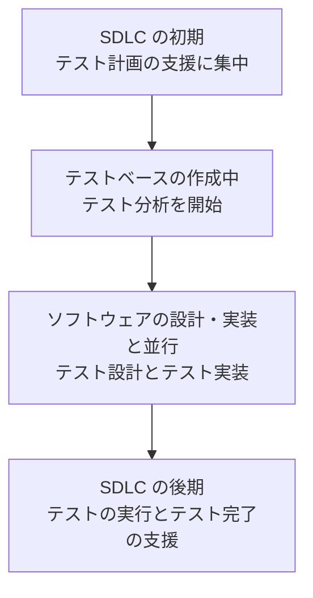

# lesson01: SDLC におけるテストアナリストの関わり — 開発モデルごとに変わるタスクの組み立て

## このレッスンで学ぶこと

- テストアナリストが担当する範囲（役割・テストレベル・品質特性）を説明できるようになる
- シーケンシャル開発モデルでテストアナリストのタスクが時間とともにどう変わるかを要約できるようになる
- インクリメンタル開発モデルとイテレーティブ開発モデルでの関わり方の違いを要約できるようになる
- どの SDLC モデルにも共通するよい実践例を挙げられるようになる

## テストアナリストという役割

Foundation Level シラバス（1.4.5）は、テストにおける 2 つの主要な役割として、テストマネジメントの役割とテストを行う役割を挙げています。Advanced Level のシラバスでは、テストを行う役割のうち、ソフトウェアの**ビジネス側面**のテストを担当する人を**テストアナリスト**（TA）と呼びます。

TA という名前の専任ポジションが置かれることはまれです。それでも、TA には明確に定義されたタスクと、必要なコンピテンシーがあります。担当範囲は次のように整理できます。

| 観点 | TA の重点 |
|------|------|
| テストレベル | システムテスト、受け入れテスト、システム統合テスト |
| 品質特性 | 機能適合性を中心に、使用性・適応性・インストール性・相互運用性などユーザーが直面する非機能品質特性もカバーする |

::: tip TTA との線引き
テストを行う役割のうち、技術的側面を担当するのはテクニカルテストアナリスト（TTA）です。TA はユーザーから見える振る舞いと品質に集中します。
:::

## SDLC で変わる関わり方

テスト活動をどう組み立てるかは、採用する**ソフトウェア開発ライフサイクル**（SDLC）によって変わります。そのため TA の関わり方も、SDLC モデルごとに異なります。シラバスは、シーケンシャル・インクリメンタル・イテレーティブの 3 つのモデルと、それらを組み合わせたモデルについて、TA の関わり方を整理しています。

### シーケンシャル開発モデル

シーケンシャル開発モデルでは、開発活動をフェーズごとに行い、前のフェーズが完了してから次のフェーズを始めます。活動どうしの重複はほとんどありません。そのため、TA のタスクは時間の経過とともに変わっていきます。

- SDLC の初期のフェーズでは、テスト計画の支援に集中する
- テストベースが作成されるときに、テスト分析を開始する
- テスト設計とテスト実装は、ソフトウェアの設計・実装と並行して進める
- 最後にテストを実行し、SDLC の後期のフェーズでテスト完了を支援する

### インクリメンタル開発モデル

インクリメンタル開発モデルでは、ソフトウェアを小さくマネジメントしやすい**インクリメント**に分割し、各インクリメントを独立して開発・テストします。独立してテストするので、TA はインクリメントごとに同じ活動（テスト分析・テスト設計・テスト実装・テスト実行・テストマネジメントの支援）を繰り返します。

ただし、TA の作業をどう編成するかは、インクリメントごとに異なる場合があります。

このモデルで TA が特に注意する点は次の 2 つです。

- テストの焦点は、新規または変更したフィーチャーに置く
- リグレッションのリスクが高まるため、リファクタリングと、リグレッションテストスイートの組み立てに特に注意を払う

### イテレーティブ開発モデル

イテレーティブ開発モデルでは、開発プロセスが循環的になります。プロジェクトは、プロトタイピング・テスト・洗練・デプロイのサイクルを繰り返します。

このモデルでの TA の役割は、ダイナミックで適応的です。

- 開発担当者やビジネス担当者と密接に協力し、進化するプロダクトに適応する
- ソフトウェアの進化に合わせて、テスト条件やテストケースを調整・修正する
- 各イテレーションで、テストプロセスを改善するためのフィードバックを提供する

イテレーションの頻度が高いほど、TA によるリグレッションテストの継続的なメンテナンスと拡充が重要になります。

### 組み合わせたモデル

実際の SDLC は、さまざまなモデルや技術・アプローチの要素を組み合わせたものになります。たとえばアジャイルソフトウェア開発は、イテレーティブモデルとインクリメンタルモデルの両方の側面を持っています。このような場合、TA の関わり方は、その SDLC がどの特性をどう組み合わせているかに依存します。

::: info すべての SDLC モデルに共通するよい実践例
TA が SDLC の初期段階から関与することは、どの SDLC モデルにも共通するよい実践例です。
:::

## 3 つのモデルの比較

| 観点 | シーケンシャル | インクリメンタル | イテレーティブ |
|------|------|------|------|
| 開発の進み方 | フェーズを順に進め、重複はほとんどない | 小さなインクリメントに分割し、独立して開発・テストする | プロトタイピング・テスト・洗練・デプロイを循環する |
| TA のタスク | 時間の経過とともに変わる（計画支援から分析、設計・実装、実行・完了支援へ） | 同じ活動をインクリメントごとに繰り返す | 進化するプロダクトに合わせてテスト条件・テストケースを調整する |
| リグレッションへの注意 | 特になし | リファクタリングとリグレッションテストスイートの組み立て | イテレーションが頻繁なほど、リグレッションテストの継続的なメンテナンスと拡充が重要 |

::: warning インクリメンタルとイテレーティブの混同
「同じ活動をインクリメントごとに繰り返す」理由は、各インクリメントを独立して開発・テストするからです。「開発が循環的だから」はイテレーティブモデルの説明であり、インクリメンタルモデルの理由ではありません。選択肢の中で入れ替えて問われやすい点です。
:::

## 試験のポイント

- TA の重点はテストレベルではシステム・受け入れ・システム統合テスト、品質特性では機能適合性とユーザーが直面する非機能品質特性（使用性・適応性・インストール性・相互運用性）
- インクリメンタル（分割して独立に開発・テスト、同じ活動を繰り返す）とイテレーティブ（循環的、ダイナミックで適応的）の区別が K2 で問われる
- リグレッションへの注意はインクリメンタルなら「リファクタリングとリグレッションテストスイートの組み立て」、イテレーティブなら「頻度が高いほど継続的なメンテナンスと拡充」
- すべての SDLC モデルに共通するよい実践例は、TA が SDLC の初期段階から関与すること
