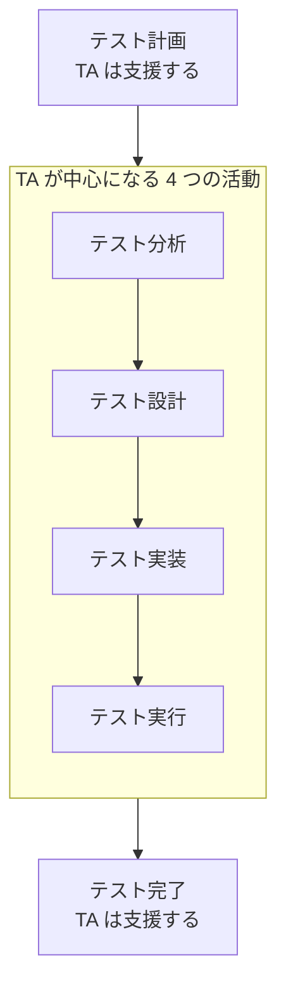

# lesson02: テスト活動への関与 — 分析・設計・実装・実行でテストアナリストが担うタスク

## このレッスンで学ぶこと

- テストプロセスの 7 つの活動のうち、テストアナリストが中心になる 4 つの活動を挙げられるようになる
- テスト分析でのタスク（開始基準の確認、テストベースの評価、テスト条件の定義と優先順位付け）を要約できるようになる
- テスト設計でのタスク（テストケースの設計、トレーサビリティ、環境要件とデータ要件の定義）を要約できるようになる
- テスト実装でのタスク（テストプロシジャーの定義、優先順位付け、テストデータの作成、スモークテスト）を要約できるようになる
- テスト実行でのタスク（不正の分析、結果の記録、トレーサビリティの更新、テスト結果の評価）を要約できるようになる

## テストアナリストが中心になる 4 つの活動

FL シラバス 1.4.1（テスト活動とタスク）は、テストプロセスを 7 つの活動で説明しています。テストアナリスト（TA）が主に焦点を当てるのは、そのうちテスト分析・テスト設計・テスト実装・テスト実行の 4 つです。残りのテスト計画・テスト完了・テストのモニタリングとコントロールは、テストマネージャー（TM）を中心とするテストマネジメントの役割が担い、TA は支援に回ります（[lesson01](/lessons/lesson01/)）。

::: tip 問われ方
試験では「このタスクはどの活動に属するか」という形で問われます。タスクの中身だけでなく、どの活動のものかをセットで押さえてください。
:::

## テスト分析

テスト分析は「何をテストするか」を決める活動です。TA はテストベースの完全性を確認し、テストに関連する追加情報を集めます。集める情報は文書だけではありません。ユーザーストーリーの共同執筆での会話のような、口頭の情報も含みます。

### 開始基準の確認

テスト分析を効果的に進めるため、TA は次の開始基準を確認します。

- テスト計画が行われ、テスト範囲・テスト目的・テストアプローチが明確になっている
- テストベース（要件やユーザーストーリーなどの情報を含む）が定義されている
- すでに識別したプロダクトリスクについて、必要に応じて評価と文書化がされている

### テストベースの評価

TA はテストベースを評価して、含まれている可能性のある欠陥を識別し、テスト可能性を評定します。これにより、プロダクトオーナーに早期のフィードバックを届けられます。評価の中では次のことも行います。

- 適用するテスト技法に従って、システムの振る舞いをモデル化する（[lesson27](/lessons/lesson27/)）
- レビュー技法を適用する（[lesson28](/lessons/lesson28/)）
- テストベースの欠陥を直接修正しない場合は、文書化する
- 必要なテストオラクルを決定する（[lesson05](/lessons/lesson05/)）

テストベースが変更されると、テストマネジメントと連携してテストスコープを調整することになる場合があります。

### テスト条件の定義と優先順位付け

TA は、スコープ内の各テストアイテムについて**テスト条件**を定義し、優先順位を付けます。テスト条件には次のことが求められます。

- テスト目的に対応している
- テストベースの要素に対するトレーサビリティを持つ
- 範囲と焦点が、プロダクトリスクを考慮したものになっている

開発モデルによって、テスト条件の決め方に次の違いがあります。

| 開発モデル | テスト条件の扱い |
|------|------|
| インクリメンタル・イテレーティブ | 影響度分析に基づいてリグレッションテストの範囲を決めることを含める（[lesson09](/lessons/lesson09/)） |
| アジャイルソフトウェア開発 | ユーザーストーリーのリスクを反映した受け入れ基準として表現できる |

### 段階的な詳細化

テスト条件は、一度に詳細なものを書く必要はありません。TA は、ハイレベルのテスト条件から始めて段階的に詳細化できます。

| 段階 | テスト条件の例 |
|------|------|
| ハイレベル | 「配送先入力画面の機能性」 |
| より詳細 | 「配送先入力画面は、郵便番号が 1 桁足りない入力を拒否する」 |

この進め方には 2 つの利点があります。

- 十分なカバレッジを支援する
- ユーザーストーリーがまだ洗練されていない場合でも、テスト設計を早く始められる

### ステークホルダーとのレビュー

TA は、ステークホルダーを巻き込んでテスト条件をレビューします。テストベースを正しく理解できているか、テストする内容がテスト目的に沿っているかを確認するためです。

## テスト設計

テスト設計は「どのようにテストするか」を記述する活動で、通常はテストケースを使って行います。テスト設計の進め方は、求められるカバレッジ・テストベース・SDLC・プロジェクトの制約・テスト担当者の知識と経験など、多くの要因に依存します。

### テストケースの設計

TA は、どのエリアでローレベルテストケースが適切か、ハイレベルテストケースが適切かを決めます（[lesson03](/lessons/lesson03/)）。どちらの場合も、合格／不合格の基準を明確にしなければなりません。新規または変更したテスト条件に対しては、テストケースの品質基準（[lesson03](/lessons/lesson03/)）に従ってテストケースを設計します。

リグレッションテストの場合は、通常、既存のハイレベルテストケースを選択するか、優先順位付けに基づいて既存のローレベルテストケースを調整すれば十分です。

::: tip ハイレベルかローレベルかの判断は設計の仕事
「期待結果に具体的なポイント数まで書くかどうか」のような抽象度の判断はテスト設計で行います。テスト条件を定義するのはテスト分析、テストスクリプトを書いたりテストデータをリポジトリに用意したりするのはテスト実装です。
:::

### トレーサビリティと環境・データの要件

TA は、テストベース・テスト条件・テストケースの間のトレーサビリティを確立します。経験ベースのテストではテストケースを必ずしも文書化しないので、その場合はテスト条件などがテスト実行の指針になります。また、ハイレベルのテスト目的に基づいてテストケースを設計することもあります。

これらに加えて、TA はテスト設計の中で次の 2 つを定義します（[lesson04](/lessons/lesson04/)）。

- テスト環境要件を定義する
- テストデータの要件を識別・作成・明確化する

### テスト設計の終了時期

十分なテストケースを設計できたかどうかは、テスト計画書で定義した終了基準で判断します。ただし、残存リスクレベルや、予算・時間といったプロジェクトの制約のような他の終了基準が、テスト設計の終了時期を示すこともあります。

### 設計の進め方とテストケースの伝達的な役割

テスト設計はツールで支援できますが、特定のツールや技術に縛られないよう、ツールや技術に依存しない形で行うべきです。進め方は、テスト技法を使った体系的なアプローチか、そうでなければアドホックになります。

テストケースには伝達的な役割があり、関連するステークホルダーが理解できるものでなければなりません。作成者本人が実行するとは限らないからです。

| 読み手 | 理解する必要があること |
|------|------|
| 他のテスト担当者 | 実行方法、テスト目的（背後にあるテスト条件）、重要性 |
| 開発担当者 | テストの実装や、故障発生時の再実行のために内容を理解できること |
| 監査担当者 | テストを承認するために内容を理解できること |

## テスト実装

テスト実装では、TA はテスト実行に必要なテストウェアを用意します。テストプロシジャーとテストスクリプトをテストスイートにまとめたり、自動化するテストケースを提案したりします。

### テストプロシジャーの定義

**テストプロシジャー**は、複数のテストケースの実行順序と、その前後に必要なアクションをまとめたものです。定義するときは、テスト実行順序に影響しうる制約や依存関係を注意深く識別する必要があります。テストプロシジャーには、テストケースのステップに加えて次を含めます。

- 初期の事前条件の設定（例: データリポジトリからテストデータを投入する）
- 期待結果と事後条件の検証
- 実行後のリセット手順（例: データベース・環境・システムをリセットする）

### 優先順位付けとトレーサビリティの更新

TA は、リスク分析とテスト計画書の作成時に識別した優先順位付け基準に基づいて、テストプロシジャーとテストスクリプトに優先順位を付けます。そのうえで、テスト対象の現行バージョンで実行すべきテストプロシジャーやテストスクリプトを識別します。こうすると、新しいフィーチャー用のテストやリグレッションテストのような関連するテストを、特定のテストランでまとめて実行できます。

あわせて、テストベースと、テストプロシジャー・テストスクリプト・テストスイートなどのテストウェアとの間のトレーサビリティを更新します。

### テスト実行スケジュールの支援

TA はテスト実行順序を定義することで、TM がテスト実行スケジュールを策定するのを支援できます。スケジュールには、効率的なテスト実行のためのリソースの割り当ても含まれます。テストケースの優先順位付けの考え方は FL シラバス 5.1.5（テストケースの優先順位付け）で学んだとおりです。

### テストデータの作成

TA は、データベースやその他のリポジトリに投入する入力データや環境データを作成します（[lesson04](/lessons/lesson04/)）。このデータは、特定のテスト目的を支援する「目的に合った」ものでなければなりません。

### スモークテストによる環境の検証

TA は、テスト環境が完全にセットアップされ、テスト実行の準備が整っていることを検証すべきです。この検証は、**スモークテスト**を設計して実行するのが最適です。テスト環境に求められるのは次の 3 点です。

- テスト実行を通じて、テスト対象内の欠陥を明らかにする
- 故障が発生しないときは正常に動作する
- 必要に応じて、本番環境またはエンドユーザー環境を適切に再現する

### 詳細度と規制

テスト実装で行う作業の詳細度と複雑さは、テスト条件やテストケースの詳細度に影響されます。また、規制上のルールが適用される場合は、テストウェアが該当する標準（航空機ソフトウェアの RTCA DO-178C など）への適合を示す証拠を提供すべきことがあります。

## テスト実行

テスト実行は、テスト実行スケジュールに従って行います。TA の典型的な作業は、テストの実行、実際の結果と期待結果の比較、不正の分析、欠陥の報告、テスト結果の記録です。

### 手動実行と自動実行

TA はテストを手動で実行します。これには次が含まれます。

- 探索的テスト。テストチャーターを使ったセッションベースドテストとして行える（[lesson18](/lessons/lesson18/)）
- テストプロシジャーの実行
- リグレッションテスト
- 確認テスト

TA が自動テストスクリプトを実行することもあります。ただし、故障が起きたときに自動テストスクリプトを実行して分析するのは、開発担当者・テスト自動化エンジニア（TAE）・テクニカルテストアナリスト（TTA）の仕事になることがあります。

### 不正の分析と欠陥の伝達

TA は、手動または自動のテスト実行で見つかった**不正**（期待から逸脱した状態）を分析し、その推定原因を特定します。不正の原因はテスト対象の欠陥とは限りません。

- 事前条件の欠如
- テストデータの誤り
- テストスクリプトやテスト環境の欠陥
- 仕様の誤解

TA はテスト実行の実際の結果を記録し、観測された故障に基づいて欠陥を伝達し、必要に応じて報告します。

::: warning 不正と欠陥の違い
不正は「期待と違った」という観測結果で、欠陥はその原因の 1 つにすぎません。不正を見つけたら、まず推定原因を分析するのが TA のタスクです。すべてを欠陥として報告する、という選択肢はひっかけです。
:::

### トレーサビリティの更新

TA は、テスト結果を踏まえて、テストベースと他のテストウェアとの間のトレーサビリティを更新します。この情報があると、テスト結果をハイレベルのリスク情報やカバレッジ情報に変換でき、ステークホルダーは情報に基づいた判断を下せます。たとえば、あるテスト条件に関連するテストケースのうち、いくつが合格していくつが不合格なのかを関係者に示せます。

### テスト結果の評価

典型的なタスクに加えて、TA はテスト結果を評価します。評価には次のタスクが含まれます。

| タスク | 内容 |
|------|------|
| 欠陥クラスターの認識 | テスト対象の特定の部分に、より多くのテストが必要であることを示す（[lesson29](/lessons/lesson29/)） |
| 不合格の自動テストの手動再実行 | テスト自動化が偽陽性結果を出していないことを確認する |
| 追加テストの提案 | 前回のテストで学んだことに基づいて提案する |
| 新たなリスクの識別 | テスト実行で得た情報から識別する |
| 改善の提案 | テスト設計やテスト実装（テストプロシジャーの改善など）、さらにはテスト対象システムの改善を提案する |
| リグレッションテストスイートの改善提案 | リファクタリング、スコープ調整、テスト自動化など（[lesson09](/lessons/lesson09/)） |

## 4 つの活動とタスクの対応

| 活動 | TA の主なタスク |
|------|------|
| テスト分析 | 開始基準の確認、テストベースの評価とフィードバック、テストオラクルの決定、テスト条件の定義と優先順位付け、ステークホルダーとのレビュー |
| テスト設計 | ハイレベル／ローレベルの判断、合格／不合格基準の明確化、品質基準に従ったテストケースの設計、トレーサビリティの確立、テスト環境要件とテストデータ要件の定義 |
| テスト実装 | テストプロシジャーの定義、テストスイートへの編成、優先順位付け、トレーサビリティの更新、テストデータの作成、スモークテストによる環境の検証 |
| テスト実行 | テストの実行、結果の比較と記録、不正の分析、欠陥の伝達、トレーサビリティの更新、テスト結果の評価 |

## 試験のポイント

- タスクの所属が K2 で問われる（テスト条件の定義は分析、ハイレベル／ローレベルの判断は設計、テストスクリプトの作成やテストデータの投入は実装）
- 不正の推定原因はテスト対象の欠陥だけでなく、事前条件の欠如・テストデータの誤り・スクリプトや環境の欠陥・仕様の誤解もある
- TA はテストを手動で実行するのが基本で、自動テストスクリプトの故障時の実行と分析は開発担当者・TAE・TTA の仕事である場合がある
- テスト結果の評価タスク 6 つ（欠陥クラスター・偽陽性の確認・追加テスト・新たなリスク・改善提案・リグレッションスイートの改善）を漏れなく想起できるように
