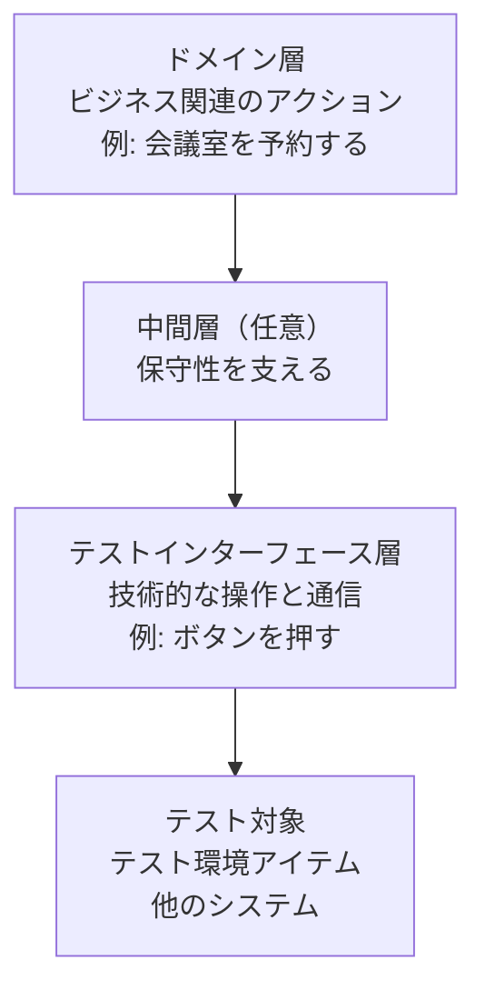

# lesson06: キーワード駆動テスト — キーワードの定義とテストスクリプトの作成

## このレッスンで学ぶこと

- キーワード駆動テストでテストアナリストが担う範囲と、実装を担う役割との線引きを説明できるようになる
- アクションキーワードと検証キーワード、ドメイン層とテストインターフェース層、アトミックと複合という 3 つの切り口でキーワードを分類できるようになる
- 受け入れ基準からキーワードを定義し、命名ルールで点検できるようになる
- キーワードを使ったテストスクリプトを書き、それが受け入れ基準を正しく検証しているかを判定できるようになる

## キーワード駆動テストと TA の担当範囲

**キーワード駆動テスト**は、テストスクリプト（テストを実行するための、順序付けられた一連の操作指示）にキーワードを含め、そのキーワードを実装するスクリプトを補助ファイルに持たせるテスト自動化のアプローチです。**キーワード**は、テスト実行中に行う特定のアクションを表す語句で、たとえば「会議室を予約する」のように業務の言葉で書きます。

テストアナリスト（TA）は、このキーワードを使ってテストスクリプトを作る側です。キーワードの中身（画面を操作し、結果を読み取るコード）の実装は、TA の仕事ではありません。

| 役割 | 担当 |
|------|------|
| TA | キーワードを識別・定義し、キーワードでテストスクリプトを書く |
| テクニカルテストアナリスト（TTA）・テスト自動化エンジニア（TAE）・開発担当者 | キーワードを実装する |

TA は、テストベースの分析や関係者との協働を通じてキーワードを識別し、定義します。

::: tip 手動テストにも使える
キーワード駆動テストはテスト自動化のアプローチですが、手動テストでも恩恵を受けられます。手動テストの手順をキーワードで書いておくと、後で手動テストから自動テストへ移行するときの支えになります。
:::

## キーワードの 3 つの分類軸

### アクションキーワードと検証キーワード

キーワードは、役目によってアクションと検証の 2 つに分類できます。

| 分類 | 役目 | 相互作用の相手と例 |
|------|------|------|
| **アクションキーワード** | テスト対象やその周辺に働きかける | テスト対象（機能の実行、データの送信、テスト対象内の移動）、テスト環境（コンフィギュレーションの設定、シミュレーターの起動）、他のコンポーネントやシステム（テスト対象のインターフェースのトリガー） |
| **検証キーワード** | テスト対象が実際に生成した結果が期待と一致するかを評価する | アサーション（[lesson05](/lessons/lesson05/)）を表す。「予約が登録されていることを確認する」など |

### ドメイン層とテストインターフェース層

キーワードは、少なくとも 2 つの抽象化レイヤーに存在します。



| レイヤー | 性質 |
|------|------|
| **ドメイン層** | ビジネス関連のアクションに対応し、アプリケーションドメインの用語を反映する。テスト対象のインターフェースの技術的な詳細を抽象化する |
| **テストインターフェース層** | テストインターフェースを介して、テスト対象、テスト環境アイテム、他のコンポーネントやシステムと通信する。最も低い抽象化レイヤー |
| 中間層 | 付加的に置くことができ、キーワードの保守性を支援する |

TA が受け入れ基準から定義するキーワードは、主にドメイン層のものです。「予約ボタンを押す」のような画面操作の語は、テストインターフェース層に属します。

### アトミックと複合

キーワードは、それ以上分解しない**アトミック**なキーワードと、他のキーワードから構成される**複合**キーワードに分かれます。

- 構造（アトミックか複合か）と抽象化レイヤーは、互いに独立した属性です
- ただし傾向として、複合キーワードはより高い抽象レベルに、アトミックキーワードはテストインターフェース層に存在しやすくなります

::: warning 「複合キーワードはドメイン層」と決めつけない
あくまで傾向です。ドメイン層にアトミックなキーワードがあってもよく、構造だけからレイヤーは決まりません。
:::

## キーワード駆動テストにおける TA のタスク

TA のタスクは次の 6 つです。

| タスク | 内容 |
|------|------|
| キーワードとそのパラメーターの指定 | 「会議室を予約する（会議室, 日付, 開始, 終了）」のように、名前と引数を決める |
| キーワードテストケースの指定 | キーワードを並べてテストスクリプトを書く |
| 追加手順の指定 | 事前条件、検証アクション、テスト後のテスト環境のクリーンアップをキーワードで書き足す |
| キーワードテストケースの保守 | テスト対象の変更をテストケースに反映する |
| キーワードテストスクリプトの実行 | 自動でも手動でもよい |
| 不合格となったキーワードテストケースの分析 | 故障の原因を特定する |

キーワードテストケースを書いている途中で足りないキーワードに気づいたら、TA はその場で定義します。テストケースの形式はリストでも表でもかまいません。

## キーワードの命名ルール

キーワードはプロジェクトのライフサイクルを通じて変化し、同じ意味のものが重複して定義されがちです。冗長さを避けて保守の労力を減らすため、TA はキーワードを定義するとき次の 6 つを必ず満たします。

| ルール | 満たさない例 | 直した例 |
|------|------|------|
| 動詞を含む（名詞を伴ってもよい） | 「会議室予約」 | 「会議室を予約する」 |
| 動詞の命令形を使う | 「会議室が予約される」 | 「会議室を予約する」 |
| 意味が一意である | 「確認する」（何を確認するのか不明） | 「予約が登録されていることを確認する」 |
| 適切に文書化されている | パラメーターの意味が書かれていない | 各パラメーターの意味と値の例を書く |
| アプリケーションドメインの語彙を反映する | 「レコードを INSERT する」 | 「会議室を予約する」 |
| 再利用可能である | 「4 月 10 日の会議室 A を予約する」（値を名前に埋め込んでいる） | 「会議室を予約する（会議室, 日付, 開始, 終了）」 |

::: info 日本語の命令形について
英語のキーワードは "Reserve Room" のように動詞の命令形で始めます。日本語のキーワードでは、この教材は「〜する」の終止形で書いて命令形の代わりにしています。試験で問われるのは「動詞を含み、命令形で、意味が一意」という原則のほうです。
:::

## 例題 会議室予約のキーワードテストスクリプト

受け入れ基準からキーワードを定義し、スクリプトを書き、そのスクリプトが受け入れ基準を検証しているかを判定するまでを通して練習します。

::: info 題材とするユーザーストーリーと受け入れ基準
ユーザーストーリー: 「社員として、打ち合わせの場所を確保できるように、会議室を予約したい」

- 受け入れ基準 AC1: 空いている会議室は、日付と開始時刻・終了時刻を指定して予約できる
- 受け入れ基準 AC2: すでに予約されている時間帯と重なる予約はできず、重複を知らせるエラーメッセージが表示される
- 受け入れ基準 AC3: 予約した本人は、自分の予約を取り消せる
:::

### ステップ 1 テスト対象と環境の相互作用の洗い出し

テストベースを分析するとき、TA はテスト対象と、その環境（ユーザー、他のシステム、デバイス）との相互作用を探します。受け入れ基準から読み取れる相互作用は次のとおりです。

| 相互作用 | 由来 |
|------|------|
| 社員がログインする | ユーザーストーリーの主語 |
| 社員が会議室・日付・時刻を指定して予約する | AC1・AC2 |
| システムが予約を登録する、またはエラーメッセージを表示する | AC1・AC2 |
| 社員が自分の予約を取り消す | AC3 |

### ステップ 2 キーワードとパラメーターの定義

相互作用ごとに、アクションキーワードと検証キーワードを定義します。パラメーターはカッコの中に書きます。

| キーワード | 分類 | パラメーター |
|------|------|------|
| ログインする | アクション | 社員 ID |
| 会議室を予約する | アクション | 会議室, 日付, 開始, 終了 |
| 予約を取り消す | アクション | 予約番号 |
| 予約が登録されていることを確認する | 検証 | 会議室, 日付, 開始, 終了 |
| 予約が存在しないことを確認する | 検証 | 会議室, 日付, 開始, 終了 |
| エラーメッセージを確認する | 検証 | メッセージ |
| 予約を削除する | アクション（テスト環境のクリーンアップ） | 会議室, 日付 |

ここで定義したキーワードは、すべて業務の言葉で書かれたドメイン層のキーワードです。「予約ボタンを押す」「開始時刻の欄に入力する」のような操作は、テストインターフェース層のキーワードとして実装側が用意します。TA は、識別したキーワードが適切な抽象化レイヤーにあるかを確認します。

### ステップ 3 複合キーワードの定義

AC2 と AC3 のテストでは「すでに予約がある」状態を事前条件として作る必要があります。毎回同じ 3 つのキーワードを並べるのは冗長なので、複合キーワードにまとめます。

```
予約済みの会議室を用意する（会議室, 日付, 開始, 終了）
  構成するキーワード:
    ログインする（E001）
    会議室を予約する（会議室, 日付, 開始, 終了）
    予約が登録されていることを確認する（会議室, 日付, 開始, 終了）
```

この複合キーワードは事前条件を作るためのもので、ドメイン層に置きます。

ログインには、事前条件づくり専用のテスト用アカウント（社員 ID `E001`）を使います。どのテストでも変わらない値なので、パラメーターにせず複合キーワードの中で固定しています。

### ステップ 4 命名ルールによる点検

定義したキーワードを 6 つのルールで点検します。たとえば次のような候補が出てきたら、その場で直します。

| 候補 | 問題 | 修正 |
|------|------|------|
| 「予約」 | 動詞がなく、予約する操作なのか予約の確認なのか意味が一意でない | 「会議室を予約する」 |
| 「確認する（画面）」 | 何を確認するかが一意でない | 「予約が登録されていることを確認する」 |
| 「会議室 A を 4 月 10 日に予約する」 | 値が名前に埋め込まれていて再利用できない | 「会議室を予約する（会議室, 日付, 開始, 終了）」 |

### ステップ 5 キーワードテストスクリプトの作成

AC2 を検証するスクリプトを、事前条件・手順・検証・クリーンアップの順に書きます。

```
テストスクリプト AC2-1: 重なる時間帯の予約は拒否される
  事前条件:
    予約済みの会議室を用意する（A, 4/10, 10:00, 11:00）
  手順:
    ログインする（E002）
    会議室を予約する（A, 4/10, 10:30, 11:30）
  検証:
    エラーメッセージを確認する（「指定した時間帯はすでに予約されています」）
    予約が存在しないことを確認する（A, 4/10, 10:30, 11:30）
  クリーンアップ:
    予約を削除する（A, 4/10）
```

表形式で書く場合は、1 行を 1 キーワードにして「キーワード」「パラメーター」「期待結果」の列を設けます。

### ステップ 6 スクリプトが受け入れ基準を検証しているかの判定

試験の K3 問題では、複数のスクリプトを示して「この受け入れ基準を検証しているのはどれか」を問う形が想定されます。判定の観点は 3 つです。

1. 使っているキーワードがすべて定義済みか
2. 手順が受け入れ基準の条件（「重なる時間帯」など）を実際に作り出しているか
3. 検証キーワードが、受け入れ基準の期待結果を確かめているか

AC2「すでに予約されている時間帯と重なる予約はできず、エラーメッセージが表示される」に対して、次の 4 本を判定します。

```
スクリプト i:
  予約済みの会議室を用意する（A, 4/10, 10:00, 11:00）
  会議室を予約する（A, 4/10, 10:30, 11:30）
  エラーメッセージを確認する（「指定した時間帯はすでに予約されています」）

スクリプト ii:
  予約済みの会議室を用意する（A, 4/10, 10:00, 11:00）
  会議室を予約する（A, 4/10, 11:00, 12:00）
  予約が登録されていることを確認する（A, 4/10, 11:00, 12:00）

スクリプト iii:
  予約済みの会議室を用意する（A, 4/10, 10:00, 11:00）
  会議室を予約する（B, 4/10, 10:30, 11:30）
  エラーメッセージを確認する（「指定した時間帯はすでに予約されています」）

スクリプト iv:
  予約済みの会議室を用意する（A, 4/10, 10:00, 11:00）
  会議室を予約する（A, 4/10, 10:30, 11:30）
  予約が重複していることを確認する（A, 4/10）
```

| スクリプト | 判定 | 理由 |
|------|------|------|
| i | AC2 を検証している | 同じ会議室 A の 10:00〜11:00 に対し 10:30〜11:30 は重なる時間帯で、期待結果のエラーメッセージを検証キーワードで確かめている |
| ii | AC2 を検証していない | 11:00〜12:00 は既存の予約と重ならないため、確かめているのは「空いている会議室を予約できる」という AC1 のほう |
| iii | AC2 を検証していない | 会議室 B には予約がないので重複は起きず、エラーメッセージを期待する検証そのものが誤り |
| iv | AC2 を検証していない | 手順は正しいが「予約が重複していることを確認する」は未定義のキーワードで、使う前に定義しなければならない |

::: tip 検算の手順
判定で迷ったら、スクリプトを 1 行ずつ追って「この時点でシステムはどういう状態か」を書き出します。スクリプト ii なら「10:00〜11:00 に予約あり」の状態に「11:00〜12:00」を加えるので、終了時刻と開始時刻が接するだけで重なりません。重ならない以上、AC2 の条件は作られていません。
:::

## 試験のポイント

- TA が担うのはキーワードの定義とキーワードを使ったスクリプトの作成で、キーワードの実装は TTA・TAE・開発担当者の担当という線引きを取り違えない
- 分類の 3 軸（アクションと検証、ドメイン層とテストインターフェース層、アトミックと複合）のうち、構造とレイヤーは独立した属性で「複合は高い抽象レベルに、アトミックはテストインターフェース層に存在しやすい」のは傾向にすぎない
- K3 では、スクリプトが受け入れ基準を検証しているかを「キーワードが定義済みか」「手順が基準の条件を作っているか」「検証が基準の期待結果を確かめているか」の 3 点で判定する
- 命名ルール 6 つ（動詞を含む・命令形・意味が一意・文書化・ドメインの語彙・再利用可能）は冗長な定義を避けて保守の労力を減らすためのもの
