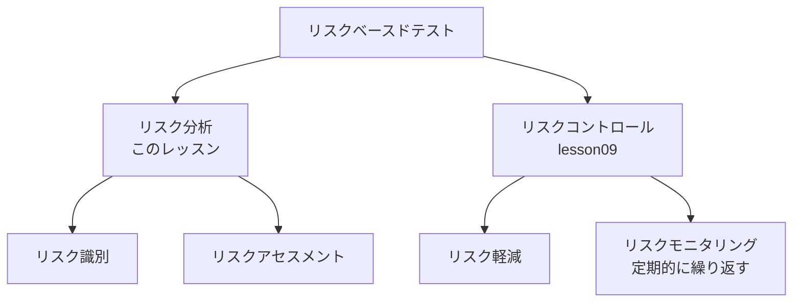

# lesson08: プロダクトリスク分析への貢献 — リスク識別とリスクアセスメントで TA がすること

## このレッスンで学ぶこと

- リスクベースドテストにおけるテストマネージャーとテストアナリストの役割分担を説明できるようになる
- リスクベースドテストを構成するリスク分析・リスクコントロール・定期的なリスクモニタリングの関係を説明できるようになる
- リスク識別とリスクアセスメントのそれぞれで、テストアナリストが何を持ち込んで貢献するかを要約できるようになる
- リスクレベルの決定で見積もる要素、品質特性による分類、テストアイテムへの分解、軽減策の提案を要約できるようになる

## リスクベースドテストにおける TA の位置づけ

**リスクベースドテスト**は、テストアイテムのリスクレベルに基づいてテストの取り組みに優先順位を付けるテストアプローチです。このアプローチの方針を定めるのはテストマネージャーで、テストアナリスト（TA）はその実装において積極的な役割を果たします。

| 役割 | 担当 |
|------|------|
| テストマネージャー | リスクベースドテストのアプローチを定める |
| TA | リスク分析に参加し、リスクコントロールを実装する |

リスクベースドテストは、FL シラバス 5.2 で学んだとおり、リスク分析とリスクコントロールで構成します。さらに、リスクとそのレベルは静的ではなく時間とともに変化するため、定期的なリスクモニタリングも含まれます。

### リスクモニタリングの頻度と TA の貢献

リスクモニタリングをどの頻度で行うかは、ライフサイクルによって決まり方が異なります。

| ライフサイクル | 頻度を決める人 | 目安 |
|------|------|------|
| イテレーティブ型 | チーム | イテレーションごとに1回になることが多い |
| その他 | プロダクトリスクマネジメントの責任者（多くの場合テストマネージャー） | 責任者が設定する |

TA は、行われた変更に基づいて**リスクレジスター**（識別したリスクを評価・優先順位付け・追跡するための文書）を更新し、リスク軽減アクションを調整することで貢献します。

## TA がプロダクトリスク分析に貴重な理由

**リスク分析**は、リスク識別とリスクアセスメントで構成します。シラバスは、リスクベースドテストを正しく実装するために TA がリスク分析にどう参加すべきかに焦点を当てています。

TA がプロダクトリスク分析で貴重なステークホルダーになるのは、次の知識を持っていることが多いからです。

- そのシステムに関する独自の知識
- 通常どのような問題が発生しやすいか、という経験的で直感的な知識
- その問題がどのような影響を及ぼすか、という知識
- テストによってどのようにリスクを軽減できるか、という知識

「どこで何が壊れやすく、壊れたら何が起きるか」を、テストの経験を通じて知っているのが TA です。

## リスク識別での貢献

**リスク識別**は、リスクを発見し、認識し、記述する活動です。TA は自らの経験と知識を持って、次の活動に貢献します。

| 活動 | TA の持ち込むもの |
|------|------|
| ふりかえり | 過去のイテレーションやリリースで実際に起きた問題 |
| リスクワークショップ | 壊れやすい箇所や影響の大きい機能についての知見 |
| ブレーンストーミング | 「こういう場合にうまくいかないのでは」という着想 |
| チェックリストの作成 | 繰り返し起きる問題のパターン |

これに加えて、TA はステークホルダーへのインタビューを実施できます。ステークホルダーの視点から見て最も重大なリスクが何かを理解することが目的です。

## リスクアセスメントでの貢献

**リスクアセスメント**は、識別したリスクを検証してリスクレベルを決定する活動です。TA の貢献は4つの場面に整理できます。

### リスクレベルを決める要素の見積り

TA は他のステークホルダーとともに、次のような要素を見積もることでリスクレベルの決定に貢献します。

| 見積もる要素 | 例 |
|------|------|
| 影響を受ける機能の使用頻度と深刻度合い | 毎日全ユーザーが使うログイン機能か、年に1度の帳票か |
| 影響を受けるビジネス目的の深刻度合い | 売上に直結する決済か、社内向けの補助機能か |
| 金銭的、環境的、評判上の被害 | 誤請求による返金、SNS での評判の低下 |
| テストベースの品質 | 仕様が曖昧な機能ほど欠陥が入り込みやすい |
| 法的または安全上の必要 | 個人情報保護の規制、人の安全に関わる機能 |

リスクレベルがリスクの可能性とリスクの影響から決まることは FL で学んだとおりです。上の5つの要素は、その可能性と影響を見積もるための具体的な材料になります。

### 品質特性による分類

TA は、プロダクトリスクを影響のある品質特性で分類することも支援します。分類の枠組みには、たとえば ISO/IEC 25010（2023）の製品品質モデルを使います。

| プロダクトリスクの例 | 影響のある品質特性 |
|------|------|
| 送料の計算を誤る | 機能適合性 |
| 入力画面の操作がわかりにくい | 使用性 |
| 他社の会計システムと注文データを交換できない | 互換性 |
| 新しい OS のバージョンで動作しない | 柔軟性 |

品質特性で分類しておくと、どのテストタイプで軽減するかを決めやすくなります（第4章、[lesson23](/lessons/lesson23/)〜[lesson25](/lessons/lesson25/)）。

### テストアイテムへの分解

リスクレベルは、テスト対象の全体に一様に分布していないことがよくあります。その場合、TA はテスト対象をテストアイテム（コンポーネント、インターフェース、フィーチャーなど）に分解し、テストアイテムごとに対象となるリスクを個別に評価します。

| テストアイテム | 「計算を誤る」リスクのレベル |
|------|------|
| 送料の計算 | 高（料金体系の改定が頻繁で、誤りが直接請求額に出る） |
| ポイント付与の計算 | 中（ルールは安定しているが、影響は顧客からの問い合わせにつながる） |
| 注文履歴の表示 | 低（計算を伴わない） |

「注文機能のリスクは高」とひとまとめにするのではなく、このように分解すると、テスト工数をかけるべき場所が見えてきます。

### 軽減策の提案

プロダクトリスクアセスメントの最後に、TA は識別した各プロダクトリスクを軽減するための適切なテスト活動を提案します。提案する活動には、静的テストと動的テストの両方が含まれます。

TA は、リスクレベル、関連するテストアイテムのタイプ、影響を受ける品質特性などの要因に応じて、次のものを示します。

- 求められるテストレベル
- テストタイプ
- テスト技法（選び方は [lesson21](/lessons/lesson21/)）
- テストの独立性レベル
- テストの徹底度

::: tip シフトレフトの精神
TA は、テスト工数を最小化するために、どのテスト活動が最も早くリスクを軽減できるかも示します。仕様の曖昧さに起因するリスクなら、動的テストを待たずにレビュー（[lesson28](/lessons/lesson28/)）で早く潰すほうが安く済みます。
:::

## リスク分析とリスクコントロールの線引き

試験では、TA の活動を挙げて「プロダクトリスク分析への貢献はどれか」と問う形が想定されます。リスクコントロールやリスクモニタリングに属する活動が選択肢に混ざるので、どの活動がどこに属するかを整理しておきます。

| TA の活動 | 属する活動 |
|------|------|
| ステークホルダーにインタビューして、何がうまくいかないかを聞く | リスク分析（リスク識別） |
| 各プロダクトリスクが顕在化したときの被害を見積もる | リスク分析（リスクアセスメント） |
| リスクごとに適切なテスト活動を提案する | リスク分析（リスクアセスメント） |
| 提案したテスト技法を実際に適用してテストする | リスクコントロール（リスク軽減） |
| 影響度分析でリグレッションテストの範囲を決める | リスクコントロール（リスク軽減、[lesson09](/lessons/lesson09/)） |
| テスト実行中に見つかった新しいリスクを識別し評価する | リスクモニタリング |

「提案する」まではリスク分析、「実際に行う」のはリスクコントロール、「変化を追いかけて更新する」のはリスクモニタリングと覚えておくと見分けやすくなります。

## 試験のポイント

- リスクベースドテストの方針を定めるのはテストマネージャーで、TA はリスク分析への参加とリスクコントロールの実装を担う（K2）
- リスク識別での貢献（ふりかえり・リスクワークショップ・ブレーンストーミング・チェックリストの作成・ステークホルダーへのインタビュー）と、リスクアセスメントでの貢献（要素の見積り・品質特性での分類・テストアイテムへの分解・軽減策の提案）を対応づけて想起できるようにする
- リスクレベルの決定で見積もる要素5つ（機能の使用頻度と深刻度合い、ビジネス目的の深刻度合い、金銭的・環境的・評判上の被害、テストベースの品質、法的または安全上の必要）を漏れなく想起できるようにする
- 「軽減策を提案する」まではリスク分析で、「テスト技法を適用する」「リグレッションテストの範囲を決める」はリスクコントロール、「テスト実行中に新しいリスクを識別する」はリスクモニタリングというひっかけに注意する
