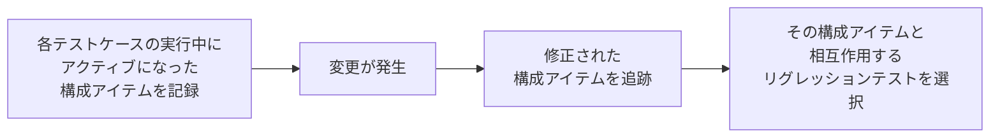

# lesson09: リグレッションテストの範囲の決定 — 変更の影響度分析とテスト選択技法

## このレッスンで学ぶこと

- リスクコントロールの中でテストアナリストが重要な役割を担うリスク軽減活動を挙げられるようになる
- リグレッションテストの範囲を絞らざるをえない理由と、テストサイクルごとに範囲を見直す必要性を説明できるようになる
- 自動テストの選択に最も信頼できる影響度分析の仕組みを説明できるようになる
- 手動テストを選択する6つの技法を区別し、状況に応じてどれを使うかを判断できるようになる
- トレーサビリティとリスクレベルから、変更後に実行するテストケースとその順序を導出できるようになる

## リスクコントロールにおける TA の役割

**リスクコントロール**は、リスク軽減とリスクモニタリングで構成します。テストアナリスト（TA）はシステムの機能性と、それに関連する潜在的なリスクを理解しているため、FL シラバス 5.2.4 が挙げるリスク軽減活動のいくつかで重要な役割を担います。

| リスク軽減活動 | この教材で扱う場所 |
|------|------|
| レビューの実施 | [lesson28](/lessons/lesson28/) |
| 適切なテスト技法とカバレッジレベルの適用 | [lesson21](/lessons/lesson21/) |
| 適切なテストタイプの適用 | 第4章（[lesson23](/lessons/lesson23/)〜[lesson25](/lessons/lesson25/)） |
| リグレッションテストの実行 | このレッスン |

リスク分析での TA の貢献は [lesson08](/lessons/lesson08/) で扱っています。このレッスンは、リスクコントロールのうちリグレッションテストの範囲をどう決めるかに絞ります。

## リグレッションテストの範囲を絞る理由

**リグレッションテスト**の主な目的は、変更が加えられた後のテスト対象の品質に対する信頼を確保することです。理想を言えば、手持ちのリグレッションテストケースをすべて実行したいところです。

しかし、時間・予算・テスト環境・テストデータの制約のために、すべてを実行できない場合があります。

| 実行形態 | 制約が問題になる場面 |
|------|------|
| 手動テスト | 主にこちらが懸念事項になる |
| 自動テスト | テストサイクルが短く、長時間かかる自動テストが多い場合には同じ問題が起きる |

そこで、特定の基準に基づいて適切なリグレッションテストケースを選択する必要が出てきます。リグレッションテストの範囲はテストサイクルごとに見直すことが不可欠で、見直しの結果、既存のリグレッションテストスイートを調整すると結論づけることもあります。

## 自動テストの選択は影響度分析

**影響度分析**は、変更が影響するすべての作業成果物を識別する活動です。自動テストを選択するための最も信頼できる技法がこの影響度分析で、ツールで支援できます。

- このようなツールは、自動化された構成管理システムに基づいています
- 各テストケースの実行中にどの構成アイテムがアクティブになったかを記録しておきます
- 変更が発生すると、どの構成アイテムが修正されたかを追跡し、その構成アイテムと相互作用するリグレッションテストを選択します

こうすることで、構成アイテムの変更後、故障を発見する可能性が最も高い部分にテストが集中します。

## 手動テストを選択する6つの技法

手動で実行するテストについては、リグレッションテストの選択で明確に優れていると言える技法は、これまでの研究で決定的に示されていません。結果がさまざまな要因に左右されるためです。したがって TA は、与えられた状況に基づいてどの技法を使うかを判断しなければなりません。

| 技法 | 選択の根拠にするもの |
|------|------|
| リスクベースのテスト選択 | リスクレジスターとリグレッションテストスイートのトレーサビリティ |
| 履歴ベースドテスト | 過去のテスト実行の結果 |
| カバレッジベースドテスト | 選択したテスト技法のカバレッジ |
| 要件トレーサビリティマトリクス | 要件とテストの対応 |
| 運用プロファイルに基づくテスト | テスト対象の使用パターン |
| 影響度分析 | 変更された構成アイテムと相互作用するテストの知識 |

### リスクベースのテスト選択

TA は、リグレッションテストスイートとリスクレジスターとのトレーサビリティを維持します。変更が行われ、それに応じてリスクレジスターを更新したら、最も高いリスクレベルをカバーするようにリグレッションテストスイートを調整します。

### 履歴ベースドテスト

TA は過去のテスト実行を評価し、次のテストを判別します。

- 過去に欠陥を検出したテスト
- 前回のテスト実行以降に加えられた変更と類似の変更で、影響を受けやすかったテスト

これらを再度実行すると、同様の欠陥を検出する可能性が高まります。TA はさらに、長い間実行していないテストを含めて、それらが引き続き合格するかも確認できます。

### カバレッジベースドテスト

TA は、選択したテスト技法に基づいて、できるだけ少ないテストで高いカバレッジを達成するようにテストを選びます。テストの数は、テスト1件あたりで得られるカバレッジの増分とのバランスを慎重に取らなければなりません。

### 要件トレーサビリティマトリクス

要件の変更が関連するテストに与える影響を評価するために使います。新しい要件や変更された要件が、既存のフィーチャーに間接的に影響する場合にとくに有用です。

- TA は、直接影響を受ける機能に加えて、関連する機能のリグレッションテストも選択し、意図しない副作用の可能性をカバーします
- アジャイルソフトウェア開発では、新しいユーザーストーリーや変更されたユーザーストーリーによって影響を受ける受け入れ基準をカバーするテストを選ぶことで、同様に行えます

### 運用プロファイルに基づくテスト

**運用プロファイル**は、コンポーネントやシステムの実際または予測される利用パターンです。TA はテスト対象の使用パターンに基づいて、実行するリグレッションテストケースを選びます。

- オンラインストアなら、ログインし、商品を検索し、カートに追加し、注文するという一連の流れを1つのテストにする
- アプリケーションを大幅に変更する場合、この技法はシステム全体の機能を素早く概観するのに向く
- テストが多くなりすぎる場合は、頻繁に発生し重要な機能とビジネスプロセスをカバーする使用パターンに優先順位を付ける

### 手動テストへの影響度分析の適用

影響度分析は自動テスト向けの技法として説明しましたが、変更された構成アイテムと相互作用するリグレッションテストケースを TA が知っていれば、手動で実行するテストの選択にも使えます。

## 技法の組み合わせと継続的な改善

より包括的で効果的なリグレッションテストスイートにするには、選択技法を組み合わせて使うことが必要になる場合が多くあります。ただし TA は、カバレッジの必要性と、テストスイートのマネジメント可能なサイズとのバランスを注意深く取らなければなりません。

選択は一度決めて終わりではなく、サイクルごとに改善します。

1. 各テストサイクルの終了後、TA はテスト結果を分析して、適用した技法の有効性を判断する（分析の方法は [lesson29](/lessons/lesson29/)）
2. 次回は、効果的だった技法を維持し、効果的でなかった技法を置き換える
3. これを繰り返して、リグレッションテストの選択を継続的に改善する

この改善の繰り返しは、変更が頻繁なイテレーティブ開発モデルやインクリメンタル開発モデルでは不可欠です。

## 例題1 トレーサビリティとリスクレベルから実行順序を決める

K4 の出題で中心になるのが、トレーサビリティ情報とリスクレベルから「どのテストを、どの順で実行するか」を導く問題です。影響度分析で実行するテストを絞り、リスクベースのテスト選択で順序を決める、という2段構えで解きます。

::: info 題材 オンラインストアの注文機能
注文機能は5つの機能（F1〜F5）で構成され、5つのプロダクトリスク（R1〜R5）が識別されています。リグレッションテストケースは TC1〜TC6 の6件で、前回のテストサイクルではすべて実行しました。今回、送料の料金体系の改定に伴って **F3（送料計算）の実装が変更**されました。影響度分析で変更の影響を受けるテストケースだけを実行し、リスクベースドテストに従って順序を決めます。
:::

機能とリスクのトレーサビリティは次のとおりです。

| 機能 | R1 | R2 | R3 | R4 | R5 |
|------|------|------|------|------|------|
| F1 カート | | | | | X |
| F2 配送先入力 | | | X | | |
| F3 送料計算 | X | X | | X | |
| F4 決済 | | X | | | |
| F5 注文確認メール | | | | X | |

リスクとテストケースのトレーサビリティは次のとおりです。

| リスク | TC1 | TC2 | TC3 | TC4 | TC5 | TC6 |
|------|------|------|------|------|------|------|
| R1 送料の計算を誤る | X | | X | | | |
| R2 決済額が注文内容と一致しない | | | X | X | | |
| R3 配送先が誤って登録される | | X | | | | |
| R4 注文確認メールの金額が誤る | | | | | X | |
| R5 カートの内容が消える | X | | | | | X |

リスクレベルは、リスクの可能性とリスクの影響をそれぞれ5段階で見積もり、掛け合わせて求めてあります。

| リスク | リスクの可能性 | リスクの影響 | リスクレベル |
|------|------|------|------|
| R1 | 4 | 3 | 12 |
| R2 | 3 | 5 | 15 |
| R3 | 2 | 4 | 8 |
| R4 | 3 | 2 | 6 |
| R5 | 2 | 2 | 4 |

### ステップ1 変更された機能から影響を受けるリスクを引く

機能とリスクの表で F3 の行を見ると、X が付いているのは R1・R2・R4 です。変更の影響を受けるリスクはこの3つです。

### ステップ2 影響を受けるリスクからテストケースを引く

リスクとテストケースの表で、R1・R2・R4 の行を見ます。

| リスク | 対応するテストケース |
|------|------|
| R1 | TC1、TC3 |
| R2 | TC3、TC4 |
| R4 | TC5 |

重複を除くと、今回実行するのは TC1・TC3・TC4・TC5 の4件です。TC2 と TC6 は実行しません。

### ステップ3 外したテストケースの検算

外した TC2 と TC6 が本当に変更と無関係かを、逆向きにたどって確かめます。

- TC2 が対応するのは R3 だけで、R3 に関係する機能は F2 だけです。F3 の変更とはつながりません
- TC6 が対応するのは R5 だけで、R5 に関係する機能は F1 だけです。こちらもつながりません

逆向きにたどっても変更された機能に届かないので、外して問題ありません。

### ステップ4 リスクレベルの高い順に並べる

影響を受けるリスクをリスクレベルの高い順に並べると、R2（15）、R1（12）、R4（6）です。この順にリスクをカバーしていきます。

| 順番 | カバーするリスク | 実行するテストケース | 補足 |
|------|------|------|------|
| 1 | R2（15） | TC3、TC4 | R2 に対応する2件を最初に実行する |
| 2 | R1（12） | TC1 | R1 に対応する TC3 はすでに実行済みなので、残る TC1 だけを実行する |
| 3 | R4（6） | TC5 | 最後に実行する |

したがって、実行順序は TC3・TC4、次に TC1、最後に TC5 です。「最後に実行すべきテストケースはどれか」と問われたら、答えは TC5 になります。

::: tip 検算の手順
並べ終えたら、選択した4件すべてが順序表のどこかに1回ずつ現れているかを数えます。TC3・TC4・TC1・TC5 で4件そろっています。また、同じリスクに対応する複数のテストケース（ここでは TC3 と TC4）の間の順序は、リスクレベルだけでは決まりません。問題文に追加の情報（実行時間、依存関係など）があればそれに従います。
:::

## 例題2 状況に応じた選択技法の判断

もう1つの出題の形は、プロジェクトの状況を示して「どの選択技法が適切か」「その技法ならどのテストを選ぶか」を問うものです。技法ごとに「何を根拠にするか」が決まっているので、状況の中にどの根拠があるかを探します。

| 状況 | 適切な技法 | 判断の理由 |
|------|------|------|
| 変更に合わせてリスクレジスターを更新したので、リスクの高い箇所を優先して確認したい | リスクベースのテスト選択 | 根拠はリスクレジスターとテストスイートのトレーサビリティ |
| 直近のリリースで特定の画面に故障が集中し、今回も同種の変更がある | 履歴ベースドテスト | 根拠は過去のテスト実行で欠陥を検出した、または類似の変更に影響を受けやすかったという履歴 |
| 限られた件数で、選んだ技法のカバレッジをできるだけ高くしたい | カバレッジベースドテスト | 根拠はテスト1件あたりのカバレッジの増分 |
| 要件が変更され、直接の対象だけでなく関連する機能にも影響が及びそう | 要件トレーサビリティマトリクス | 根拠は要件とテストの対応で、間接的な影響と副作用をカバーする |
| アプリケーションを大幅に作り替えたので、まず全体がひととおり動くかを素早く見たい | 運用プロファイルに基づくテスト | 根拠は代表的な使用パターンで、多すぎれば頻繁で重要なパターンに絞る |
| どのテストがどの構成アイテムと相互作用するかを把握している | 影響度分析 | 根拠は変更された構成アイテムとテストの相互作用 |

::: info 題材 経費精算システムの次回リリース
次回リリースでは、領収書を撮影して金額を読み取る機能の追加、承認ルートを計算するロジックの修正、申請一覧画面の刷新の3つが入ります。承認ルートの計算は経験豊富なチームが担当し、欠陥の修正も速く確実です。一方、申請一覧画面は直近2回のリリースで表示崩れの故障が続き、担当者の入れ替わりも多いチームが担当しています。テストリソースが限られているため、履歴ベースドテストでリグレッションテストを選びます。
:::

履歴ベースドテストの根拠は「過去に欠陥を検出した」「類似の変更に影響を受けやすかった」という履歴です。この根拠に照らすと、次のように判断できます。

| 候補 | 判断 | 理由 |
|------|------|------|
| 申請一覧画面のリグレッションテストを、表示崩れが出た画面サイズを優先して実行する | 選ぶ | 履歴上、故障が集中した領域で、今回の変更もその領域に及ぶ |
| 承認ルート計算に関するリグレッションテストをすべて実行する | 選ばない | 履歴上は安定しており担当チームも確実なので、変更があってもリグレッションの可能性は低く、すべてを実行する根拠に欠ける |
| すべての要件について少なくとも1件ずつリグレッションテストを実行する | 選ばない | これは要件のカバレッジを根拠にするカバレッジベースドテストの考え方で、履歴ベースドテストではない |

状況に「履歴」という根拠があるのに、カバレッジやリスクレジスターを根拠にした選択肢を選ばないことが判断の要点です。

## 試験のポイント

- K4（3点）の中心は「機能からリスク、リスクからテストケース」と影響度分析でたどって実行するテストを絞り、リスクレベルの高い順にカバーして順序を決める手順で、すでに実行したテストケースを二度数えない
- 自動テストの選択に最も信頼できるのは影響度分析であり、手動テストでは明確に優れた技法は示されていないので TA が状況に応じて判断し、多くの場合は技法を組み合わせる
- 6つの選択技法は根拠で見分ける（リスクレジスター・過去の実行結果・カバレッジの増分・要件とテストの対応・使用パターン・変更された構成アイテム）
- 各テストサイクル後にテスト結果を分析して技法の有効性を判断し、効果的な技法を維持して効果的でない技法を置き換える継続的改善は、イテレーティブ・インクリメンタル開発で不可欠
