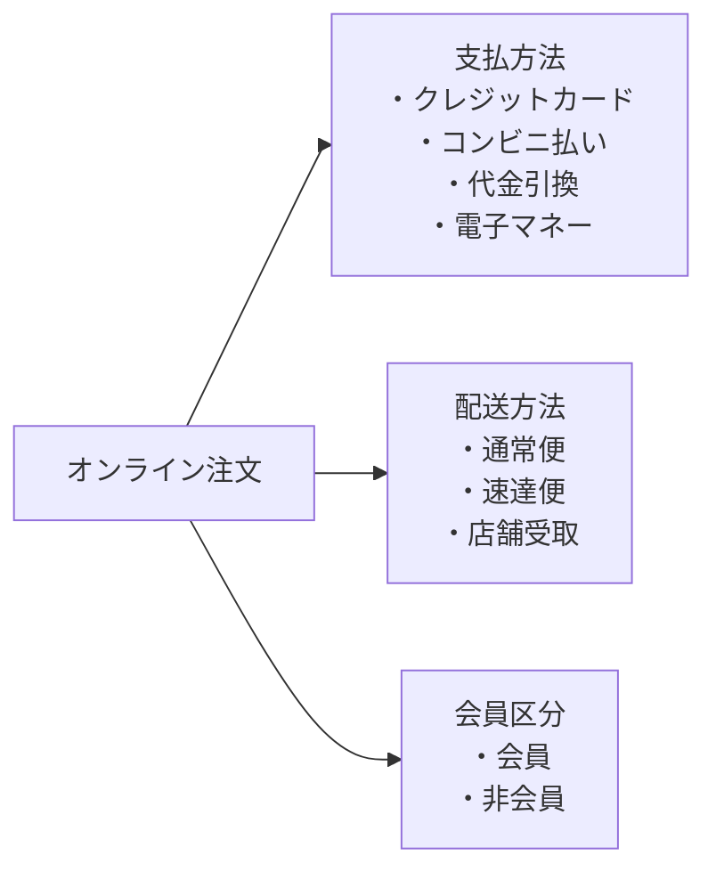

# lesson11: 組み合わせテスト — ベースチョイスとペアワイズで相互作用の故障を狙う

## このレッスンで学ぶこと

- 相互作用の故障と、組み合わせテストの 2 つのアプローチを説明できるようになる
- パラメーター-値ペアを使って、ベースチョイスカバレッジに必要な構成をすべて列挙できるようになる
- ペアワイズカバレッジに必要なテストケース数の下限を求め、実際に組を作って確かめられるようになる
- EP・クラシフィケーションツリー・制約が組み合わせの数に与える影響を説明できるようになる
- 少数のパラメーターの相互作用で大半の故障が起きるという知見を説明できるようになる

## 相互作用の故障

ソフトウェアの故障には、パラメーター値の特定の組み合わせでだけ起きるものがあります。これを**相互作用の故障**と呼びます。「Safari で、かつ画面幅がスマホサイズのときだけメニューが開かない」のように、単独の値では現れず、2 つ以上の値がそろったときに現れる故障です。

**組み合わせテスト**は、パラメーター値の組み合わせを探索して、相互作用の故障を見つけることを目的とするデータに基づくテスト技法です（データに基づくテスト技法の位置づけは [lesson10](/lessons/lesson10/)）。

### 2 つのアプローチ

組み合わせテストのテスト条件は、たいてい構成パラメーターか入力データ値の組み合わせです。どちらを組み合わせるかで、アプローチが 2 つに分かれます。

| アプローチ | 組み合わせるもの | テストケースとの関係 |
|---|---|---|
| 構成パラメーターの組み合わせ | OS・ブラウザー・画面サイズなどの環境 | 各構成を同じテストケースで実行する |
| 入力データ値の組み合わせ | 画面の入力項目の値など | 組み合わせが完全なテストケースの一部になり、テスト対象システムのテストスイートを作る |

### パラメーター-値ペア

パラメーターとその値の組を**パラメーター-値ペア**と呼び、`(ブラウザー, Chrome)` のように書きます。組み合わせテストのカバレッジアイテムは、このパラメーター-値ペアを単位に定義します。

## 2 つのカバレッジ基準

シラバスは、ベースチョイスカバレッジとペアワイズカバレッジの 2 つを扱います。

### ベースチョイスカバレッジ

**ベースチョイスカバレッジ**は、パラメーター-値ペアの中に他より重要なものがある、という前提に立ちます。

1. 各パラメーターについて、ベースとなるパラメーター-値ペアを 1 つ選ぶ（最も多い構成、デフォルト値など）
2. ベースのペアをすべて組み合わせたものが**ベースカバレッジアイテム**になる
3. 各パラメーターについて、ベースカバレッジアイテムのそのパラメーターのペアを、ベース以外の各値で 1 つずつ置き換えたカバレッジアイテムを作る

一度に置き換えるのは 1 つのパラメーターだけです。必要なカバレッジアイテムの数は、ベースの 1 つに、各パラメーターの「値の数から 1 を引いた数」を足した値になります。

### ペアワイズカバレッジ

**ペアワイズカバレッジ**のカバレッジアイテムは、任意の 2 つのパラメーターについてのパラメーター-値ペアの組み合わせです。パラメーターが 3 つ以上あっても、見るのは「どの 2 つを取っても、その値の組み合わせがすべて少なくとも 1 回現れるか」です。

カバレッジアイテムを生成するツールはありますが、ペアワイズカバレッジを達成する最小のテストケース集合を見つけることは一般に難しい、とされています。

## 組み合わせの数を左右する要素

### EP による値の削減

値をたくさん取れるパラメーター（注文金額など）をそのまま組み合わせると、組み合わせの数が爆発します。そこで、まず FL シラバス 4.2（ブラックボックステスト技法）の同値分割法（EP）を適用して値の数を減らしてから組み合わせます。たとえば「注文金額」を 3 つの同値パーティションに分け、各パーティションの代表値 1 つを値として使います。

### クラシフィケーションツリーとフィーチャーモデル

パラメーターとその値を**クラシフィケーションツリー**やフィーチャーモデルに整理しておくと、この作業がやりやすくなります。クラシフィケーションツリーは、テスト対象のテストデータ領域をツリーで表した図です。次の図は、オンライン注文を根に置き、パラメーター（支払方法など）を枝、それぞれが取る値を葉として整理した例です（図では、各パラメーターの葉をその枠の中にまとめて示しています）。

### 制約と追加の組み合わせ

最終的なテストケースの数は、次の要素で増減します。

| 要素 | 例 |
|---|---|
| パラメーター-値ペア間の制約 | 代金引換は店舗受取と組み合わせられない |
| 問題があるとわかっていて手動で追加する組み合わせ | 過去に故障が出た「Safari と スマホサイズ」の組み合わせ |
| 無効な組み合わせ・実行不可能な組み合わせ | テスト環境に存在しない構成 |

## 例題 1: ベースチョイスカバレッジの構成の列挙

::: info 例題の仕様
Web 予約フォームを、次の構成パラメーターの組み合わせでテストする。

- ブラウザー: Chrome、Firefox、Safari
- 画面サイズ: PC、タブレット、スマホ
- 表示言語: 日本語、英語

アクセス解析によると、最も多い構成は Chrome・PC・日本語である。
:::

### 手順 1: ベースのパラメーター-値ペアを決める

最も多い構成をベースにします。

| パラメーター | ベースのペア | ベース以外の値 |
|---|---|---|
| ブラウザー | (ブラウザー, Chrome) | Firefox、Safari |
| 画面サイズ | (画面サイズ, PC) | タブレット、スマホ |
| 表示言語 | (表示言語, 日本語) | 英語 |

### 手順 2: ベースカバレッジアイテムと置き換えを列挙する

| 番号 | ブラウザー | 画面サイズ | 表示言語 | 作り方 |
|---|---|---|---|---|
| 1 | Chrome | PC | 日本語 | ベースカバレッジアイテム |
| 2 | Firefox | PC | 日本語 | ブラウザーを Firefox に置き換え |
| 3 | Safari | PC | 日本語 | ブラウザーを Safari に置き換え |
| 4 | Chrome | タブレット | 日本語 | 画面サイズをタブレットに置き換え |
| 5 | Chrome | スマホ | 日本語 | 画面サイズをスマホに置き換え |
| 6 | Chrome | PC | 英語 | 表示言語を英語に置き換え |

### 手順 3: 数を検算する

ベースの 1 つに、各パラメーターのベース以外の値の数（2 と 2 と 1）を足して 6 です。全組み合わせは 3 × 3 × 2 で 18 なので、3 分の 1 で済んでいます。

「Firefox・スマホ・日本語」のように 2 つのパラメーターを同時に置き換えた構成は、ベースチョイスカバレッジのカバレッジアイテムではありません。すでにテスト済みの構成が与えられて「足りない構成はどれか」と問われたら、上の表と突き合わせて、表にあってテスト済みにない構成を選びます。

## 例題 2: ペアワイズカバレッジに必要なテストケース数

::: info 例題の仕様
オンライン注文の確定処理を、次の入力データの組み合わせでテストする。

- 支払方法: クレジットカード、コンビニ払い、代金引換、電子マネー（4 値）
- 配送方法: 通常便、速達便、店舗受取（3 値）
- 会員区分: 会員、非会員（2 値）
:::

### 手順 1: カバレッジアイテムを数える

パラメーターの組は 3 通りあり、それぞれの値の組み合わせがカバレッジアイテムです。

| パラメーターの組 | カバレッジアイテムの数 |
|---|---|
| 支払方法 × 配送方法 | 4 × 3 で 12 |
| 支払方法 × 会員区分 | 4 × 2 で 8 |
| 配送方法 × 会員区分 | 3 × 2 で 6 |
| 合計 | 26 |

### 手順 2: テストケース数の下限を求める

1 つのテストケースは、支払方法と配送方法の組み合わせをちょうど 1 つしか含みません。この組み合わせは 12 通りあるので、テストケースは少なくとも 12 個必要です。

一般に、値の数が多い順に 2 つのパラメーターを選び、その値の数を掛けた数が、ペアワイズカバレッジに必要なテストケース数の下限です。残りのパラメーターの値は、その下限の数のテストケースにうまく割り振れれば増やさずに済みます。

### 手順 3: 実際に組を作って確かめる

支払方法と配送方法の 12 通りを 1 行ずつ並べ、会員区分を交互に割り振ります。

| 番号 | 支払方法 | 配送方法 | 会員区分 |
|---|---|---|---|
| 1 | クレジットカード | 通常便 | 会員 |
| 2 | クレジットカード | 速達便 | 非会員 |
| 3 | クレジットカード | 店舗受取 | 会員 |
| 4 | コンビニ払い | 通常便 | 非会員 |
| 5 | コンビニ払い | 速達便 | 会員 |
| 6 | コンビニ払い | 店舗受取 | 非会員 |
| 7 | 代金引換 | 通常便 | 会員 |
| 8 | 代金引換 | 速達便 | 非会員 |
| 9 | 代金引換 | 店舗受取 | 会員 |
| 10 | 電子マネー | 通常便 | 非会員 |
| 11 | 電子マネー | 速達便 | 会員 |
| 12 | 電子マネー | 店舗受取 | 非会員 |

3 つの組それぞれについて、すべての組み合わせが現れているかを確認します。

- 支払方法 × 配送方法: 12 行がすべて異なる組み合わせなので、12 通りすべてを含む
- 支払方法 × 会員区分: どの支払方法にも会員の行と非会員の行があるので、8 通りすべてを含む
- 配送方法 × 会員区分: どの配送方法にも会員の行と非会員の行があるので、6 通りすべてを含む

26 のカバレッジアイテムをすべて含むので、12 個のテストケースでペアワイズカバレッジは 100% です。全組み合わせの 24 個と比べて半分で済みました。

### 手順 4: 制約がある場合

「代金引換は店舗受取と組み合わせられない」という制約があると、(代金引換, 店舗受取) はカバレッジアイテムから外れ、合計は 25 になります。9 番のテストケースは実行不可能なので削除します。

削除した 9 番が担っていた (代金引換, 会員) は 7 番に、(店舗受取, 会員) は 3 番にあるので、残りの 11 個のテストケースで 25 のカバレッジアイテムをすべて含みます。制約によってテストケース数が 12 から 11 に減りました。

::: tip 途中までのカバレッジを計算する
1 番から 6 番までしか実行していない場合、支払方法 × 配送方法は 6 通り、支払方法 × 会員区分は 4 通り、配送方法 × 会員区分は 6 通りを含むので、カバレッジは 26 分の 16 でおよそ 62% です。
:::

## 少数の相互作用で大半の故障が起きる

組み合わせテストで重要な知見は、すべてのパラメーターが故障に寄与するわけではなく、ほとんどの故障は 1 つのパラメーター値か、比較的少数のパラメーター間の相互作用で起きる、というものです。

- この知見は、単純な欠陥を検出できれば複雑な欠陥も発見できることが多い、という**結合効果仮説**と整合する
- 限られた範囲の調査では、故障の約 97% が 1 つか 2 つの相互作用する条件だけで起きていた

この結果が、全組み合わせではなくペアワイズテストで十分な効果が得られる根拠です。n-wise テストや diff-pair-t といった他のカバレッジ基準もありますが、シラバスの範囲外です。

## 試験のポイント

- ベースチョイスカバレッジの構成数は「1 に各パラメーターの（値の数 − 1）を足した数」で、一度に置き換えるパラメーターは 1 つだけ（2 つ同時に変えた構成はカバレッジアイテムではない）
- ペアワイズカバレッジに必要なテストケース数の下限は、値の数が多い 2 つのパラメーターの値の数の積（K3 で数が問われたら、まず下限を求めて実際に組を作れるか確かめる）
- 最終的なテストケース数は、パラメーター-値ペア間の制約、手動で追加した既知の問題の組み合わせ、無効または実行不可能な組み合わせで増減する
- 故障の約 97% は 1 つか 2 つの条件の相互作用で起きるという調査結果が、ペアワイズテストの有効性の根拠
