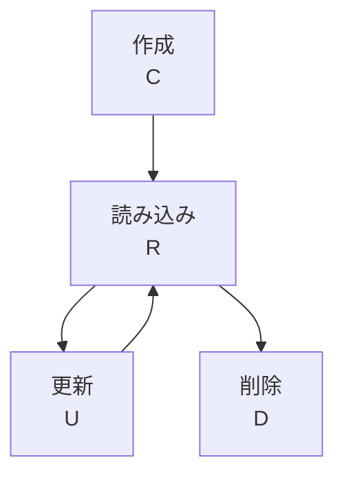

# lesson13: CRUD テスト — CRUD マトリクスでデータエンティティのライフサイクルを検証する

## このレッスンで学ぶこと

- 振る舞いに基づくテスト技法の 3 つと、FL の技法との関係を説明できるようになる
- 機能とエンティティから CRUD マトリクスを作れるようになる
- 完全性テストと一貫性テストの違いを説明できるようになる
- CRUD カバレッジを計算できるようになる
- CRUD テストを使うテストレベルと、検出できる欠陥の種類を説明できるようになる

## 振る舞いに基づくテスト技法

**振る舞いに基づくテスト技法**は、テストアイテムの動的な振る舞い、つまり状態に依存する振る舞いの仕様からテストケースを導出します（ブラックボックステスト技法の 3 分類は [lesson10](/lessons/lesson10/)）。シラバスが扱う技法は 3 つです。

| 技法 | FL シラバス 4.2 節との関係 |
|---|---|
| CRUD テスト | FL の技法の範囲を広げる新しい技法 |
| 状態遷移テスト（[lesson14](/lessons/lesson14/)） | FL で学んだ技法にカバレッジ基準を追加する |
| シナリオベースドテスト（[lesson15](/lessons/lesson15/)） | FL の技法の範囲を広げる新しい技法 |

## CRUD テストの考え方

**CRUD テスト**は、テストアイテムが処理するデータエンティティのライフサイクルを検証します。データエンティティは、会員や予約のように、システムが扱うデータのまとまりです。

CRUD は、機能がエンティティに対して実行できる 4 つの基本操作の頭文字です。

| 操作 | 英語 | 意味 |
|---|---|---|
| C | create | 作成 |
| R | read | 読み込み |
| U | update | 更新 |
| D | delete | 削除 |

エンティティは作成されてから、読み込みや更新を繰り返し、最後に削除されます。この一連の流れがライフサイクルで、CRUD テストはライフサイクル全体が正しく実装され、どの機能から扱っても一貫しているかを確かめます。

## CRUD マトリクス

**CRUD マトリクス**は、データエンティティのライフサイクルの概要を 1 枚の表にしたものです。

- 列はエンティティ、行は機能を表す
- ある機能があるエンティティに対して行う操作を、セルに C・R・U・D の文字で書く（1 つのセルに複数の文字が入ってよい）

マトリクスを作るには、テストアナリストが各機能について「4 つの操作のうちどれを、どのエンティティに対して行うか」を決めていきます。

::: warning 読み込み操作を見落とさない
読み込みは、作成・更新・削除に暗黙のうちに結びついていることが多い操作です。たとえば「予約を変更する」機能は、変更する前にその予約を読み込みます。仕様に「表示する」と書かれていなくても、裏で読み込んでいるなら R として書きます。
:::

### 例題: 会議室予約システムの CRUD マトリクス

::: info 例題の仕様
社内の会議室予約システムには、会議室・予約・利用者の 3 つのエンティティと、次の 8 つの機能がある。

1. 会議室を登録する
2. 会議室の情報を変更する
3. 利用者を登録する
4. 利用者の情報を変更する
5. 予約を作成する（会議室と利用者を選んで予約を登録する）
6. 予約の内容を変更する
7. 予約を取り消す
8. 予約の一覧を表示する
:::

各機能がどのエンティティにどの操作をするかを決めて、マトリクスに書き込みます。

| 機能 | 会議室 | 予約 | 利用者 |
|---|---|---|---|
| 会議室を登録する | C | | |
| 会議室の情報を変更する | R U | | |
| 利用者を登録する | | | C |
| 利用者の情報を変更する | | | R U |
| 予約を作成する | R | C | R |
| 予約の内容を変更する | | R U | |
| 予約を取り消す | | R D | |
| 予約の一覧を表示する | | R | |

「予約を作成する」は、会議室と利用者を選ぶ時点でそれぞれを読み込んでいるので、会議室と利用者の列に R を書いています。「予約の内容を変更する」と「予約を取り消す」も、対象の予約を読み込んでから操作するので R を付けています。

マトリクスに書いた操作は全部で 14 です（C が 3、R が 7、U が 3、D が 1 で、セルに書いた文字の数を数える）。

## 完全性テストと一貫性テスト

CRUD テストは、2 つの部分で構成します。

| | 完全性テスト | 一貫性テスト |
|---|---|---|
| 種類 | 静的テスト | 動的テスト |
| 確かめること | すべてのエンティティに対して、すべての操作（C・R・U・D）が存在するか | 複数の機能を統合したときに、エンティティが一貫して扱われるか |
| 見つかるもの | ライフサイクルが実装されていないエンティティ | 機能どうしの相互作用の誤り |

### 完全性テスト

完全性テストは、CRUD マトリクスを見て、各エンティティの列に C・R・U・D がそろっているかを確かめます。どれかの操作が存在しないことは、調査が必要な不正です。

例題のマトリクスでは、2 つの不正が見つかります。

| エンティティ | 存在する操作 | 存在しない操作 |
|---|---|---|
| 会議室 | C、R、U | D |
| 予約 | C、R、U、D | なし |
| 利用者 | C、R、U | D |

会議室を削除する機能と、利用者を削除する機能がありません。「会議室は廃止しても履歴のために残す」という仕様上の判断なのか、退会処理の機能が仕様から漏れているのかは、この時点ではわかりません。マトリクスを根拠にして、仕様の作成者に確認します。

### 一貫性テスト

一貫性テストは、機能を組み合わせて実行し、各機能がエンティティを扱うときに正しく相互作用することを検証します。テストケースの設計には 3 つの決まりがあります。

- テストケースは CRUD マトリクスのすべての操作をカバーする
- ネガティブなテストも含める（まだ作成していないエンティティを読み込む、など）
- エンティティごとに、ライフサイクル全体をカバーするように機能を組み合わせて設計する

例題の「予約」エンティティなら、次のようなテストケースになります。

| 手順 | 機能 | 操作 | 確認すること |
|---|---|---|---|
| 1 | 予約を作成する | C | 予約が登録され、選んだ会議室と利用者が正しく結び付く |
| 2 | 予約の一覧を表示する | R | 作成した予約が一覧に出る |
| 3 | 予約の内容を変更する | R U | 変更後の内容が一覧にも反映される |
| 4 | 予約を取り消す | R D | 取り消した予約が一覧から消え、会議室の空きが戻る |
| 5 | 予約の内容を変更する（取り消した予約に対して） | R U | エラーになり、取り消した予約が復活しない（ネガティブなテスト） |

## CRUD カバレッジ

**CRUD カバレッジ**は、テストスイートが実行した操作の数を、CRUD マトリクスの操作の総数で割って測ります。

例題で、テストスイートが「会議室を登録する」「利用者を登録する」「予約を作成する」「予約の内容を変更する」の 4 機能だけを実行したとします。

| 機能 | 実行した操作 | 数 |
|---|---|---|
| 会議室を登録する | 会議室の C | 1 |
| 利用者を登録する | 利用者の C | 1 |
| 予約を作成する | 会議室の R、予約の C、利用者の R | 3 |
| 予約の内容を変更する | 予約の R、予約の U | 2 |
| 合計 | | 7 |

マトリクスの操作は 14 なので、CRUD カバレッジは 14 分の 7 で 50% です。残りの 4 つの機能を通すテストケースを足せば 100% になります。

### より厳密なカバレッジ

操作を 1 つずつ数えるのではなく、操作の特定の組み合わせをカバレッジアイテムにする、より厳密な CRUD カバレッジもあります。たとえば「各 U の後に、可能なすべての R をカバーする」という基準です。

例題の予約なら、「予約の内容を変更する」で U したあとに、予約を R する 3 つの機能（予約の内容を変更する、予約を取り消す、予約の一覧を表示する）をそれぞれ実行する組み合わせがカバレッジアイテムになります。更新した内容がどの機能から読んでも同じに見えるか、を確かめる基準です。

## 適用するテストレベルと検出できる欠陥

CRUD テストは、主にシステムレベルで使います。複数の機能を統合してエンティティの扱いを見る技法なので、機能がそろったシステムテストで効果を発揮します。

狙うのは、エンティティの扱いに関するテストアイテムの振る舞いの欠陥です。

| 欠陥の種類 | 例題での例 |
|---|---|
| データ整合性違反 | 予約を取り消しても会議室の空き状況が戻らない |
| アクセスコントロールの欠陥 | 他の利用者が作成した予約を変更できてしまう |
| データの不整合 | 変更した予約の内容が、一覧では変更前のまま表示される |

## 試験のポイント

- 完全性テストは静的テスト（マトリクスの空きを見る）、一貫性テストは動的テスト（機能を統合して実行する）で、この対応を入れ替えた選択肢に注意
- CRUD マトリクスは列がエンティティ・行が機能で、作成・更新・削除に暗黙に伴う読み込みも R として書く
- CRUD カバレッジは実行した操作の数を操作の総数で割った値で、より厳密な基準では操作の組み合わせ（各 U の後のすべての R など）をカバレッジアイテムにする
- 主にシステムレベルで使い、データ整合性違反・アクセスコントロールの欠陥・データの不整合を狙う（K2）
