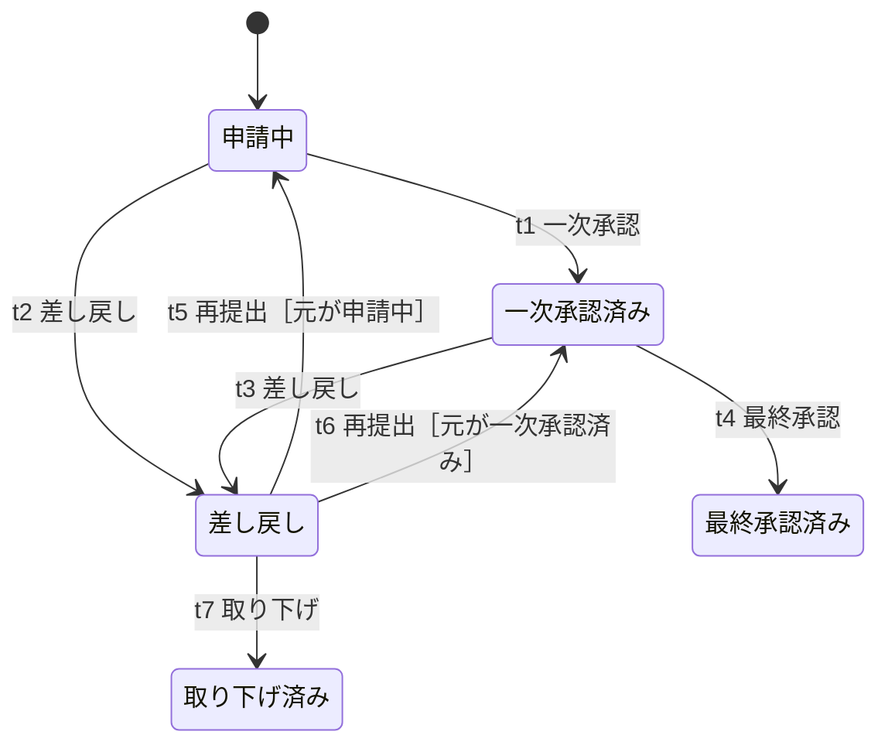
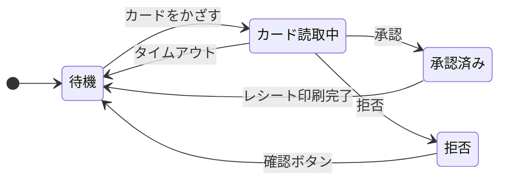

# lesson14: 状態遷移テスト — N スイッチカバレッジとラウンドトリップカバレッジ

## このレッスンで学ぶこと

- 振る舞いに基づくテスト技法の 3 つと、状態遷移テストに Advanced Level で加わる内容を説明できるようになる
- 状態ベースモデルをテスト分析で確認・調整する観点と、モデルの種類を説明できるようになる
- 1 スイッチを漏れなく列挙し、ガード条件で実行不可能な組み合わせを除けるようになる
- ラウンドトリップを列挙し、テストケースが達成するラウンドトリップカバレッジを計算できるようになる
- 状態遷移テストと自動化の相性、欠陥予防への貢献を説明できるようになる

## 振る舞いに基づくテスト技法の位置づけ

同じイベントを与えても、そのときの状態によってシステムの反応が変わることがあります。こうした動的な振る舞い、つまり状態に依存する振る舞いの仕様からテストケースを導出する技法を、シラバスは**振る舞いに基づくテスト技法**と呼びます。

| 技法 | Foundation Level との関係 | レッスン |
|------|------|------|
| CRUD テスト | FL のブラックボックステスト技法の範囲を広げる | [lesson13](/lessons/lesson13/) |
| 状態遷移テスト | FL シラバス 4.2.4 の技法に、カバレッジ基準を追加する | このレッスン |
| シナリオベースドテスト | FL のブラックボックステスト技法の範囲を広げる | [lesson15](/lessons/lesson15/) |

状態遷移テストの基本（状態・イベント・遷移・ガード条件・アクション、状態遷移表、全状態カバレッジ・有効遷移カバレッジ・全遷移カバレッジ）は FL シラバス 4.2.4 で学んだとおりです。このレッスンでは、その上に加わる 2 つのカバレッジ基準を中心に扱います。

## 状態を持つシステムと状態ベースモデル

### 状態を持つシステム

あるイベントに対する反応が、その時点の状態に依存するシステムを「状態を持つ」システムと呼びます。複雑なシステムの多くが該当し、代表例は次のとおりです。

- 組み込みシステム
- 対話型システム
- 制御システム
- エンティティとそのライフサイクルを扱うシステム（注文・申請・契約など）

状態という考え方には、複雑な内部の詳細を単純化する働きがあります。内部の変数や処理をすべて追わなくても、「今どの状態にあるか」で期待する振る舞いを語れるため、ステークホルダーが期待動作を理解しやすくなります。

### テスト分析での確認

テストアナリストは、テスト分析の段階で、状態ベースモデルがテストに必要な詳細レベルでテストアイテムの期待する振る舞いを表していることを確認します。

- テストベースにモデルがすでにあれば、そのモデルにテスト条件が含まれているかを確認する
- 足りなければモデルを調整するか、新しいモデルを設計する

モデルは仕様の図をそのまま使うものではなく、テスト条件を表せる形に整えて使う、という姿勢です。

### モデルの構成とバリエーション

状態ベースモデルでは、ノードが状態を、エッジが遷移を表します。遷移はイベントによってトリガーされ、ガード条件やアクションを持つことがあります。実務で使われるモデルにはいくつかのバリエーションがあります。

| モデル | 特徴 |
|------|------|
| 拡張有限ステートマシン | 変数とガード条件で状態機械を拡張したもの |
| ハレルのステートチャート | 階層化した状態や並行する状態を表現できる |
| UML ステートマシン | UML で標準化された状態機械の表記 |

::: info 新しいモデルの動き
シラバスは、近年提案された状態に基づくモデルとしてアクション・状態モデルにも触れています。試験ではモデルの名前が問われることは少なく、カバレッジ基準の適用が中心です。
:::

## N スイッチカバレッジ

FL で学んだカバレッジ基準に加えて、シラバスは実証研究で高い欠陥検出有効性が示された 2 つの基準を取り上げています。1 つ目が **N スイッチカバレッジ**です。

N スイッチカバレッジでは、N 足す 1 個の連続する有効な遷移のシーケンス（**N スイッチ**）をカバレッジアイテムとします。用語集では Chow のカバレッジメトリクスという同義語も載っています。

| N | カバレッジアイテム | 連続する遷移の数 |
|---|------|------|
| 0 | 単一の有効な遷移 | 1 |
| 1 | ある状態に入る遷移と、その状態から出る遷移のペア | 2 |
| 2 | 1 スイッチの末端に、有効な次の遷移を 1 つ延長したもの | 3 |

- **0 スイッチカバレッジ**は、FL の有効遷移カバレッジと同じものです
- **1 スイッチ**は、1 つの状態における入出遷移のペアです
- N スイッチの末端を有効な次の遷移で延長すると、N 足す 1 スイッチになります

実務で頻繁に使われるのは 0 スイッチと 1 スイッチのカバレッジです。N スイッチの数は N に対して指数関数的に増えるため、2 スイッチ以上で 100% を目指すのは、イベントの予期しないシーケンスによって故障が起こるリスクが高い場合に限って適切です。

### 例題 1 の題材

経費申請の承認ワークフローを題材に、1 スイッチをすべて列挙します。申請は一次承認と最終承認の 2 段階で承認され、どちらの段階でも差し戻しが起こります。差し戻された申請を再提出すると、差し戻された段階へ戻ります。

図のラベルはイベントとガード条件だけを示しています。各遷移の完全な内容は次の表のとおりです。差し戻しの遷移 t2 と t3 は、差し戻し元の状態を変数「元」に記録するアクションを持ちます。再提出の遷移 t5 と t6 は、その変数を参照するガード条件を持ちます。

| 遷移 | 遷移元 → 遷移先 | イベント | ガード条件 | アクション |
|------|------|------|------|------|
| t1 | 申請中 → 一次承認済み | 一次承認 | なし | なし |
| t2 | 申請中 → 差し戻し | 差し戻し | なし | 元を「申請中」と記録する |
| t3 | 一次承認済み → 差し戻し | 差し戻し | なし | 元を「一次承認済み」と記録する |
| t4 | 一次承認済み → 最終承認済み | 最終承認 | なし | なし |
| t5 | 差し戻し → 申請中 | 再提出 | 元が申請中 | なし |
| t6 | 差し戻し → 一次承認済み | 再提出 | 元が一次承認済み | なし |
| t7 | 差し戻し → 取り下げ済み | 取り下げ | なし | なし |

### 例題 1 の手順

1 スイッチは「ある状態に入る遷移」と「その状態から出る遷移」のペアなので、状態ごとに入る遷移と出る遷移を整理すれば機械的に数えられます。

まず、状態ごとに入る遷移と出る遷移を表にします。この例では、開始擬似状態から申請中への遷移は数えません。

| 状態 | 入る遷移 | 出る遷移 | ペアの数 |
|------|------|------|------|
| 申請中 | t5 | t1、t2 | 1 × 2 で 2 |
| 一次承認済み | t1、t6 | t3、t4 | 2 × 2 で 4 |
| 差し戻し | t2、t3 | t5、t6、t7 | 2 × 3 で 6 |
| 最終承認済み | t4 | なし | 0 |
| 取り下げ済み | t7 | なし | 0 |

ガード条件を考えなければ、1 スイッチは全部で 12 個です。

次に、12 個を状態の列として書き出します。

| 番号 | 遷移のペア | 状態の列 |
|------|------|------|
| 1 | t5 → t1 | 差し戻し → 申請中 → 一次承認済み |
| 2 | t5 → t2 | 差し戻し → 申請中 → 差し戻し |
| 3 | t1 → t3 | 申請中 → 一次承認済み → 差し戻し |
| 4 | t1 → t4 | 申請中 → 一次承認済み → 最終承認済み |
| 5 | t6 → t3 | 差し戻し → 一次承認済み → 差し戻し |
| 6 | t6 → t4 | 差し戻し → 一次承認済み → 最終承認済み |
| 7 | t2 → t5 | 申請中 → 差し戻し → 申請中 |
| 8 | t2 → t6 | 申請中 → 差し戻し → 一次承認済み |
| 9 | t2 → t7 | 申請中 → 差し戻し → 取り下げ済み |
| 10 | t3 → t5 | 一次承認済み → 差し戻し → 申請中 |
| 11 | t3 → t6 | 一次承認済み → 差し戻し → 一次承認済み |
| 12 | t3 → t7 | 一次承認済み → 差し戻し → 取り下げ済み |

最後に、ガード条件を持つ遷移（t5、t6）を含むペアについて、直前の遷移がガード条件を満たすかを確認します。

| 番号 | 直前の遷移が記録する値 | ガード条件 | 判定 |
|------|------|------|------|
| 7 | t2 が「申請中」と記録 | t5 は元が申請中 | 実行可能 |
| 8 | t2 が「申請中」と記録 | t6 は元が一次承認済み | 実行不可能 |
| 10 | t3 が「一次承認済み」と記録 | t5 は元が申請中 | 実行不可能 |
| 11 | t3 が「一次承認済み」と記録 | t6 は元が一次承認済み | 実行可能 |

番号 1、2、5、6 も t5 または t6 を含みますが、これらはガード条件を持つ遷移が先頭にあります。先頭の遷移が実行できる状況（t5 なら直前に t2 を通っている）を作れば通れるため、実行可能です。

番号 8 と 10 の 2 つを除き、100% の 1 スイッチカバレッジに必要なカバレッジアイテムは 10 個です。

::: tip 2 スイッチへの延長
番号 1 の末端は一次承認済みなので、そこから出る t3 または t4 を付け足すと 2 スイッチになります（t5 → t1 → t3 と t5 → t1 → t4）。延長するたびに末端の状態から出る遷移の数だけ枝分かれするため、N が増えるとカバレッジアイテムの数は急激に増えます。
:::

## ラウンドトリップカバレッジ

2 つ目の基準が**ラウンドトリップカバレッジ**です。状態ベースモデルのパスのうち、ループを形成するものに適用します。

**ラウンドトリップ**とは、次の 2 つを満たすループです。

- 開始状態と終了状態が同じである
- ループ内の他の状態は 2 回現れない

このラウンドトリップがカバレッジアイテムです。研究では、この基準が欠陥の発見に非常に有効だとされています。

::: warning ラウンドトリップにならない例
「待機 → 読取中 → 承認済み → 待機 → 読取中 → 待機」は、開始と終了が待機で一致していますが、途中で待機と読取中が 2 回ずつ現れるのでラウンドトリップではありません。このパスは、2 つのラウンドトリップをつないだものです。
:::

同じ状態の輪でも、開始状態が違えば別のラウンドトリップとして数えます。たとえば「待機 → 読取中 → 待機」と「読取中 → 待機 → 読取中」は、別々のカバレッジアイテムです。

### 例題 2 の題材

店舗の決済端末の状態遷移を題材に、ラウンドトリップを列挙し、テストケースのカバレッジを計算します。

### 例題 2 の手順

まず、モデルに含まれる状態の輪を見つけます。輪は 3 つです。

| 輪 | 通る状態 | 状態の数 |
|------|------|------|
| 輪 A | 待機、カード読取中 | 2 |
| 輪 B | 待機、カード読取中、承認済み | 3 |
| 輪 C | 待機、カード読取中、拒否 | 3 |

次に、各輪に含まれる状態を 1 つずつ開始状態にして、ラウンドトリップを書き出します。輪に含まれる状態の数だけラウンドトリップができるので、合計は 2 足す 3 足す 3 で 8 個です。

| 番号 | 輪 | ラウンドトリップ |
|------|------|------|
| RT1 | A | 待機 → 読取中 → 待機 |
| RT2 | A | 読取中 → 待機 → 読取中 |
| RT3 | B | 待機 → 読取中 → 承認済み → 待機 |
| RT4 | B | 読取中 → 承認済み → 待機 → 読取中 |
| RT5 | B | 承認済み → 待機 → 読取中 → 承認済み |
| RT6 | C | 待機 → 読取中 → 拒否 → 待機 |
| RT7 | C | 読取中 → 拒否 → 待機 → 読取中 |
| RT8 | C | 拒否 → 待機 → 読取中 → 拒否 |

ここで、次のイベント列を実行するテストケース TC1 を考えます。

> カードをかざす → 承認 → レシート印刷完了 → カードをかざす → タイムアウト → カードをかざす → 拒否 → 確認ボタン

TC1 が通る状態の列は、番号を付けると次のとおりです。

| 位置 | 1 | 2 | 3 | 4 | 5 | 6 | 7 | 8 | 9 |
|------|---|---|---|---|---|---|---|---|---|
| 状態 | 待機 | 読取中 | 承認済み | 待機 | 読取中 | 待機 | 読取中 | 拒否 | 待機 |

各ラウンドトリップが、この状態の列の中に連続した部分として現れるかを確認します。

| 番号 | 現れる位置 | 判定 |
|------|------|------|
| RT1 | 4 → 5 → 6 | カバー |
| RT2 | 5 → 6 → 7 | カバー |
| RT3 | 1 → 2 → 3 → 4 | カバー |
| RT4 | 2 → 3 → 4 → 5 | カバー |
| RT5 | 承認済みのあとに再び承認済みへ戻っていない | 未カバー |
| RT6 | 6 → 7 → 8 → 9 | カバー |
| RT7 | 位置 9 で終わり、読取中へ戻らない | 未カバー |
| RT8 | 拒否のあとに再び拒否へ戻っていない | 未カバー |

TC1 は 8 個のうち 5 個をカバーするので、ラウンドトリップカバレッジは 5 ÷ 8 で 62.5% です。

残りの 3 個をカバーするには、同じ輪を 2 周するテストケースを追加します。

| テストケース | イベント列 | 新たにカバーするラウンドトリップ |
|------|------|------|
| TC2 | カードをかざす → 承認 → レシート印刷完了 → カードをかざす → 承認 → レシート印刷完了 | RT5 |
| TC3 | カードをかざす → 拒否 → 確認ボタン → カードをかざす → 拒否 → 確認ボタン | RT7、RT8 |

TC1 から TC3 で 8 個すべてをカバーし、ラウンドトリップカバレッジは 100% になります。

## 自動化との相性と欠陥予防

状態遷移テストには、カバレッジ基準の適用以外にも押さえておく特徴があります。

- モデルベースドテストツールを使った自動化に適している（モデルからテストケースを生成できる。テスト設計の自動化は [lesson22](/lessons/lesson22/)）
- ほとんどのブラックボックステスト技法と同じく、モデリングの過程で仕様書の欠陥を検出し、欠陥予防に貢献する（[lesson27](/lessons/lesson27/)）
- どのテストレベルでも適用できる

他の技法との組み合わせも有効です。ガード条件に含まれる変数には境界値分析を適用できます。また、周期的に繰り返すビジネスプロセスには、シナリオベースドテストとラウンドトリップカバレッジの組み合わせがそのリスクに対応します（技法の選択は [lesson21](/lessons/lesson21/)）。

## 試験のポイント

- K3 で問われるのは 1 スイッチの個数とラウンドトリップカバレッジの計算で、1 スイッチは状態ごとの「入る遷移 × 出る遷移」を合計してからガード条件で実行不可能なペアを除き、ラウンドトリップはテストケースの状態の列に連続して現れるかで数える
- N スイッチは N 足す 1 個の連続する遷移で、0 スイッチカバレッジは有効遷移カバレッジと同じである（N と遷移の数のずれがひっかけになる）
- 2 スイッチ以上で 100% を目指すのは、予期しないイベントのシーケンスによる故障リスクが高い場合に限る（N スイッチの数は N に対して指数関数的に増える）
- ラウンドトリップは開始と終了が同じ状態で他の状態が 2 回現れないループであり、同じ輪でも開始状態が違えば別のカバレッジアイテムになる
