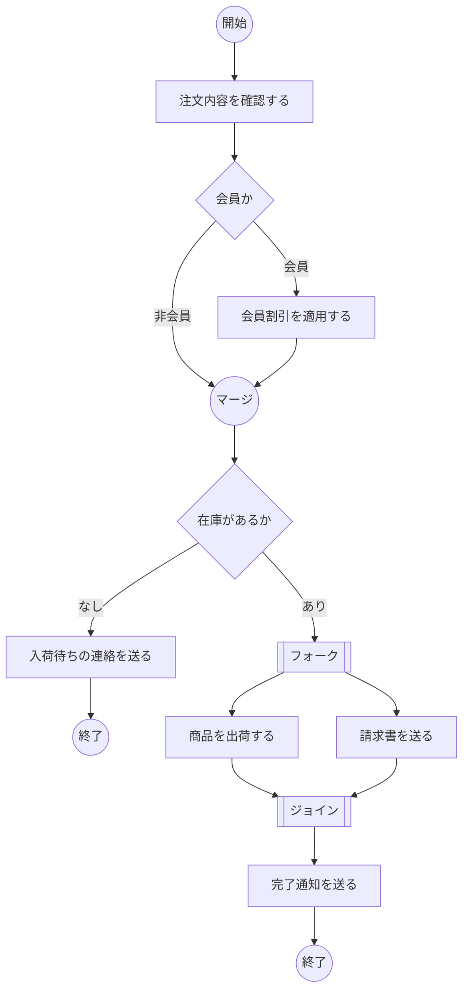

# lesson15: シナリオベースドテスト — ユースケースとアクティビティ図からテストケースを導く

## このレッスンで学ぶこと

- シナリオベースドテストの目的と、シナリオモデルに使うアクティビティ図とユースケースの要素を説明できるようになる
- ユースケースのメインシナリオ・拡張・例外を区別し、テスト戦略の制約のもとで最小のテストケース数を導けるようになる
- 判定と並行フローを含むアクティビティ図から、必要なシナリオの数を導けるようになる
- ループを含むシナリオモデルにシンプルループカバレッジを適用し、シナリオカバレッジを計算できるようになる
- シナリオベースドテストを使うテストレベルとテストタイプを説明できるようになる

## シナリオベースドテストの目的

**シナリオベースドテスト**は、現実的なシナリオの中でテストアイテムの振る舞いを評価する技法です。振る舞いに基づくテスト技法の 1 つで（分類は [lesson14](/lessons/lesson14/)）、個々の入力値ではなく、利用者がゴールに向かって操作する一連の流れを単位にテストします。

価値あるシナリオを見つけるには、次のような技法が役立ちます。

- ユーザーリサーチ
- ユーザーストーリー
- ペルソナ
- ユーザージャーニーマップ

テストアナリストは、テストアイテムを通過するワークフローを構成するアクションの並びをもとに、**シナリオモデル**を作ります。シラバスが説明するモデルはアクティビティ図とユースケースの 2 つです。フローチャート、BPMN 図、シーケンス図、コラボレーション図などもシナリオモデルになりますが、シラバスの範囲外です。

## アクティビティ図

**アクティビティ図**は、システム内のワークフローを図で表したものです。ビジネスプロセスのモデリングに特に役立ち、コントロールフローのモデリングにも使えます。フローチャートの記法を拡張しているため、並行する処理を表現できる点がフローチャートとの違いです。

主な要素は次のとおりです。

| 要素 | 役割 |
|------|------|
| 開始ノード・終了ノード | ワークフローの始まりと終わり |
| アクション | 実行する処理 |
| 遷移 | アクション間の流れ |
| 判定ノード | 条件によって流れを分ける |
| マージノード | 分かれた流れを 1 つに戻す |
| フォークノード | 流れを並行する複数の流れに分ける |
| ジョインノード | 並行する流れがすべて終わるのを待って合流させる |
| スイムレーン | 担当者やシステムごとにアクションを区分けする |

判定ノードとフォークノードは、どちらも流れが複数に分かれますが意味が違い、この違いがシナリオの数え方に直接影響します。

- 判定ノードは、条件によって**どれか 1 つ**の流れへ進む
- フォークノードは、**すべて**の流れを同時に進める

## ユースケース

**ユースケース**は、ユーザーとシステム、またはシステムどうしの相互作用を表す、アクションのテキストまたは図による記述です。ユースケースのモデルでは、3 種類のシナリオを区別します。

| 種類 | 内容 | 数 |
|------|------|------|
| **メインシナリオ** | ユーザーの視点でゴール達成につながる、典型的で期待される一連のアクション（ハッピーパス） | 1 つのユースケースに 1 つだけ |
| **拡張**（代替シナリオ） | メインシナリオとは別の一連のアクションで、最終的にメインシナリオのゴール達成につながる | 複数あってよい |
| **例外** | 異常な使い方や無効な入力など予期しないアクションのために、メインシナリオのゴールを達成できない一連のアクション | 複数あってよい |

拡張と例外の見分け方は「ゴールに到達するかどうか」です。途中の流れが違ってもゴールに着くなら拡張、着かないなら例外です。

## シナリオをカバレッジアイテムとするテスト設計

シナリオベースドテストでは、シナリオがカバレッジアイテムです。テストアナリストはシナリオをカバーするテストケースを設計し、多くの場合リスクベースの優先順位に従って並べます。

シナリオモデルにループがあるかどうかで、考え方が変わります。

| モデル | シナリオの数 | テスト設計 |
|------|------|------|
| ループがない | 有限 | 各シナリオを個別のテストケースでテストできる（すべてのシナリオをテストスイートで実行できる） |
| ループがある | 無限になりうる | シンプルループカバレッジを適用する |

### シンプルループカバレッジ

**シンプルループカバレッジ**では、各ループについて次の 4 通りの実行をテストします。

| 実行回数 | 意味 |
|------|------|
| 0 回 | ループをスキップする |
| ちょうど 1 回 | 1 回だけ反復する |
| 2 回以上 | 典型的な反復回数で実行する |
| 最大回数 | 可能であれば、上限の回数まで反復する |

### シナリオカバレッジ

シナリオベースのカバレッジは、実行したシナリオの数を、識別した全シナリオの数で割って測定します。

シナリオは、シナリオモデルにカバレッジ基準を適用して識別します。カバレッジ基準によっては、1 つのシナリオを複数回テストすることを求めます。たとえばシナリオの中に現れる変数に同値分割法や境界値分析のカバレッジを追加で求める場合、1 つのシナリオを複数のテストケースでテストすることになります。

## 例題 1 の題材

会議室の予約機能を題材に、ユースケースのすべてのシナリオをカバーする最小のテストケース数を求めます。

::: info ユースケース「会議室を予約する」
前提条件: 利用者はログイン済みである。

メインシナリオ

1. 利用者が予約画面を開く
2. 利用者が日時と参加人数を入力する
3. システムが条件に合う空き会議室の一覧を表示する
4. 利用者が会議室を選ぶ
5. システムが予約内容の確認画面を表示する
6. 利用者が予約を確定する
7. システムが予約を登録し、予約番号を表示する
8. システムが確認メールを送り、ユースケースを終了する

拡張

- 3A. 条件に合う空き会議室がない。システムが前後 1 時間の空き候補を表示し、利用者が候補を選ぶ。ステップ 4 へ進む
- 4A. 利用者が会議室の設備を確認する画面を開いてから会議室を選ぶ。ステップ 5 へ進む
- 5A. 利用者が確認画面で「入力に戻る」を選ぶ。ステップ 2 へ戻る
- 6A. 利用者が「仮予約」を選んで確定する。システムが仮予約として登録し、予約番号と仮予約の期限を表示する。ステップ 8 へ進む
- 6B. 利用者が社外ゲストを追加して確定する。システムが予約を登録し、予約番号とゲスト用の入館コードを表示する。ステップ 8 へ進む

例外

- 2A. 入力した日時が過去である。システムがエラーを表示し、ユースケースを終了する
- 7A. 登録の直前に、同じ会議室が別の利用者に予約された。システムがエラーを表示し、ユースケースを終了する
:::

テスト戦略は次のとおりです。

- メインシナリオ、すべての拡張、すべての例外をテストする
- 1 つのテストケースに複数の拡張を含めてよい
- 例外を含むテストケースには、拡張を含めない

## 例題 1 の手順

まず、シナリオを数えます。メインシナリオ 1 つ、拡張 5 つ、例外 2 つで、識別したシナリオは 8 個です。

次に、「1 つのテストケースにまとめられないもの」を見つけます。これが最小数の下限を決めます。

| 制約 | 理由 | 必要なテストケース |
|------|------|------|
| メインシナリオ | 拡張も例外も通らない流れが必要 | 1 |
| 例外 2A | 例外はユースケースを終了させるので、他の例外と同居できず、戦略により拡張とも同居できない | 1 |
| 例外 7A | 同上 | 1 |
| 拡張 6A と 6B | どちらもステップ 6 の確定操作で起こり、ステップ 6 は 1 つのテストケースで 1 回しか通らないため同居できない | 2 |

下限は 1 + 1 + 1 + 2 で 5 です。

最後に、残りの拡張（3A、4A、5A）が 6A または 6B のテストケースに同居できるかを確認します。3A はステップ 3、4A はステップ 4、5A はステップ 5 で起こり、5A でステップ 2 へ戻ったあとに通常の流れでステップ 6 に到達できます。したがって 3 つとも 1 つのテストケースに入ります。

| テストケース | ステップの並び | カバーするシナリオ |
|------|------|------|
| TC1 | 1, 2, 3, 4, 5, 6, 7, 8 | メインシナリオ |
| TC2 | 1, 2A | 例外 2A |
| TC3 | 1, 2, 3, 4, 5, 6, 7A | 例外 7A |
| TC4 | 1, 2, 3A, 4A, 5A, 2, 3, 4, 5, 6A, 7, 8 | 拡張 3A、4A、5A、6A |
| TC5 | 1, 2, 3, 4, 5, 6B, 7, 8 | 拡張 6B |

すべてのシナリオをカバーする最小のテストケース数は 5 です。

::: tip 下限から考える
いきなりテストケースを組むのではなく、「同居できない組み合わせ」から下限を出し、残りを詰め込めるか確かめる順番にすると、数え間違いが減ります。例外は必ず単独、同じステップで起こる拡張どうしはそのステップを何回通るかで判断します。
:::

### シンプルループカバレッジの適用

拡張 5A はステップ 2 へ戻るループです。シンプルループカバレッジをこのループに適用すると、次の 4 通りが必要です。

| 実行回数 | テストケース |
|------|------|
| 0 回 | TC1（5A を通らない） |
| ちょうど 1 回 | TC4（5A を 1 回通る） |
| 2 回以上 | 1, 2, 3, 4, 5A, 2, 3, 4, 5A, 2, 3, 4, 5, 6, 7, 8 のように 5A を 2 回通す（追加のテストケース） |
| 最大回数 | このユースケースには反復回数の上限がないので適用しない（「やり直しは 3 回まで」のような上限があれば、その回数で通す） |

### シナリオカバレッジの計算

識別したシナリオは 8 個です。TC1 から TC4 までを実行した時点でカバーしたシナリオは、メインシナリオ、2A、7A、3A、4A、5A、6A の 7 個なので、シナリオカバレッジは 7 ÷ 8 で 87.5% です。TC5 を実行すると 100% になります。

## 例題 2 の題材

注文処理のアクティビティ図を題材に、すべてのシナリオをカバーするのに必要なテストケースの数を求めます。

図の流れは次のとおりです。

- 注文内容を確認したあと、会員かどうかの判定で会員割引を適用するかが分かれ、マージして在庫の判定に進む
- 在庫がなければ、入荷待ちの連絡を送って終了する
- 在庫があれば、フォークで「商品を出荷する」と「請求書を送る」を並行して実行し、ジョインで両方の完了を待ってから完了通知を送って終了する

## 例題 2 の手順

シナリオの数は、流れを分ける要素だけで決まります。要素ごとに「流れの選び方が何通りあるか」を整理します。

| 要素 | 流れの選び方 | シナリオの数への影響 |
|------|------|------|
| 判定「会員か」 | 会員、非会員の 2 通り | 2 倍 |
| 判定「在庫があるか」 | あり、なしの 2 通り | 2 倍 |
| フォークとジョイン | 両方の流れを必ず実行するので 1 通り | 増えない |

判定は 2 つとも独立しているので、シナリオの数は 2 × 2 で 4 です。

| シナリオ | 会員か | 在庫があるか | 通るアクション |
|------|------|------|------|
| 1 | 会員 | あり | 確認、会員割引、出荷と請求書（並行）、完了通知 |
| 2 | 会員 | なし | 確認、会員割引、入荷待ちの連絡 |
| 3 | 非会員 | あり | 確認、出荷と請求書（並行）、完了通知 |
| 4 | 非会員 | なし | 確認、入荷待ちの連絡 |

このモデルにはループがないので、各シナリオを 1 つのテストケースでテストできます。すべてのシナリオをカバーするのに必要なテストケースの数は 4 です。

::: warning 並行フローは分岐ではない
フォークのあとの「商品を出荷する」と「請求書を送る」は、どちらか一方を選ぶのではなく両方とも実行されます。2 つのアクションの順序が前後しても、通るシナリオとしては 1 つです。フォークを判定と同じように 2 倍に数えると、答えが 8 になってしまいます。
:::

## 使われるテストレベルとテストタイプ

シナリオベースドテストは、システムテストや受け入れテストで実施することが多い技法です。ユーザーの視点から見たシステムの機能適合性（[lesson23](/lessons/lesson23/)）に焦点を当てた、エンドツーエンドテストの形を取ります。

他のテストレベルや非機能テストでも使えます。

| 適用先 | シナリオの例 |
|------|------|
| コンポーネント統合テスト | コンポーネント間の相互作用プロトコルに基づくシナリオ |
| コンポーネントテスト | 状態を持つオブジェクト指向クラスに対して、さまざまなメソッドを呼び出すシナリオ |
| 非機能テスト | 信頼性テスト、柔軟性テスト、互換性テストで使う運用プロファイルの要素になるシナリオ（[lesson25](/lessons/lesson25/)） |

## 試験のポイント

- K3 で問われるのは最小テストケース数の導出で、例外はユースケースを終了させるので 1 つずつ単独になり、同じステップで起こる拡張はそのステップを 1 回しか通らなければ同居できないことから下限を出す
- アクティビティ図では判定ノードの選び方の積がシナリオの数になり、フォークとジョインの並行フローは両方を必ず通るので数を増やさない
- 拡張と例外の区別は「最終的にメインシナリオのゴールに到達するか」で、メインシナリオは 1 つのユースケースに 1 つだけである
- ループがあるとシナリオの数が無限になりうるので、シンプルループカバレッジ（0 回・ちょうど 1 回・2 回以上・可能なら最大回数）を適用する
