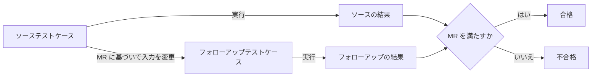

# lesson17: メタモルフィックテスト — 入力の変化と結果の関係で故障を見つける

## このレッスンで学ぶこと

- ソーステストケース・フォローアップテストケース・メタモルフィック関係の 3 つの関係と、合否の判定方法を説明できるようになる
- ある機能について、正しいメタモルフィック関係と反例のある誤った関係を見分けられるようになる
- ソーステストケースとフォローアップテストケースの結果から、メタモルフィック関係に違反する故障を判定できるようになる
- テストオラクル問題への適用と、ランダムテストとの組み合わせを説明できるようになる
- カバレッジ尺度がないことと、非機能テストや AI ベースシステムへの適用範囲を説明できるようになる

## メタモルフィックテストの仕組み

期待結果を 1 つずつ用意する代わりに、「入力をこう変えたら結果はこう変わるはずだ」という性質を使ってテストする技法が**メタモルフィックテスト**（MT）です。ルールに基づくテスト技法の 1 つで（分類は [lesson16](/lessons/lesson16/)）、既存のテストケースをもとに新しいテストケースを生成することを目的にしています。

登場するものは 3 つです。

| 用語 | 役割 |
|------|------|
| **ソーステストケース** | 出発点になる既存のテストケース |
| **メタモルフィック関係**（MR） | テストアイテムの特性を定義し、テストケースの入力の変更が期待結果にどう反映されるかを記述したもの |
| **フォローアップテストケース** | MR に基づいてソーステストケースを変更（メタモルフィック化）して生成したテストケース。1 つの MR から 1 つ以上生成する |

### 合否の判定

テストアナリストは、ある MR のソーステストケースとフォローアップテストケースを 1 つのテストプロシジャーに結合し、結果を合同で評価します。

- 2 つの結果が MR を満たしていれば合格
- 満たしていなければ不合格

不合格になったときに分かるのは「どちらかがおかしい」ことまでです。関係する個々のテストケースのどれが不合格なのかは、その後のデバッグで判断します。

### 商品の合計金額を求める関数での例

カートに入れた商品の価格から合計金額を求める関数を考えます。ソーステストケースは「1,200 円、800 円、500 円の 3 点で合計 2,500 円」で、実行して合格を確認済みとします。

| MR | フォローアップテストケース | 期待結果 |
|------|------|------|
| 商品の順序を入れ替えても合計は変わらない | 800 円、500 円、1,200 円 | 2,500 円 |
| 商品を 1 点追加すると、合計はその価格の分だけ増える | 3 点に 300 円を追加 | 2,800 円 |

1 つ目の MR からは、並べ方を変えるだけでいくつものフォローアップテストケースを作れます。2 つ目の MR なら、追加する価格を変えるだけで好きな数だけ作れます。テスト設計とテスト実行を自動化しているときに特に役立ちます。

2 つ以上の MR を組み合わせることもできます。たとえば「順序を入れ替えて、さらに 300 円を追加する」フォローアップテストケースの期待結果は 2,800 円です。

## 例題 1 の題材

会議室の検索機能を題材に、メタモルフィック関係として正しいものを見分けます。

::: info 会議室の検索機能
入力は、日時 T、参加人数 N、必要な設備 E（プロジェクター、ホワイトボードなどの集合）です。出力は、日時 T に空いていて、N 人が収容でき、E の設備をすべて備えた会議室のリスト L です。

ソーステストケースの入力を T1、N1、E1、出力を L1 とし、フォローアップテストケースの入力を T2、N2、E2、出力を L2 とします。
:::

次の 5 つの候補のうち、メタモルフィック関係として正しいものはどれでしょうか。

| 候補 | 内容 |
|------|------|
| (a) | T と E が同じで、N2 が N1 より大きければ、L2 は L1 に含まれる |
| (b) | T と N が同じで、E2 が E1 の一部（求める設備が減る）なら、L1 は L2 に含まれる |
| (c) | N と E が同じで、T1 と T2 が異なれば、L1 と L2 に共通の会議室はない |
| (d) | T と E が同じで、N2 が N1 の 2 倍なら、L2 の件数は L1 の件数の半分になる |
| (e) | N と E が同じで、T2 が T1 の 1 週間後なら、L2 は L1 と同じになる |

## 例題 1 の手順

MR は、テストアイテムの特性を定義するものです。前提条件を満たすすべての入力で成り立たなければならず、成り立たない例（反例）が 1 つでも作れれば MR として使えません。候補ごとに「必ず成り立つ理由」か「反例」を探します。

| 候補 | 判定 | 理由 |
|------|------|------|
| (a) | 正しい | N2 人を収容できる会議室は N1 人も収容できる。T と E が同じなら空き状況と設備の条件は変わらないので、L2 の会議室はすべて L1 にも入る |
| (b) | 正しい | E1 の設備をすべて備える会議室は、その一部である E2 もすべて備える。T と N が同じなので、L1 の会議室はすべて L2 にも入る |
| (c) | 誤り | 反例: ある会議室が T1 にも T2 にも空いていれば、両方のリストに入る |
| (d) | 誤り | 反例: すべての会議室が 10 人用なら、N1 が 2 人でも N2 が 4 人でもリストは同じで、件数は半分にならない |
| (e) | 誤り | 反例: 1 週間後に別の予約が入っていれば、L2 は L1 より少なくなる |

(a) と (b) が正しい MR です。

::: tip 前提条件まで含めて 1 つの関係
(a) は「T と E が同じ」という前提があって初めて成り立ちます。参加人数を増やすと同時に日時も変えてしまうと、L2 が L1 に含まれる保証はなくなります。MR を書くときも読むときも、どの入力を固定し、どの入力をどう変えるかをセットで確認します。
:::

## 例題 2 の題材

タクシーの運賃を見積もる機能を題材に、メタモルフィック関係に違反するフォローアップテストケースを見つけます。

::: info タクシーの運賃見積り機能
入力は走行距離 d（km）と時間帯（昼間または深夜）で、出力は運賃（円）です。期待結果は料金表から求められます。次の 3 つの MR を使います。

- MR1: 時間帯が同じなら、距離が長くなっても運賃は下がらない
- MR2: 距離が同じなら、深夜の運賃は昼間の運賃以上である
- MR3: 時間帯が同じなら、距離 d1 足す d2 の運賃は、距離 d1 の運賃と距離 d2 の運賃の合計を超えない

ソーステストケースは 2 つで、どちらも合格しています。

| テストケース | 入力 | 実行結果 |
|------|------|------|
| TC1 | 3 km、昼間 | 1,400 円 |
| TC2 | 5 km、昼間 | 2,000 円 |
:::

次のフォローアップテストケースのうち、MR のいずれかに違反して故障を示すものはどれでしょうか。

| テストケース | 入力 | 実行結果 |
|------|------|------|
| F1 | 4 km、昼間 | 1,700 円 |
| F2 | 5 km、深夜 | 2,400 円 |
| F3 | 8 km、昼間 | 3,500 円 |
| F4 | 8 km、深夜 | 3,900 円 |

## 例題 2 の手順

フォローアップテストケースごとに、ソーステストケースと組にして各 MR を当てはめます。先に確認するのは、その組が MR の前提条件を満たしているかです。前提条件を満たさない組では、MR が成り立たなくても違反とは判定できません。

### F1 の評価

| MR | 組にする相手 | 前提条件 | 評価 |
|------|------|------|------|
| MR1 | TC1 | 昼間どうしで 4 km は 3 km より長い | 1,700 円は 1,400 円以上なので満たす |
| MR1 | TC2 | 昼間どうしで 5 km は 4 km より長い | 2,000 円は 1,700 円以上なので満たす |
| MR2 | なし | 4 km の深夜の結果がない | 評価できない |
| MR3 | なし | 4 km を 2 つの距離の和として作れるソースがない | 評価できない |

F1 に違反はありません。

### F2 の評価

| MR | 組にする相手 | 前提条件 | 評価 |
|------|------|------|------|
| MR1 | TC1、TC2 | 時間帯が違う | 前提を満たさず評価できない |
| MR2 | TC2 | 5 km どうしで昼間と深夜 | 2,400 円は 2,000 円以上なので満たす |
| MR3 | なし | 時間帯が違う | 評価できない |

F2 に違反はありません。

### F3 の評価

| MR | 組にする相手 | 前提条件 | 評価 |
|------|------|------|------|
| MR1 | TC2 | 昼間どうしで 8 km は 5 km より長い | 3,500 円は 2,000 円以上なので満たす |
| MR3 | TC1 と TC2 | 昼間どうしで 8 km は 3 km 足す 5 km | 1,400 円足す 2,000 円は 3,400 円で、3,500 円はこれを超えるので**違反** |

F3 は MR3 に違反しています。このテストプロシジャーは不合格で、故障を示しています。

### F4 の評価

| MR | 組にする相手 | 前提条件 | 評価 |
|------|------|------|------|
| MR1 | TC1、TC2 | 時間帯が違う | 評価できない |
| MR2 | なし | 8 km の昼間の結果がソースにない | 評価できない |
| MR3 | TC1 と TC2 | 時間帯が違う | 前提を満たさず評価できない |

F4 の 3,900 円は、F3 の 3,500 円と比べると高く見えます。しかし、ソーステストケースとの組ではどの MR の前提条件も満たさないため、違反とは判定できません。

答えは F3 です。不合格の原因が TC1、TC2、F3 のどれにあるかは、この時点では分かりません。デバッグで切り分けます。

::: warning 違反と「値がおかしそう」は別
F4 のように、結果が直感に合わなくても、MR の前提条件を満たす組がなければ MT では故障と判定できません。逆に F3 のように、1 つ 1 つの値はもっともらしくても、MR に照らすと違反が見つかります。判定の根拠は常に MR です。
:::

## テストオラクル問題への適用

MT は、テストオラクル問題（[lesson05](/lessons/lesson05/)）がある状況でも使えます。期待結果を決めるコスト効率のよいテストオラクルがないため、ソーステストケースもフォローアップテストケースも個別には評価できない状況です。それでも MR があれば、2 つの結果の関係だけで合否を判定できます。

たとえば、大量のデータから中古車の査定額を予測する AI ベースのシステムを考えます。ある車の正しい査定額を事前に決めることはできません。しかし「他の条件が同じで走行距離が増えれば、予測される査定額は上がらないはずだ」という MR なら、2 回の予測結果を比べるだけで検証できます。

テストベースからテストオラクルを導くことが難しいとき、MT は経験ベースのテストと並んで候補になる技法です（技法の選択は [lesson21](/lessons/lesson21/)）。

## カバレッジ尺度とランダムテストとの組み合わせ

現在のところ、終了基準として有用な MT のカバレッジ尺度は認められていません。各 MR を 1 回ずつカバーするだけでは、期待結果を部分的に検証したにすぎず、不十分です。

そこでテストアナリストは、MT をランダムテスト（[lesson12](/lessons/lesson12/)）と組み合わせて、同じ MR に対して多くのローレベルのソーステストケースとフォローアップテストケースを生成します。合計金額の例なら、乱数発生器でソーステストケースの価格の組を生成し、フォローアップテストケース用のランダムな並べ替えや追加する価格も生成できます。

## 適用範囲

MT はほとんどのテストアイテムに使え、機能テストにも非機能テストにも適用できます。

| 適用先 | 例 |
|------|------|
| 機能テスト | 検索、計算、予測など、入力と結果の関係を性質として記述できる機能 |
| 負荷テスト | MR を使って生成したフォローアップテストケースで負荷を生成する |
| インストール性テスト | 複数の順序で選べるインストールパラメーターを、順序を変えて試す |
| AI ベースシステム | 期待結果を決めにくいため、推奨されるテスト技法とされている |

## 試験のポイント

- K3 で問われるのは正しい MR の見分けと違反の判定で、MR は前提条件を満たすすべての入力で成り立つ性質なので反例が 1 つでもあれば誤りであり、前提条件を満たさない組では違反と判定できない
- 合否はソーステストケースとフォローアップテストケースの結果を合同で評価して決め、不合格のときにどの個々のテストケースが不合格かはデバッグで判断する
- 期待結果が得られないテストオラクル問題の状況でも、2 つの結果の関係だけで判定できるので適用できる（AI ベースシステムで推奨される）
- 終了基準になるカバレッジ尺度はなく、各 MR を 1 回カバーするだけでは不十分なので、ランダムテストと組み合わせて多数のテストケースを生成する
