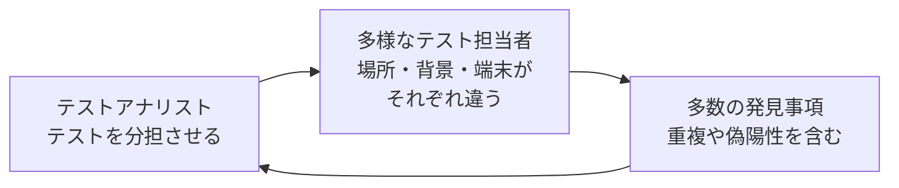

# lesson20: クラウドテスト — 多様なテスト担当者に分担する利点と制限

## このレッスンで学ぶこと

- クラウドテストが何を誰に分担するアプローチかを説明できるようになる
- クラウドテストの 6 つの利点を、例を挙げて説明できるようになる
- クラウドテストの 4 つの制限を、例を挙げて説明できるようになる
- 変動性が利点にも制限にもなる理由を説明できるようになる
- クラウドテストがテストアナリストの技法の適用に置き換わらない理由を説明できるようになる

## クラウドテストの仕組み

**クラウドテスト**は、多様な場所にいて多様な背景を持つ、内部または外部のテスト担当者のグループにテストを分担するテストアプローチです。「クラウド」は群衆（crowd）のことで、クラウドコンピューティングの cloud とは別の言葉です。

クラウドテストは、使用性の妥当性確認をコスト効率よく行う方法になりえます。カバーできるのは使用性だけではなく、機能的品質特性と非機能的品質特性の両方です（Alyahya、2020。Leicht ら、2017）。経験ベースのテストの位置づけは [lesson18](/lessons/lesson18/) で扱っています。

## 利点

シラバスが挙げる利点は 6 つです。

| 利点 | 内容 |
|------|------|
| 多様なテスト環境 | テスト担当者はさまざまな地理的な場所にいて、さまざまなデバイス・ブラウザー・ネットワーク条件で、さまざまな環境設定を使える |
| 高い柔軟性 | 短時間に多数のテストを実施する必要があっても、容易にスケールできる |
| 費用対効果 | 大規模で多様な社内テストチームを維持したり、外部のテストサービスで補ったりするより、通常は低コストである |
| 迅速なフィードバック | テスト担当者が素早くフィードバックを返せるので、故障の早期発見と修正に役立つ |
| 実際のユーザー視点 | テスト担当者がアプリケーションの実際のユーザーであることもあり、ユーザーエクスペリエンスと使用性についてよりよい洞察が得られる。ユーザー受け入れテストで特に価値がある |
| 変動性 | 毎回さまざまなテスト担当者がテストを実行するため再現性は低くなるが、カバレッジが広くなり、欠陥の発見が増える |

### 変動性の二面性

変動性は、利点の表に載っていながら「制限とも言える」と注記されている項目です。

| 見方 | 内容 |
|------|------|
| 制限として | 同じテストを同じように再実行できないので、再現性が低い |
| 利点として | 担当者ごとにやり方が違うぶんカバレッジが広がり、欠陥を発見する機会が増える |

「クラウドテストは再現性が高い」という選択肢はひっかけです。再現性の低さを受け入れて、広いカバレッジを取りにいくアプローチです。

## 制限

シラバスが挙げる制限は 4 つです。

| 制限 | 内容 |
|------|------|
| テスト品質の不安定性 | テストの品質が個々のテスト担当者のスキルで大きく変わる。ただし、ユーザーエクスペリエンスに関するフィードバックが目的なら、これは問題にならない場合がある |
| コミュニケーションの課題 | タイムゾーン・文化の違い・言葉の壁があり、さまざまな場所にいる多数のテスト担当者との調整が難しい |
| セキュリティ | ソフトウェアを外部のテスト担当者と共有すると、データセキュリティと機密性のリスクが生じる。適切な対策で軽減すれば、機密情報を開示したり盗用を助長したりせずに責任ある形で利用できる |
| 文書化と報告 | 大規模で多様なテスト担当者を相手にすると、重複や偽陽性を含む多数の発見事項をマネジメントしながら網羅的なテスト文書を確保するのが難しい |

::: tip 制限が目的によっては問題にならない
テスト品質の不安定性は、「スキルの高いテスト担当者でなければ見つからない欠陥」を狙うときには重い制限です。一方、実際のユーザーがどう感じるかを知りたいときには、スキルのばらつきはそもそも問題になりません。制限を暗記するだけでなく、テストの目的と結び付けて考えます。
:::

## 向く場面と向かない場面

利点と制限を合わせると、クラウドテストが力を発揮する場面が見えてきます。

| 場面 | 判断 | 理由 |
|------|------|------|
| 多様なデバイスやネットワーク条件で動くかを広く確かめたい | 向く | 多様なテスト環境を社内でそろえるより低コスト |
| ユーザー受け入れテストやベータテストで、実際のユーザーの反応を知りたい | 向く | 実際のユーザー視点と迅速なフィードバック |
| 同じテストスクリプトを毎回同じように再実行したい | 向かない | 変動性があり、再現性は低い |
| テスト技法を体系的に適用してカバレッジを保証したい | 向かない | それは TA の仕事で、クラウドテストは置き換えにならない |
| 公開前の機密情報を含むソフトウェアを外部に出せない | 向かない | セキュリティと機密性のリスク |

多様な構成の組み合わせを体系的に減らしたいなら組み合わせテスト（[lesson11](/lessons/lesson11/)）、使用性を評価する手法そのものは第4章の使用性テスト（[lesson24](/lessons/lesson24/)）で扱います。

::: warning テスト技法の適用に置き換わるものではない
クラウドテストは、TA がテスト技法を適用する活動に置き換わるものではありません。多様なテスト環境におけるカバレッジを高めるアプローチです。技法の選択の中でどう位置づけるかは [lesson21](/lessons/lesson21/) で扱います。
:::

## 試験のポイント

- 利点 6 つ（多様なテスト環境・高い柔軟性・費用対効果・迅速なフィードバック・実際のユーザー視点・変動性）と制限 4 つ（テスト品質の不安定性・コミュニケーションの課題・セキュリティ・文書化と報告）を例とともに想起できるようにする（K2）
- 変動性は再現性を下げる制限でありながら、カバレッジを広げて欠陥の発見を増やす利点でもある
- テスト品質の不安定性は、ユーザーエクスペリエンスのフィードバックが目的なら問題にならない場合があり、セキュリティのリスクは適切な対策で軽減できる
- クラウドテストは TA がテスト技法を適用する活動の置き換えではなく、多様なテスト環境のカバレッジを高めるアプローチである
