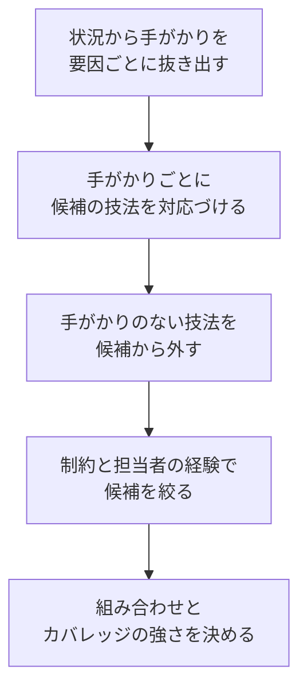

# lesson21: テスト技法の選択 — 状況の手がかりからプロダクトリスクを軽減する技法を選ぶ

## このレッスンで学ぶこと

- 最適なテスト技法の選択でテストアナリストが担う役割と、自動化との関係を説明できるようになる
- テスト技法の選択に影響する要因を漏れなく挙げられるようになる
- データ・振る舞い・ルールの各技法が検出しやすい欠陥のタイプを対応づけられるようになる
- 状況の説明から手がかりを抜き出し、適切な技法を選んで、選ばない技法の理由も説明できるようになる
- 技法を組み合わせて欠陥検出の効率と有効性を高める例を挙げられるようになる

## 最適なテスト技法の適用

テストは、特定のコンテキストにおいて、できる限り効果的かつ効率的でなければなりません。そのために、テストアナリスト（TA）は最も適切なテスト技法を選ぶ中でテストマネージャー（TM）を支援します。選ぶのは TA 単独ではなく、TM の意思決定を TA の分析で支える関係です。

TA はさらに、テスト活動を支援するために自動化を活用できます。

| 自動化の対象 | 扱う場所 |
|------|------|
| テスト設計の自動化 | [lesson22](/lessons/lesson22/) |
| テスト実行自動化の支援（キーワード駆動テスト） | [lesson06](/lessons/lesson06/) |

このレッスンは、3.5 節の前半にあたるテスト技法の選択を扱います。

## 選択に影響する要因

最適なテスト技法の選択は、効果的かつ効率的なプロダクトリスク軽減にとって極めて重要で、多くの要因に影響されます。

| 要因 | 技法の選択への影響 |
|------|------|
| テスト目的 | テスト対象のどの側面を評価するかを指定する。システムのタイプに依存する（エンジニアリングの数値計算にはドメインに基づくテスト、与信リスクマネジメントにはデシジョンテーブルテスト、など） |
| プロダクトリスク | 潜在的な欠陥と関連しており、ほとんどの技法は特定のタイプの欠陥の検出に焦点を当てている |
| リスク分析 | カバレッジに基づく終了基準の厳密さと、経験ベースのテストを使えるかどうかを決める |
| テストベース | 仕様がモデルを使っていれば、そのモデルに基づく技法を使える。テストオラクルを導出できないなら、メタモルフィックテストや経験ベースのテスト技法を使える |
| 繰り返し発生する欠陥タイプの知識 | その欠陥の検出に焦点を当てた技法（チェックリストベースドテストなど）を選ぶ根拠になる。以前と同様の欠陥を期待するなら、過去に成功した技法を使うのが合理的である |
| テスト担当者の知識と経験 | 精通していない技法を重要なテスト課題で使うことは推奨されない。ドメイン知識がほとんどなければ、探索的テストのような技法は効果がない場合がある |
| ソフトウェア開発ライフサイクル | シーケンシャル開発モデルはより形式的な技法に適している。イテレーティブ開発モデルは、軽量な技法（経験ベースなど）や、テスト設計を自動化できる場合に適している |
| 顧客および契約要件 | 契約が特定のテスト（テストレベルやテストタイプ）を明示的に要求することがある。顧客がシナリオ一式で受け入れ基準を提供していれば、シナリオベースドテストが示唆される |
| 規制要件 | 標準に従うプロジェクトでは特定の技法が要件になる。ISO 26262 は ASIL（自動車用の安全度水準）に応じて同値分割法・境界値分析・エラー推測などの技法を要求する |
| プロジェクトの制約 | 時間や予算の制約が、時間のかかる技法や高価なリソースを必要とする技法の適用に影響する |

### 技法と検出しやすい欠陥のタイプ

プロダクトリスクは潜在的な欠陥と結び付いています。ほとんどの技法は特定のタイプの欠陥の検出に焦点を当てているので、リスクが示す欠陥のタイプから技法のカテゴリーを絞れます。

| 技法のカテゴリー | 検出しやすい欠陥 |
|------|------|
| データに基づくテスト技法 | データ処理、入力ドメインの実装、ユーザーインターフェース、計算、パラメーターの組み合わせの欠陥 |
| 振る舞いに基づくテスト技法 | 機能の欠落、コミュニケーション上の欠陥、処理の欠陥といったユーザー要件の欠陥 |
| ルールに基づくテスト技法 | ロジックやコントロールフローの欠陥 |

### リスク分析が決めるテストアプローチ

リスク分析は、技法だけでなく、どこまでカバーするかにも影響します。

| 観点 | 内容 |
|------|------|
| カバレッジに基づく終了基準 | リスクレベルが高いほど、より厳密なカバレッジが必要になる場合がある（ペアワイズカバレッジではなく、組み合わせカバレッジの全組み合わせ、など）。ただし TA は、カバレッジの強さと必要なテスト工数のトレードオフを常に考慮する |
| 経験ベースのテストを使える場面 | リスクレベルが低い場合、カバレッジの定義が難しい場合、プロジェクトスケジュールがタイトな場合 |

## 手がかりと技法の対応

状況の説明文には、どの技法が合うかを示す手がかりが埋め込まれています。第3章の各技法について、手がかりとなる言葉を整理します。

| 状況にある手がかり | 候補になる技法 |
|------|------|
| 数値の範囲や境界、複数の変数が絡む条件、計算の正しさ | ドメインテスト（[lesson10](/lessons/lesson10/)） |
| 構成やパラメーターの組み合わせで動かないリスク、相互作用の故障 | 組み合わせテスト（[lesson11](/lessons/lesson11/)） |
| ドメイン知識が限られている、大量のテストデータが必要、自動化したテストオラクルがある | ランダムテスト（[lesson12](/lessons/lesson12/)） |
| データエンティティのライフサイクル、データの整合性、作成・読み込み・更新・削除 | CRUD テスト（[lesson13](/lessons/lesson13/)） |
| 状態によって受け付ける操作や振る舞いが変わる、状態遷移モデルがある | 状態遷移テスト（[lesson14](/lessons/lesson14/)） |
| ユースケースやアクティビティ図がある、顧客がシナリオを提供している、ビジネスプロセスの流れ | シナリオベースドテスト（[lesson15](/lessons/lesson15/)） |
| ビジネスルール、条件の組み合わせで結果が決まる、ルール表がある | デシジョンテーブルテスト（[lesson16](/lessons/lesson16/)） |
| 期待結果を決められない、テストオラクル問題、AI ベースシステム | メタモルフィックテスト（[lesson17](/lessons/lesson17/)） |
| カバレッジの定義が難しい、リスクレベルが低い、スケジュールがタイト、担当者の経験とドメイン知識が豊富 | 経験ベースのテスト（[lesson18](/lessons/lesson18/)、[lesson19](/lessons/lesson19/)） |
| 繰り返し発生する欠陥タイプを知っている | チェックリストベースドテスト（[lesson19](/lessons/lesson19/)） |
| 多様な端末やネットワーク条件でのカバレッジ、実際のユーザーの視点 | クラウドテスト（[lesson20](/lessons/lesson20/)） |

手がかりの言葉は、この教材が各技法のレッスンから整理したものです。試験では、状況にその手がかりが「ある」ことを根拠に選び、「ない」技法は選びません。

## 技法の組み合わせ

欠陥検出の効率性と有効性を高めるために、技法はよく組み合わせて使います。シラバスが挙げる例は 4 つです。

| 組み合わせ | 内容 |
|------|------|
| 境界値分析と状態遷移テスト | 状態遷移テストのガード条件に境界値分析を使う |
| ドメインテストとシナリオベースドテスト | シナリオベースドテストで、デシジョンテーブルの条件やテスト対象システムの変数の値をドメインテストで決める |
| シナリオベースドテストとデシジョンカバレッジ | ホワイトボックステスト技法のデシジョンカバレッジ（TTA の範囲）と組み合わせて、ビジネスプロセスの判定を厳密にカバーする。Koomen ら（2006）のプロセスサイクルテストが例 |
| シナリオベースドテストとラウンドトリップカバレッジ | 周期的なビジネスプロセス活動に特有のリスクに対応する |

## 分析の手順

K4 の出題では、状況の説明文から技法を選び、その理由を説明できることが問われます。次の手順で分析します。

1. 状況から、選択に影響する要因ごとに手がかりを抜き出す
2. 手がかりごとに、候補になる技法を対応づける
3. 状況に手がかりがない技法は、候補から外す。「使えそう」ではなく「状況に根拠がある」技法だけを残す
4. 制約（時間、予算、規制）と担当者の知識と経験で候補を絞る
5. 残った技法の組み合わせと、リスクレベルに応じたカバレッジの強さを決める

手順 3 が最も重要です。状態遷移テストやデシジョンテーブルテストのような強力な技法でも、状況に状態やルールの手がかりがなければ選びません。

## 例題 1 の題材

自動車保険の見積りサービスを題材に、形式的な技法が求められる状況を分析します。

::: info 自動車保険の見積りサービス
損害保険会社が、Web で自動車保険の見積り額を提示するサービスを開発しています。

- 見積り額は、契約者の年齢・免許取得からの年数・車種区分・補償の組み合わせで決まる。仕様書には、条件の組み合わせと適用する料率を整理したルール表がある
- 入力フォームでは、年齢は 18 歳以上 99 歳以下、免許取得からの年数は 0 年以上 80 年以下といった範囲を受け付け、範囲外はエラーにする
- 開発はシーケンシャル開発モデルで進み、金融分野の社内標準により、テスト技法の適用とカバレッジを文書で示すことが求められている
- リスク分析では「見積り額の計算誤り」がリスクレベル最高、「入力値の範囲チェック誤り」が高と評価された
- テスト担当者はデシジョンテーブルテストとドメインテストの経験が豊富である
:::

## 例題 1 の手順

### 手順 1 手がかりを抜き出す

| 要因 | 状況にある手がかり |
|------|------|
| テスト目的・プロダクトリスク | 計算誤り（リスクレベル最高）と範囲チェック誤り（高）。ルール表で決まる計算と、数値の範囲 |
| テストベース | 条件の組み合わせと料率を整理したルール表がある。数値の範囲が明記されている |
| SDLC | シーケンシャル開発モデル |
| 規制要件 | 社内標準で、技法の適用とカバレッジの文書化が求められる |
| テスト担当者 | デシジョンテーブルテストとドメインテストの経験が豊富 |

### 手順 2 と 3 候補を対応づけて絞る

| 技法 | 判定 | 理由 |
|------|------|------|
| デシジョンテーブルテスト | 選ぶ | ルール表という条件の組み合わせの手がかりがあり、ロジックの欠陥（計算誤り）を検出しやすい |
| ドメインテスト | 選ぶ | 数値の範囲の手がかりがあり、入力ドメインの実装と計算の欠陥を検出しやすい |
| 状態遷移テスト | 選ばない | 見積りが状態によって振る舞いを変える、という手がかりがない |
| シナリオベースドテスト | 選ばない | ユースケースやシナリオが提供されている、という手がかりがない |
| メタモルフィックテスト | 選ばない | 料率表から期待結果を求められるので、テストオラクル問題がない |
| 探索的テスト | 選ばない | 形式的な技法とカバレッジの文書化が求められる状況で、リスクレベルも最高 |

### 手順 4 と 5 制約と経験で確かめて強さを決める

シーケンシャル開発モデルと文書化の要求は、形式的な技法に適しています。担当者の経験も 2 つの技法と合っています。

リスクレベルが最高の計算誤りには、厳密なカバレッジを求めます。デシジョンテーブルテストでは最小化を控えて完全なデシジョンテーブルの実行可能な列をカバーし（[lesson16](/lessons/lesson16/)）、ドメインテストでは信頼性の高いドメインカバレッジを使います（[lesson10](/lessons/lesson10/)）。さらに、ルール表の条件の値をドメインテストで決める、という組み合わせも使えます。

::: tip 「選ばない理由」を言えるようにする
K4 の問題では、状況に合わない技法が選択肢に並びます。「状態の手がかりがない」「テストオラクルがある」のように、状況の中の根拠の有無で退けられるようにしておきます。
:::

## 例題 2 の題材

スマートホームアプリを題材に、イテレーティブ開発で状態と構成の手がかりがある状況を分析します。

::: info スマートホームアプリの機器制御
家庭の照明や空調をスマートフォンから操作するアプリを、2 週間のイテレーションで開発しています。今回のイテレーションのテスト対象は、機器の接続と操作の機能です。

- 機器には「未接続」「接続中」「省電力」「操作可能」といった状態があり、状態によって受け付ける操作とアプリの表示が変わる。仕様書には状態遷移図がある
- 対応するスマートフォンの OS とバージョン、アプリのバージョン、機器のファームウェアの版の組み合わせは多く、リスク分析では「特定の組み合わせで機器を操作できない」がリスクレベル高と評価された
- 機器の一覧画面の見た目に関するリスクは低と評価された
- テスト担当者はこのアプリの前のイテレーションからテストしており、ドメイン知識と探索的テストの経験が豊富である
- 顧客から提供されたシナリオや受け入れ基準はない
:::

## 例題 2 の手順

### 手順 1 手がかりを抜き出す

| 要因 | 状況にある手がかり |
|------|------|
| プロダクトリスク | 組み合わせで操作できない（高）。一覧画面の見た目（低） |
| テストベース | 状態遷移図がある。シナリオや受け入れ基準はない |
| SDLC | 2 週間のイテレーティブ開発 |
| テスト担当者 | ドメイン知識と探索的テストの経験が豊富 |
| 顧客および契約要件 | 顧客提供のシナリオはない |

### 手順 2 と 3 候補を対応づけて絞る

| 技法 | 判定 | 理由 |
|------|------|------|
| 状態遷移テスト | 選ぶ | 状態によって振る舞いが変わる手がかりと、状態遷移図というモデルがある |
| 組み合わせテスト | 選ぶ | OS・アプリ・ファームウェアの組み合わせで動かないリスクがある |
| 探索的テスト | 選ぶ | リスクレベルの低い一覧画面に対して、ドメイン知識と経験が豊富な担当者が短いイテレーションで使える |
| シナリオベースドテスト | 選ばない | シナリオや受け入れ基準が提供されていない |
| デシジョンテーブルテスト | 選ばない | 条件の組み合わせで結果が決まるルールの手がかりがない |
| CRUD テスト | 選ばない | データエンティティのライフサイクルを確かめる必要を示す手がかりがない |

### 手順 4 と 5 制約と経験で確かめて強さを決める

イテレーティブ開発モデルは軽量な技法に適しているので、リスクの低い部分に探索的テストを使う判断は SDLC とも整合します。担当者の経験も探索的テストに合っています。

カバレッジの強さはリスクレベルで分けます。

| 対象 | リスクレベル | カバレッジの判断 |
|------|------|------|
| 機器の操作の組み合わせ | 高 | ペアワイズカバレッジを基本にし、工数とのトレードオフを見て全組み合わせまで上げるかを決める（[lesson11](/lessons/lesson11/)） |
| 状態遷移 | 高 | 状態遷移図から、ラウンドトリップカバレッジや N スイッチカバレッジのような厳密なカバレッジ基準を選ぶ（[lesson14](/lessons/lesson14/)） |
| 一覧画面の見た目 | 低 | 探索的テストで、カバレッジ基準を定義せずにセッションベースドテストで確かめる（[lesson18](/lessons/lesson18/)） |

## 例題 3 の題材

業務システムの移行を題材に、ドメイン知識が乏しい状況を分析します。

::: info 契約管理システムの移行
通信会社の契約管理システムを新しい基盤に移行します。システムは、顧客・契約・請求の各データを登録・参照・変更・解約する機能で構成されています。

- テストチームは今回のプロジェクトで初めてこの業務に関わり、ドメイン知識はほとんどない
- 顧客からは、受け入れ基準として業務の流れを記述したシナリオ一式と、ユースケース仕様書が提供されている
- 過去の移行プロジェクトでは、解約した契約のデータが請求に残る、というデータの不整合の欠陥が繰り返し発生した
- 期待結果は現行システムの出力と仕様書から決められる
:::

## 例題 3 の手順

| 技法 | 判定 | 理由 |
|------|------|------|
| シナリオベースドテスト | 選ぶ | 顧客提供のシナリオと受け入れ基準、ユースケース仕様書があるという契約要件とテストベースの手がかりがある |
| CRUD テスト | 選ぶ | 顧客・契約・請求という複数のデータエンティティのライフサイクルがあり、解約後のデータの不整合という繰り返し発生する欠陥タイプと一致する |
| 探索的テスト | 選ばない | ドメイン知識がほとんどない状況では効果がない場合がある |
| メタモルフィックテスト | 選ばない | 現行システムと仕様書から期待結果を決められるので、テストオラクル問題がない |
| ランダムテスト | 選ばない | ドメイン知識が限られているという手がかりはあるが、大量のテストデータや自動化したテストオラクルの必要を示す手がかりがない |

ドメイン知識が乏しいという手がかりは、探索的テストを退ける根拠になります。同じ手がかりがランダムテストを選ぶ根拠にもなりえますが、この状況には顧客提供のシナリオという明確なテストベースがあるので、シナリオベースドテストを優先します。繰り返し発生した欠陥タイプには、その検出に焦点を当てた CRUD テストで対応します。

## 試験のポイント

- K4（3 点）で問われるのは、状況の説明文にある手がかり（テストオラクルの有無、構成の組み合わせ、状態、ルール、シナリオの提供、担当者の経験、SDLC、規制）から技法を選び、手がかりのない技法を退けること
- 技法のカテゴリーと欠陥タイプの対応（データに基づく技法は入力ドメイン・計算・パラメーターの組み合わせ、振る舞いに基づく技法はユーザー要件の欠陥、ルールに基づく技法はロジックとコントロールフロー）
- 経験ベースのテストはリスクレベルが低い・カバレッジの定義が難しい・スケジュールがタイトな場合に使えるが、ドメイン知識がほとんどなければ探索的テストは効果がない場合があり、精通していない技法を重要な課題で使うことは推奨されない
- リスクレベルが高いほど厳密なカバレッジ（ペアワイズではなく全組み合わせなど）が求められる一方、カバレッジの強さとテスト工数のトレードオフを常に考慮する
