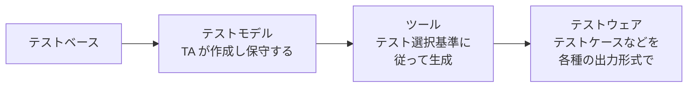

# lesson22: テスト設計の自動化 — テストモデルからテストウェアを生成する利点とリスク

## このレッスンで学ぶこと

- テスト設計の自動化で、テストアナリストが作るものとツールが生成するものを区別できるようになる
- テスト設計の自動化とテスト実行の自動化の違いを説明できるようになる
- テスト設計の自動化の 9 つの利点を、理由とともに説明できるようになる
- テスト設計の自動化の 4 つのリスクを説明できるようになる
- 自動化によって適用しやすくなる技法とカバレッジ基準を挙げられるようになる

## テスト設計の自動化の仕組み

テストアナリスト（TA）は、テスト技法、特にブラックボックステスト技法を適用するためにツールを使うことがあります。**テスト設計の自動化**では、TA が**テストモデル**を作り、そのモデルからツールがテストウェアを自動生成します。テストモデルは、テスト対象をテストするために使うテストウェアを規定するモデルです。

シラバスが挙げる例は、TA が状態遷移モデルを設計し、モデルベースドテストツールにラウンドトリップカバレッジのテストケースを生成させる、というものです。**モデルベースドテスト**（MBT）は、モデルに基づく、またはモデルを活用するテストです。状態遷移テストのカバレッジ基準は [lesson14](/lessons/lesson14/)、テストオラクルとしてのモデルの使い方は [lesson05](/lessons/lesson05/) で扱っています。

### 実行の自動化との違い

自動化という言葉は、テストプロセスのどの活動を自動化するかで意味が変わります。

| 自動化の対象 | 自動化するもの | 人が作るもの | 扱う場所 |
|------|------|------|------|
| テスト設計の自動化 | テストモデルからテストウェアを導出する作業 | テストモデル | このレッスン |
| テスト実行の自動化 | テストスクリプトを実行して結果を比較する作業 | テストスクリプト（キーワードなど） | [lesson06](/lessons/lesson06/) |

「繰り返し実行できる自動テストスクリプト」や「故障の自動検知」は実行の自動化の話で、テスト設計の自動化の利点ではありません。試験では、この 2 つを混ぜた選択肢が出ることがあります。

## 利点

テスト設計を自動化すると、テストの効率性と有効性が向上することが多くあります。シラバスが挙げる利点は 9 つです。

| 利点 | 内容 |
|------|------|
| 欠陥予防 | テストのためのモデリングは、テストベースの品質を評価する効果的な方法である（[lesson27](/lessons/lesson27/)） |
| 対応能力の拡張 | 組み合わせテスト、ランダムテスト、N スイッチカバレッジのような、より複雑な技法やカバレッジ基準を適用できるようになり、テストされていないコードのリスクが減る |
| わかりやすさの向上 | ツールで指定したテスト選択基準はテスト条件をより明確に目に見える形で参照し、生成されたカバレッジの充足度合いをよりわかりやすく示す |
| 繰り返し作業の削減 | テストモデルからテストウェアを生成できるので、テストの具体化のような手作業の繰り返しが減る |
| メンテナンス工数の削減 | テストモデルがテストウェアを導出する信頼できる唯一の情報源になるので、保守するのはテストモデルだけでよい |
| テストウェアの欠陥削減 | 手作業はエラーを起こしやすい。ツールが生成したテストウェアは品質と一貫性が高い |
| チームコラボレーションの強化 | ステークホルダーがテストモデルをレビューして、欠陥を見つけたりテスト条件の理解を深めたりできる |
| トレーサビリティの強化 | テストモデルの要素をテスト条件にリンクするのは、テストケースそのものをリンクするより簡単で、ツールが支援していれば生成されたテストケースがそのリンクを継承する |
| 多様な出力形式 | 他のツールやその後の活動の要件に応じて、さまざまな出力形式でテストウェアを生成できる |

### 欠陥予防という利点

9 つの中で見落としやすいのが欠陥予防です。利点が生まれる順序は次のとおりです。

- テストケースを生成する前に、TA はテストベースをモデルに写し取る
- 仕様の矛盾・曖昧さ・抜けは、モデル化できない箇所として表に出る
- 生成したテストケースを実行するより前にテストベースの欠陥を取り除けるので、後の作業成果物に欠陥が持ち込まれない

この順序の説明は、この教材が 5.2.1 項の内容から補ったものです。

### 対応能力の拡張と各技法の関係

複雑なカバレッジ基準ほど、手作業でカバレッジアイテムを列挙するのは現実的ではありません。

| 技法・カバレッジ基準 | 手作業で難しい理由 | レッスン |
|------|------|------|
| 組み合わせテスト | ペアワイズカバレッジを満たす最小のテストケース集合を見つけるのは一般に難しい | [lesson11](/lessons/lesson11/) |
| ランダムテスト | 確率分布に従って大量の入力を生成する | [lesson12](/lessons/lesson12/) |
| N スイッチカバレッジ | N が大きくなるほど、遷移の連鎖の数が急増する | [lesson14](/lessons/lesson14/) |

テスト設計を自動化できることが、イテレーティブ開発モデルでの技法の選択にどう影響するかは [lesson21](/lessons/lesson21/) で扱っています。

## リスク

TA は、テスト設計を自動化するリスクも考慮しなければなりません。シラバスが挙げるリスクは 4 つです。

| リスク | 内容 |
|------|------|
| モデルにないテスト条件の見落とし | ツールはモデルに示されたものからしか生成しないので、モデルに書かれていないテスト条件はテストされない |
| テストモデルのメンテナンス工数の過小評価 | 保守するのはモデルだけで済むが、そのモデルの保守工数を少なく見積もりすぎる |
| ステークホルダーがモデルを理解しにくいと感じる | レビューやコラボレーションの利点は、ステークホルダーがモデルを読めることが前提になる |
| テスト自動化の一般的なリスク | FL シラバス 6.2（テスト自動化）で学んだ、ツールの利点への非現実的な期待や、導入と保守に必要な時間・コスト・労力の見積もりの誤りといったリスクが、テスト設計の自動化にも当てはまる |

::: warning 利点と裏表のリスク
「メンテナンス工数の削減」が利点にあり、「メンテナンス工数の過小評価」がリスクにあります。モデルだけを保守すればよいのは事実ですが、そのモデルの保守が軽いとは限りません。同じように、「チームコラボレーションの強化」はステークホルダーがモデルを理解できるときの利点で、理解しにくければリスクに転じます。利点とリスクは対で覚えます。
:::

## 試験のポイント

- 利点 9 つ（欠陥予防・対応能力の拡張・わかりやすさの向上・繰り返し作業の削減・メンテナンス工数の削減・テストウェアの欠陥削減・チームコラボレーションの強化・トレーサビリティの強化・多様な出力形式）を、それぞれの理由とともに想起できるようにする（K2）
- 利点の理由と対応づける問題では、欠陥予防は「テストのためのモデリングがテストベースの品質を評価する」からであり、「繰り返し実行できるスクリプト」や「故障の自動検知」は実行の自動化の話なので誤り
- リスク 4 つは、モデルにないテスト条件の見落とし、モデルの保守工数の過小評価、ステークホルダーがモデルを理解しにくいこと、テスト自動化の一般的なリスク
- TA が作るのはテストモデルで、ツールが生成するのがテストウェア（組み合わせテスト・ランダムテスト・N スイッチカバレッジのような複雑な基準を適用しやすくなる）
