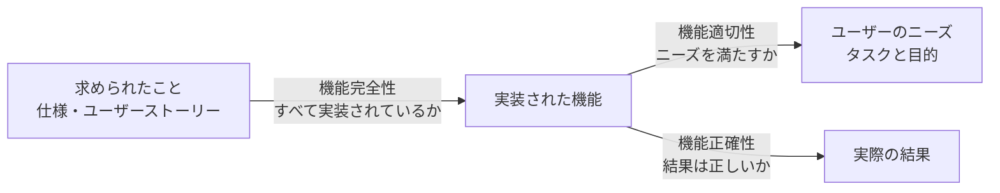

# lesson23: 機能テスト — 機能完全性・機能正確性・機能適切性のテストを区別する

## このレッスンで学ぶこと

- ISO/IEC 25010 の品質特性のうち、テストアナリストが担当する範囲と他の役割との線引きを説明できるようになる
- 機能適合性の 3 つの副特性（機能完全性・機能正確性・機能適切性）を、それぞれが答える問いで区別できるようになる
- 副特性ごとに、どの段階・どのテストレベルで、どのテスト技法を使ってテストするかを対応づけられるようになる
- テスト活動の説明を読んで、どの副特性のテストに当たるかを判別できるようになる

## 品質特性のテストとテストアナリストの担当範囲

第 4 章は、FL シラバス 2.2.2 で学んだテストタイプを、品質特性ごとに掘り下げます。シラバスは **ISO/IEC 25010**（2023 年版）の製品品質モデルをガイドにして、テストアナリスト（TA）が注目すべき品質特性を扱います。

ただし、品質モデルの特性をすべて TA が担当するわけではありません。どの特性をどの役割が担当するかは、シラバスの付録 F に整理されています。

| 品質特性 | TA が担当する範囲 | 他の役割が担当する範囲 |
|------|------|------|
| 機能適合性 | 機能完全性・機能正確性・機能適切性（このレッスン） | |
| 使用性 | 使用性テスト全般（[lesson24](/lessons/lesson24/)） | 使用性テスト担当者（UT）のシラバスがより詳しく扱う |
| 柔軟性 | 適応性・インストール性（[lesson25](/lessons/lesson25/)） | 拡張性は性能テスト担当者（PT）、置換性はテクニカルテストアナリスト（TTA） |
| 互換性 | 相互運用性（[lesson25](/lessons/lesson25/)） | 共存性は TTA |
| 性能効率性・信頼性・セキュリティ・保守性・安全性 | 扱わない | PT・TTA・セキュリティテスト担当者・自動車ソフトウェアテスト担当者 |

TA が受け持つのは、ユーザーから見える振る舞いと品質です。同じ特性の中でも、技術的な側面（共存性・置換性・拡張性）は他の役割に分かれます（TA と TTA の線引きは [lesson01](/lessons/lesson01/)）。

::: info 使用性の用語について
ISO/IEC 25010 の 2023 年版では、使用性に当たる特性の名前が変わっています。それでもシラバスは、使用性テストのシラバス（ISTQB-UT）と整合させるために「使用性」の用語を使い続けています。詳細は [lesson24](/lessons/lesson24/) で扱います。
:::

## 機能テストと機能適合性の 3 つの副特性

**機能テスト**は、テスト対象の機能適合性を判定するテストタイプで、TA のコアタスクの 1 つです。FL シラバスではテストタイプの 1 つとして簡潔にまとめられていますが、AL-TA のシラバスは**機能適合性**（コンポーネントやシステムが、特定の条件の下で使用される場合に、定義または示唆されているニーズを満たす機能を備えている度合い）の副特性まで踏み込みます。

ISO/IEC 25010 の製品品質モデルは、機能適合性を 3 つの副特性に分けています。

| 副特性 | 定義（ISTQB 用語集） | 中心となる問い |
|------|------|------|
| **機能完全性** | 機能のセットが、指定されたすべてのタスクとユーザーの目的を網羅する度合い | 求められていることが、すべて実装されているか |
| **機能正確性** | コンポーネントやシステムが、必要な精度で正しい結果を提供する度合い | 実際の結果は、有効な入力にも無効な入力にも正しいか |
| **機能適切性** | 機能が、指定されたタスクと目的の達成を容易にする度合い | 実装されているものすべてが、ユーザーのニーズを満たしているか |

3 つの副特性はどれも機能テストで評価できます。しかし、すべての機能テスト活動が 3 つに同じように効くわけではありません。そのため TA は、特定の副特性に関連するプロダクトリスクに対処するために、適切なテストレベルとテスト技法を選べなければなりません。これが学習目標の核心です。

図のように、機能完全性は「求められたことから実装へ」の漏れを、機能適切性は「実装からユーザーのニーズへ」の充足を、機能正確性は「実装が出す結果」の正しさを見ます。

## 機能完全性テスト

機能完全性テストは、ソフトウェアに指定されたすべてのタスクと、想定されるユーザーの目的をカバーしなければなりません。確かめたいのは「求められていることがすべて実装されているか」です。

機能完全性は、できるだけ早い段階で対処します。開発モデルによって手段が違います。

| 開発モデル | 早い段階での対処 |
|------|------|
| シーケンシャル開発モデル | 要件仕様のレビュー |
| アジャイルソフトウェア開発 | ユーザーストーリーの共同執筆時に、受け入れ基準を含むユーザーストーリーについて議論する |

動的にテストできるのは、システムテスト・システム統合テスト・受け入れテストです。テスト技法は、シナリオベースドテスト（[lesson15](/lessons/lesson15/)）のような振る舞いに基づくテスト技法が適しています。他のブラックボックステスト技法も使えます。

達成した機能完全性のレベルを判断するときに欠かせないのが、テストベース・テスト条件・テストケースの間のトレーサビリティ（[lesson02](/lessons/lesson02/)）です。要件に 12 の機能が書かれているのに、テスト条件が対応づくのは 11 だけなら、その時点で 1 つの機能が抜けている可能性に気づけます。

## 機能正確性テスト

機能正確性テストは、実際の結果が有効な入力に対しても無効な入力に対しても正しいか、という問いに答えます。「正しい」には、正確であること、精密であること、一貫性があることが含まれます。

期待結果を詳細に与える効果的なテストオラクル（[lesson05](/lessons/lesson05/)）を見つけることが、極めて重要です。正しい結果が何かを決められなければ、結果の正しさは判定できません。

機能正確性はどのテストレベルでもテストできます。ただしシフトレフトの観点から、ほとんどの機能正確性テストはコンポーネントテストとコンポーネント統合テストで行うべきです。TA がこれらのテストレベルに責任を持たない場合でも、テスト目的を最良に達成するために貢献すべきとされています。

テスト技法は、すべてのブラックボックステスト技法、経験ベースのテスト技法、コラボレーションベースのテストが適しています。

::: tip 無効な入力も機能正確性の対象
「存在しない日付を入れたら正しくエラーになるか」のような無効な入力への振る舞いも、機能正確性テストの対象です。有効な入力に対する計算結果だけを思い浮かべないようにしてください。
:::

## 機能適切性テスト

機能適切性テストは、機能が指定されたタスクや目的の達成を容易にするものであることを検証します。焦点は「実装されているものすべてがユーザーのニーズを満たしているか」です。機能が存在して正しく動いても、ユーザーの仕事を楽にしていなければ、機能適切性は低いことになります。

特に対話型アプリケーションでは、機能適切性テストにユーザーインターフェース設計のレビューが含まれることがあります。動的テストを始める時期も開発モデルで違います。

| 開発モデル | 動的テストの開始 |
|------|------|
| シーケンシャル開発モデル | システムテストと受け入れテストから |
| アジャイルソフトウェア開発 | デモセッションから |

テスト技法は、探索的テストとコラボレーションベースのテストが最も適しています。これに加えて、振る舞いに基づくブラックボックステスト技法も使えます。

## 3 つの副特性の比較

| 観点 | 機能完全性 | 機能正確性 | 機能適切性 |
|------|------|------|------|
| 中心となる問い | 求められていることがすべて実装されているか | 結果が有効な入力にも無効な入力にも正しいか | 実装されたものがユーザーのニーズを満たしているか |
| 静的な手段 | 要件仕様のレビュー、ユーザーストーリーの議論 | （詳細な期待結果を与えるテストオラクルの発見） | ユーザーインターフェース設計のレビュー |
| 動的テストのテストレベル | システム・システム統合・受け入れ | どのレベルでも可（主にコンポーネント・コンポーネント統合） | システム・受け入れから（アジャイルではデモセッションから） |
| 適したテスト技法 | 振る舞いに基づく技法（シナリオベースドテストなど）、他のブラックボックス技法 | すべてのブラックボックス技法、経験ベースの技法、コラボレーションベースのテスト | 探索的テストとコラボレーションベースのテスト、振る舞いに基づくブラックボックス技法 |
| 欠かせない情報 | テストベースからテストケースまでのトレーサビリティ | テストオラクル | ユーザーのニーズ |

::: warning 完全性と適切性は向きが逆
機能完全性は「求められたことが実装に漏れなく入っているか」で、要求から実装へ向かう見方です。機能適切性は「実装されたものがユーザーの役に立つか」で、実装からユーザーのニーズへ向かう見方です。どちらも「すべて」という言葉が出てくるので、問いの向きで区別してください。
:::

## 例題 テスト活動がどの副特性に当たるかの判別

::: info 題材 経費精算アプリの交通費申請
社員が出発駅・到着駅・経路を入力して交通費を申請する機能をテストします。ユーザーストーリーは「社員として、通勤定期の区間を除いた交通費を申請したい。立て替えた金額を漏れなく、手間をかけずに精算するためだ」です。
:::

次の各テスト活動が、どの副特性のテストに当たるかを判別します。

| テスト活動 | 判別 | 理由 |
|------|------|------|
| 要件に挙がった「申請・修正・取り下げ・承認依頼」の 4 つの操作すべてに、対応するテスト条件があるかをトレーサビリティで確認する | 機能完全性 | 求められた操作が漏れなく実装されるかを、テストベースとテスト条件の対応で確かめている |
| 入力した経路から算出した金額が、定期区間の控除を含めて正しいか、存在しない駅名を入れたときに正しくエラーになるかを確かめる | 機能正確性 | 有効な入力と無効な入力の両方について、実際の結果の正しさを見ている |
| よく使う経路を 1 回の操作で呼び出せる機能が、月末にまとめて申請する社員の作業を本当に楽にしているかを、代表的なユーザーと探索的に確かめる | 機能適切性 | 機能が存在するかや結果が正しいかではなく、タスクの達成を容易にしているかを見ている |
| 画面の文言がわかりやすく、初めての社員でも迷わず操作できるかを確かめる | 機能テストではない | 習得のしやすさは使用性の観点（[lesson24](/lessons/lesson24/)） |
| 交通系 IC カードの利用履歴サービスから取り込んだデータの金額と日付が、正しく解釈されるかを確かめる | 機能テストではない | 他のシステムとの情報交換は相互運用性の観点（[lesson25](/lessons/lesson25/)） |

試験では、このように 1 つのユーザーストーリーに対する複数のテスト活動を示して「機能正確性テストの例はどれか」のように問われます。問いの向きを手がかりに、他の品質特性の観点が混ざった選択肢を外してください。

## 試験のポイント

- 3 つの副特性は問いで区別する（完全性は「求められたことがすべて実装されているか」、正確性は「結果が正しいか」で無効な入力も含む、適切性は「実装されたものがユーザーのニーズを満たすか」）が K2 で問われ、使用性や相互運用性の観点が混ざった選択肢がひっかけになる
- テストレベルの対応を取り違えない（正確性はどのレベルでも可だがシフトレフトでコンポーネント・コンポーネント統合が中心、完全性はシステム・システム統合・受け入れ、適切性はシステム・受け入れまたはデモセッションから）
- 最適な技法の対応を押さえる（完全性はシナリオベースドテストなど振る舞いに基づく技法、適切性は探索的テストとコラボレーションベースのテスト、正確性はすべてのブラックボックス・経験ベース・コラボレーションベース）
- TA が担当する品質特性は機能適合性・使用性・適応性・インストール性・相互運用性で、共存性・置換性・拡張性・性能効率性・セキュリティなどは TTA・PT・SEC の範囲
