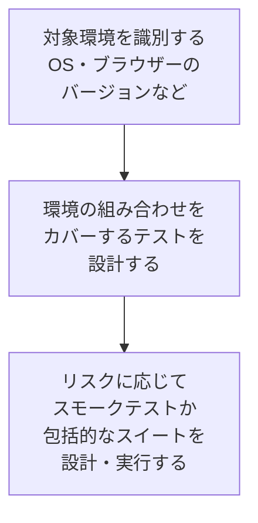

# lesson25: 柔軟性テストと互換性テスト — 適応性・インストール性・相互運用性でテストアナリストが担う範囲

## このレッスンで学ぶこと

- 柔軟性の 4 つの副特性のうち、テストアナリストが担当する適応性とインストール性を他の役割の範囲と区別できるようになる
- 適応性テストでテストアナリストが貢献すること（対象環境の識別・組み合わせテスト・スモークテスト）と、よい実践例を説明できるようになる
- インストール性テストの 4 つの典型的なテスト目的を挙げられるようになる
- 互換性の 2 つの副特性のうち、相互運用性テストの目的・検出できる欠陥・適した技法を説明できるようになる
- テスト活動の説明を読んで、第 4 章のどのテストタイプに当たるかを判別できるようになる

## 柔軟性テスト

**柔軟性テスト**は、テスト対象が使用コンテキストやシステム環境の変化に適応できることを検証します。移植性テストとも呼ばれます。もとになる**柔軟性**は、コンポーネントやシステムが、要求・利用状況・システム環境の変化に適応できる程度です。

ISO/IEC 25010 の 2011 年版では「移植性」と呼ばれていた特性が、2023 年版で「柔軟性」に名前が変わりました。製品品質モデルは、柔軟性を 4 つの副特性に分けています。柔軟性には技術的側面と非技術的側面があり、シラバスが扱うのはテストアナリスト（TA）が貢献できる 2 つです。

| 副特性 | 内容 | 担当 |
|------|------|------|
| **適応性** | 異なる、または変化するハードウェア・ソフトウェア・その他の運用環境や使用環境に適応できる度合い | TA（このレッスン） |
| 拡張性 | 増加する負荷に応じてアップグレードできる能力 | 性能テスト担当者（PT） |
| **インストール性** | 指定された環境に正常にインストール・アンインストールできる度合い | TA（このレッスン） |
| 置換性 | 同じ環境で同じ目的の他のコンポーネントやシステムを置き換えられる度合い | テクニカルテストアナリスト（TTA） |

拡張性と置換性は技術的側面に関連するため、それぞれ性能テストのシラバスと TTA のシラバスで扱われます。

### 適応性テスト

**適応性テスト**は、テスト対象が意図した対象のハードウェア・ソフトウェア・その他の運用環境や使用環境に適応できること、または移行できることを検証します。

TA は次の流れで適応性テストを支援します。

- 対象環境の識別では、サポート対象のモバイル OS のバージョンや、使われる可能性のあるブラウザーのバージョンを挙げます
- 環境の組み合わせをカバーするには、さまざまな環境パラメーターの構成を表すテストデータが必要です。そのため、組み合わせテスト（[lesson11](/lessons/lesson11/)）のようなテスト技法がよく使われます
- もう 1 つの例は、対象環境間での互換性を確保するために、さまざまなプラットフォームのコンポーネントを顧客プロジェクトに統合することです
- プロダクトリスクに応じて、スモークテストか、より包括的なテストスイートを設計・実行し、対象環境に正しく適応することを検証します

シラバスは、適応性テストのよい実践例として次を挙げています。

| よい実践例 | ねらい |
|------|------|
| 早期に対象環境を定義する | どの環境をカバーするかを早く決める |
| 組み合わせテストを使う | 環境の組み合わせを体系的にカバーする |
| 新しい環境でスモークテストを行う | 新しい環境で、詳細なテストに進める状態かを素早く確かめる |
| 環境に固有の欠陥をモニタリングする | 特定の環境でだけ起きる欠陥の傾向をつかむ |

これらに従うことで、TA はソフトウェアの寿命や使用性（例: 異なる画面サイズでの使いやすさ）を制限しかねない欠陥を発見できます。テスト自動化エンジニアが実装する自動化されたクロスプラットフォームテストも、TA の作業を支援するべきとされています。

厳格な適応性テストは、環境に固有の問題を早期に検出します。その結果、デプロイ後の頻繁なメジャーアップデートや再設計を避け、メンテナンスコストを下げることにつながります。

### インストール性テスト

**インストール性テスト**は、テスト対象が指定した環境で正しくインストール・アンインストール・更新・再設定できることを検証します。単にインストール手順が完了まで動くかを確かめるだけではありません。

TA の焦点となる典型的なテスト目的は次のとおりです。

| テスト目的 | 補足 |
|------|------|
| さまざまな環境パラメーター設定の下で、インストール手順が正しく実行されることを検証する | 適応性テストと同様に、組み合わせテストのような技法が役立つ |
| インストールまたはアップデート後に、テスト対象が正しく動作するかを判断するテストを設計・実行する | 「入った」だけでなく「入った後に動く」まで見る |
| ユーザーがインストール・アンインストール・アップデートをどれだけ簡単に行えるかをチェックする | インストール文書のレビューを含む |
| 権限に関連する動作をテストする | 特にモバイルアプリケーション |

::: tip 「手順が完了する」で終わらない
インストール手順が最後まで走ることは出発点にすぎません。更新後に以前の設定やデータが引き継がれるか、アンインストールで不要なものが残らないか、再設定が効くかまでがインストール性テストの範囲です。
:::

## 互換性テスト

**互換性テスト**は、テスト対象が使用されたときに、他のコンポーネントやシステムと互換性があるかを検証します。もとになる**互換性**は、コンポーネントやシステムが他のコンポーネントやシステムと情報を交換できる度合いと、同じハードウェアまたはソフトウェア環境を共有しながら必要な機能を果たせる度合いです。

ISO/IEC 25010 の製品品質モデルは、互換性を 2 つの副特性に分けています。互換性テストもそれに対応して 2 つのテストタイプに分かれます。

| テストタイプ | 検証すること | 担当 |
|------|------|------|
| **相互運用性テスト** | 相互運用する相手のコンポーネントやシステムとの互換性 | 通常はブラックボックスの機能テストなので、TA が責任を負う |
| 共存性テスト | 他のコンポーネントやシステムと干渉することなく、対象環境を共有できること | 技術的なテストタイプで、TTA のシラバスで扱う |

### 相互運用性テストの目的

**相互運用性**は、2 つ以上のコンポーネントやシステムが情報を交換でき、交換した情報を使用できる度合いです。相互運用性テストの目的も同じで、情報を交換できることと、交換した情報を相互に利用できることの両方を検証します。情報交換がデータ変換を伴う場合は、その変換の検証を含めなければなりません。

::: tip 「交換できる」だけでは足りない
日付のデータを相手のシステムに送れても、相手が月と日を逆に解釈すれば、交換した情報を使えていません。相互運用性テストは、送れたかどうかで終わらず、受け取った側が正しく使えるかまで確かめます。
:::

相互運用性テストが特に重要になるのは、複数のシステムが連携し、データを共有し、共にタスクを実行する必要がある場合です。次のような最新のソフトウェアアーキテクチャーでは、この状況が顕著です。

- クラウドソリューション（クラウドテストは [lesson20](/lessons/lesson20/)）
- ウェブサービス
- マイクロサービス
- コンテナ化
- IoT

### 相互作用の理解とテスト条件

相互運用性は通常、さまざまなアーキテクチャーレベルで発生します。TA は起こりうる相互作用を理解し、それらをカバーする適切なテスト条件を定義しなければなりません。

ここで注意したいのは、すべての相互作用が文書化されているとは限らないことです。TA は、アーキテクチャーや設計文書から相互作用に関する情報を間接的に得られる場合があります。相互作用の重要な側面を確実にテストするには、これらの文書を理解することが極めて重要です。

### 検出できる欠陥

相互運用性テストは、次の欠陥を検出できます。

- データ交換のためのデータ変換
- 交換されたデータの解釈または使用
- 通信フローとプロトコル
- 標準への準拠
- エンドツーエンドの機能性
- 設計文書

最後の「設計文書」に注目してください。相互作用をテストする過程で、設計文書そのものの欠陥が見つかることがあります。

### テストレベルと適した技法

相互運用性テストは通常、統合テスト中に適用します。ブラックボックステスト技法は、何に焦点を当てるかで使い分けます。

| テスト技法 | 焦点 |
|------|------|
| データに基づくテスト技法（[lesson10](/lessons/lesson10/)〜[lesson12](/lessons/lesson12/)） | 交換されるデータ |
| 振る舞いに基づくテスト技法（[lesson13](/lessons/lesson13/)〜[lesson15](/lessons/lesson15/)） | データの解釈や使用 |
| ルールに基づくテスト技法（[lesson16](/lessons/lesson16/)〜[lesson17](/lessons/lesson17/)）や、エンドツーエンドの機能性のテスト | データ変換 |

経験ベースのテスト技法（[lesson18](/lessons/lesson18/)〜[lesson19](/lessons/lesson19/)）は、ブラックボックステストを有効に補完します。また、機能テストや適応性テストのテストケースを相互運用性テストに再利用もできます。

相互運用性に関する一般的な標準の例として、シラバスは ISO 15745 と ISO 16100 を挙げています。電気通信分野の具体的な相互運用性テスト方法論の例としては、ETSI の EG 202 237 があります。

## 例題 第 4 章のテストタイプの判別

::: info 題材 スマートフォン向けの家計簿アプリ
収支を記録し、銀行の明細取り込みサービスから取引データを受け取って集計するアプリです。複数の OS バージョンと画面サイズをサポートし、アプリストアから配布します。
:::

次の各テスト活動が、第 4 章のどのテストタイプに当たるかを判別します。

| テスト活動 | 判別 | 理由 |
|------|------|------|
| サポート対象の OS バージョンと画面サイズの組み合わせを洗い出し、ペアワイズで構成を選んで主要機能を確認する | 適応性テスト | 対象環境の識別と、その組み合わせをカバーするテスト設計 |
| アプリストアからの更新後に、登録済みのデータと設定が引き継がれ、カメラの権限を求める動作が正しいかを確かめる | インストール性テスト | 更新後の動作と、モバイルアプリケーションの権限に関連する動作 |
| 明細取り込みサービスから受け取った取引データの金額・日付・摘要が、家計簿の項目として正しく解釈され、集計に使えるかを確かめる | 相互運用性テスト | 他のシステムと交換した情報を使えるかの検証 |
| 画面読み上げ機能で主要な操作ができ、色だけに頼らずに収入と支出を区別できるかを確かめる | 使用性テスト（アクセシビリティ） | 障がいのあるユーザーが効果的・効率的に使えるか（[lesson24](/lessons/lesson24/)） |
| 月ごとの収支の集計額が、入力した取引の合計と一致するかを確かめる | 機能テスト（機能正確性） | 結果の正しさ（[lesson23](/lessons/lesson23/)） |
| 同じ端末で動く他のアプリと、通知やストレージを奪い合わずに動くかを確かめる | 共存性テスト | 環境の共有は TTA の範囲 |
| 利用者が 10 倍に増えたときにサーバー側が処理できるかを確かめる | 拡張性テスト | 容量の変化への対応は PT の範囲 |

試験では「相互運用性テストへの TA の貢献として最も適切なものはどれか」のように問われ、デバイスやブラウザーの違い（適応性）、文化的背景（アクセシビリティ）、計算結果の正しさ（機能正確性）を扱う選択肢が混ざります。「何と何の間の、何を確かめているか」で見分けてください。

## 試験のポイント

- 柔軟性（旧 移植性）の 4 つの副特性のうち TA は適応性とインストール性で、拡張性は PT・置換性は TTA、互換性では相互運用性が TA で共存性が TTA という線引きが問われる
- 適応性テストでの TA の貢献は「対象環境の識別と、その組み合わせをカバーするテスト設計（組み合わせテスト）」で、プロダクトリスクに応じてスモークテストか包括的なテストスイートを使い分ける
- インストール性テストの 4 つの目的（環境パラメーター設定ごとの手順の検証、インストール・更新後の動作、インストールなどのしやすさと文書のレビュー、モバイルの権限）は「手順が完了するか」だけではない
- 相互運用性テストは「情報を交換でき、交換した情報を使える」ことの検証で、データ変換を伴うならその検証を含み、デバイスやブラウザーの違い（適応性）や文化的背景（アクセシビリティ）を扱う選択肢はひっかけ
