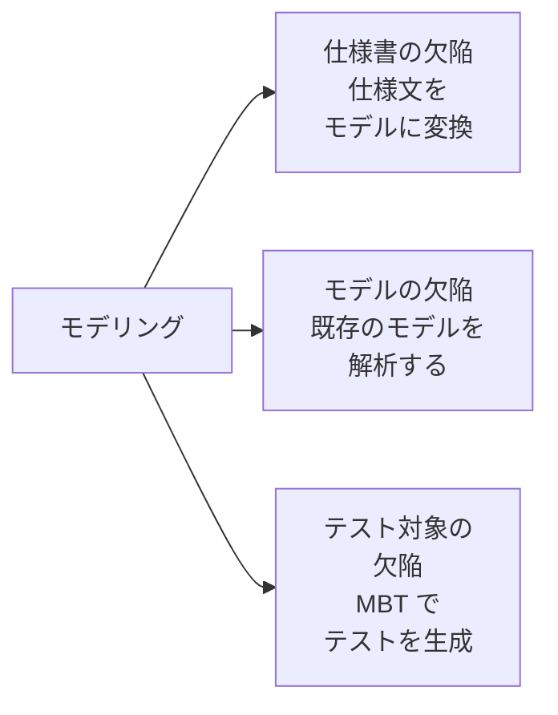
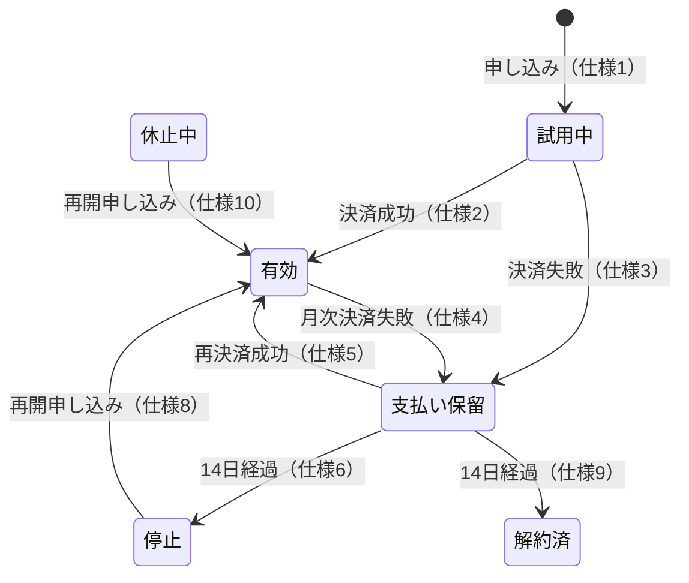

# lesson27: モデルを使った仕様の欠陥検出 — 仕様文をモデルに変換して不完全・不整合・曖昧さを見つける

## このレッスンで学ぶこと

- フェーズ内封じ込めの目的と、テストアナリストがテストベースの品質評価で貢献する理由を説明できるようになる
- モデリングがフェーズ内封じ込めを支援する 3 つの方法を区別できるようになる
- データ・振る舞い・ルールの 3 種類のモデルで、それぞれどんな仕様の欠陥が見つかるかを挙げられるようになる
- 仕様文からデシジョンテーブルを作り、ルールの矛盾と漏れを見つけられるようになる
- 仕様文から状態遷移図と状態遷移表を作り、非決定的な動作・到達不可能な状態・欠落した遷移を見つけられるようになる

## フェーズ内封じ込めの支援

**フェーズ内封じ込め**は、欠陥が作り込まれたのと同じ SDLC のフェーズで、その欠陥を検出して除去する方針です。要件のフェーズで混入した欠陥は要件のフェーズのうちに、設計で混入した欠陥は設計のうちに取り除きます。アジャイルソフトウェア開発では、シフトレフトのアプローチを同じ目的で使えます。

この方針を守ると、品質コストが下がります。後のフェーズまで欠陥が流出するほど、修正にかかる手戻りが大きくなるからです（欠陥予防の全体像は [lesson26](/lessons/lesson26/)）。

テストアナリスト（TA）がフェーズ内封じ込めに最も貢献できるのは、テストベースの品質を評価する場面です。テストベースはテスト分析とテスト設計の重要なインプットだからです（[lesson02](/lessons/lesson02/)）。

早い段階でテストベースの品質に注意を払えば、後の労力を抑えられ、欠陥が後続フェーズへ流出するのを防げます。

TA がテストベースの欠陥を見つける方法として、シラバスは 2 つを挙げています。

| 方法 | 仕組み | レッスン |
|------|------|------|
| テストの意図のモデリング | 仕様をモデルに変換して欠陥を明らかにする | このレッスン |
| レビュー技法を使ったテストベースのレビュー | 仕様を元の形式のまま読んで欠陥を見つける（ISO/IEC 20246 のレビュー技法） | [lesson28](/lessons/lesson28/) |

## モデリングが支援する 3 つの方法

モデリングは、システムの抽象化を一定の精度と詳細さで提供します。開発中のシステムを、ステークホルダーがよりよく理解する助けになります。モデリングがフェーズ内封じ込めを支援する方法は、少なくとも 3 つあります。

| 方法 | 欠陥がある場所 | TA がすること |
|------|------|------|
| 仕様書の欠陥を検出する | 文章で書かれた仕様 | 仕様からモデルを作り、変換の過程で欠陥を見つける |
| モデルの欠陥を検出する | テストベースに含まれるモデル | 既存のモデルを解析して欠陥を見つける |
| モデルベースドテストを使って欠陥を検出する | テスト対象 | MBT モデルからテストケースを生成し、テスト対象を体系的に探索する |

このレッスンの中心は 1 つ目です。学習目標（K3）が「仕様書の欠陥を検出するためにテスト対象のモデルを使用する」だからです。

## 仕様書の欠陥の検出

仕様書は多くの場合、非形式的な文章として渡されます。TA はその仕様を、モデルを使って形式的に表現できます。モデルを作るときは、テスト条件（要件など）をモデルの要素に対応づけ、トレーサビリティのためにモデル要素へリンクします。

テスト条件をモデルの中で形式化し、目に見える形にすると、不完全性・不整合・曖昧さのような欠陥が効率よく明らかになります。

### レビューとの違い

レビューは、仕様を当初の形式のままチェックします。モデリングの強みは、仕様が別の形に**変換される**ことです。文章を表や図に置き換える過程で、文章のままでは見えなかった空欄や衝突が表れます。

変換した結果が手元に残るので、TA は欠陥を見つけるだけでなく、検出した欠陥に対する適切な解決策を見つけることにも貢献できます。

### モデルの種類と見つかる欠陥

第 3 章のテスト技法は、データ・振る舞い・ルールの 3 種類のモデルを使います（[lesson10](/lessons/lesson10/)）。仕様をどのモデルに変換するかで、見つかる欠陥が変わります。

| モデルの種類 | モデルの例 | 見つかる仕様の欠陥 |
|------|------|------|
| データに基づくモデル | ドメインモデル、組み合わせテストモデル | 重複するパーティション、ドメインカバレッジのギャップ、空のパーティション、パラメーターの欠落や不正確な組み合わせ |
| 振る舞いに基づくモデル | CRUD マトリクス、状態ベースモデル、シナリオモデル | 不完全または一貫性のないエンティティのライフサイクル、欠落または欠陥のある状態遷移、デッドロック、無限ループ、曖昧または一貫性のないシステム動作、欠落した例外処理 |
| ルールに基づくモデル | デシジョンテーブル、メタモルフィック関係 | ビジネスルールの抜け・不整合・曖昧さ・冗長性、エラーを起こしやすいシナリオ、複雑なビジネスロジック |

モデルの種類を問わず、モデリングは次のような欠陥も明らかにします。

- 命名、データ値（境界値など）、入力や出力の不整合
- 欠落している情報、不完全な情報、曖昧な情報、不要な情報

::: tip どのモデルを選ぶか
仕様が「条件の組み合わせで結果が決まる」ならデシジョンテーブル、「状態によって同じ操作への反応が変わる」なら状態ベースモデル、「エンティティの作成から削除までの扱い」なら CRUD マトリクス、というように、仕様の性質に合うモデルを選びます。技法の選択は [lesson21](/lessons/lesson21/) で扱います。
:::

## 例題 1 の題材

社内ヘルプデスクのチケット振り分けの仕様から、デシジョンテーブルを作って欠陥を探します。デシジョンテーブルの構造と最小化、レビュー基準（一貫性・実現可能性・完全性・正確性）は [lesson16](/lessons/lesson16/) のとおりです。ここでは「文章をデシジョンテーブルに変換すると何が見えるか」に絞ります。

::: info チケット振り分けの仕様
- 仕様 A: 緊急度が高く、担当者が未割り当てのチケットは、マネージャーへエスカレーションする。
- 仕様 B: VIP 顧客からのチケットは、緊急度にかかわらずマネージャーへエスカレーションする。
- 仕様 C: 緊急度が高くないチケットは、担当者が割り当て済みなら通常キューに残し、未割り当てなら担当者を自動で割り当てる。
:::

## 例題 1 の手順

### 条件とアクションの抽出

仕様文に出てくる判断材料を条件に、結果をアクションにします。条件は真偽で答えられる形にそろえます。

| 記号 | 内容 |
|------|------|
| C1 | 緊急度が高い |
| C2 | 担当者が割り当て済みである |
| C3 | VIP 顧客からのチケットである |
| A1 | マネージャーへエスカレーションする |
| A2 | 通常キューに残す |
| A3 | 担当者を自動で割り当てる |

### 仕様文のルールへの変換

次に、仕様文を 1 文ずつルール（列）にします。仕様に書かれていない条件は don't care の「-」にします。仕様 C は「割り当て済み」と「未割り当て」で結果が違うので、2 列に分かれます。

| | 仕様 A | 仕様 B | 仕様 C-1 | 仕様 C-2 |
|---|---|---|---|---|
| C1 緊急度が高い | T | - | F | F |
| C2 担当者が割り当て済み | F | - | T | F |
| C3 VIP 顧客 | - | T | - | - |
| A1 エスカレーション | X | X | | |
| A2 通常キューに残す | | | X | |
| A3 自動で割り当て | | | | X |

ここまでで、各ルールと仕様文の対応（トレーサビリティ）ができました。この表は仕様を写しただけなので、まだ欠陥は見えません。

### 完全な組み合わせとの照合

条件は 3 つともブール値なので、組み合わせは 2 の 3 乗で 8 通りです。8 通りそれぞれに、どのルールが当てはまるかを照合します。

| 組み合わせ | C1 | C2 | C3 | 当てはまるルール | アクション | 判定 |
|---|---|---|---|---|---|---|
| 1 | T | T | T | 仕様 B | A1 | 問題なし |
| 2 | T | T | F | なし | 決まらない | **漏れ** |
| 3 | T | F | T | 仕様 A、仕様 B | A1、A1 | 問題なし |
| 4 | T | F | F | 仕様 A | A1 | 問題なし |
| 5 | F | T | T | 仕様 B、仕様 C-1 | A1、A2 | **矛盾** |
| 6 | F | T | F | 仕様 C-1 | A2 | 問題なし |
| 7 | F | F | T | 仕様 B、仕様 C-2 | A1、A3 | **矛盾** |
| 8 | F | F | F | 仕様 C-2 | A3 | 問題なし |

### 欠陥の読み取り

照合の結果から、3 つの欠陥が見つかりました。

| 組み合わせ | 欠陥の種類 | 内容 |
|---|---|---|
| 2 | 不完全性（ルールの抜け） | 緊急度が高く、担当者が割り当て済みで、VIP でないチケットの扱いが、どの仕様にも書かれていない |
| 5、7 | 不整合（ルールの矛盾） | VIP 顧客で緊急度が高くないチケットに、仕様 B はエスカレーション、仕様 C は通常キューまたは自動割り当てを求めている |

組み合わせ 3 には仕様 A と仕様 B の両方が当てはまりますが、アクションはどちらも A1 で同じです。これは一貫性の違反ではなく欠陥ではありません（ルールの重複と一貫性の区別は [lesson16](/lessons/lesson16/)）。

文章のままでは、「緊急度にかかわらず」という仕様 B の一言が、仕様 C と衝突していることに気づきにくいものです。表に変換して全組み合わせを照合すると、空欄（漏れ）と二重の記入（矛盾）として機械的に表れます。

### 解決策への貢献

TA は見つけた欠陥を仕様の作成者に報告します。モデルがあるので、解決策の候補も具体的に示せます。

- 組み合わせ 2 には、仕様 C と同じく通常キューに残すのか、緊急度が高いので別の扱いにするのかを決めてもらう
- 組み合わせ 5・7 には、「VIP 顧客の仕様 B を優先する」のような優先順位を仕様に明記してもらう

どちらに決まっても、表の該当する列を直せば、修正後の仕様とモデルの対応が保てます。

## 例題 2 の題材

動画配信サービスの契約のライフサイクルを、状態遷移図と状態遷移表で表して欠陥を探します。状態・イベント・遷移・ガード条件・アクションの基本は FL シラバス 4.2.4（状態遷移テスト）、Advanced Level で加わるカバレッジ基準は [lesson14](/lessons/lesson14/) のとおりです。

::: info 契約ライフサイクルの仕様
- 仕様 1: 利用者が申し込むと、契約は「試用中」になる。
- 仕様 2: 試用期間が終了したとき、決済に成功すると契約は「有効」になる。
- 仕様 3: 試用期間が終了したとき、決済に失敗すると契約は「支払い保留」になる。
- 仕様 4: 「有効」な契約で月次決済に失敗すると、契約は「支払い保留」になる。
- 仕様 5: 「支払い保留」の契約で再決済に成功すると、契約は「有効」に戻る。
- 仕様 6: 「支払い保留」が 14 日続くと、契約は「停止」になる。
- 仕様 7: 利用者はいつでも解約でき、契約は「解約済」になる。
- 仕様 8: 「停止」の契約は、利用者が再開を申し込むと「有効」になる。
- 仕様 9: 「支払い保留」が 14 日続いた契約は、「解約済」にする。
- 仕様 10: 「休止中」の契約は、利用者が再開を申し込むと「有効」に戻る。
:::

## 例題 2 の手順

### 状態とイベントの抽出

仕様文に出てくる状態と、状態を変えるきっかけ（イベント）を抜き出します。

| 状態 | 出典 |
|------|------|
| 試用中 | 仕様 1 |
| 有効 | 仕様 2、4、5、8、10 |
| 支払い保留 | 仕様 3、4、5、6、9 |
| 停止 | 仕様 6、8 |
| 解約済 | 仕様 7、9 |
| 休止中 | 仕様 10 |

| イベント | 出典 |
|------|------|
| 申し込み | 仕様 1 |
| 試用終了（決済成功） | 仕様 2 |
| 試用終了（決済失敗） | 仕様 3 |
| 月次決済失敗 | 仕様 4 |
| 再決済成功 | 仕様 5 |
| 14 日経過 | 仕様 6、9 |
| 解約 | 仕様 7 |
| 再開申し込み | 仕様 8、10 |

### 状態遷移図の作成

抜き出した状態と遷移を図にします。遷移のラベルには、トレーサビリティのために仕様番号を添えます。「試用中」から出る 2 本の遷移は、試用終了時の決済の成否で分かれるので、図では「決済成功」「決済失敗」と短く書きます。仕様 7 の「解約」はどの状態からも「解約済」へ向かう遷移なので、図が込み入らないように省き、状態遷移表のほうで確認します。

図にした時点で、2 つのことが目に入ります。「支払い保留」から同じ「14 日経過」で出ていく矢印が 2 本あること、そして「休止中」に入ってくる矢印が 1 本もないことです。

### 状態遷移表による確認

図で気づいたことを、状態遷移表で漏れなく確認します。行が現在の状態、列がイベントで、セルに遷移先を書きます。

| 現在の状態 | 試用終了（決済成功） | 試用終了（決済失敗） | 月次決済失敗 | 再決済成功 | 再決済失敗 | 14 日経過 | 解約 | 再開申し込み |
|---|---|---|---|---|---|---|---|---|
| 試用中 | 有効 | 支払い保留 | | | | | 解約済 | |
| 有効 | | | 支払い保留 | | | | 解約済 | |
| 支払い保留 | | | | 有効 | **未定義** | **停止／解約済** | 解約済 | |
| 停止 | | | | | | | 解約済 | 有効 |
| 休止中 | | | | | | | **未定義** | 有効 |
| 解約済 | | | | | | | **未定義** | |

空欄は「その状態ではそのイベントが起こらない」と仕様から読める組み合わせです。確認が必要なのは、太字のセルです。

### 欠陥の読み取り

| 場所 | 欠陥の種類 | 内容 |
|---|---|---|
| 支払い保留 × 14 日経過 | 非決定的な動作 | 同じ状態で同じイベントが起きたとき、仕様 6 は「停止」、仕様 9 は「解約済」を求めている |
| 休止中 | 到達不可能な状態 | 仕様 10 は「休止中」からの遷移を定めているが、「休止中」に入る遷移がどの仕様にもない |
| 支払い保留 × 再決済失敗 | 欠落した例外処理 | 仕様 5 は再決済の成功だけを定めており、失敗したときに何が起こるかがない |
| 休止中・解約済 × 解約 | 曖昧さ | 仕様 7 の「いつでも」が、休止中や解約済の契約にも当てはまるのかが読み取れない |

文章で読むと、仕様 6 と仕様 9 は離れた場所にあり、どちらも単独ではもっともらしく見えます。状態遷移表の 1 つのセルに 2 つの遷移先が入ったとき、初めて衝突が確定します。

「休止中」も同じです。仕様 10 を読んだだけでは「どこかに入る遷移があるのだろう」と流してしまいがちですが、表の行として並べると入口のないことがわかります。

### 解決策への貢献

TA は、モデルを根拠に仕様の作成者へ次のような確認を出せます。

- 14 日経過後の扱いは「停止」と「解約済」のどちらか。段階を踏むなら、停止から解約済へ移るイベント（たとえば停止後 30 日経過）を追加する
- 「休止中」へ入るイベント（利用者による休止の申し込みなど）があるのか、それとも「休止中」は不要な状態なのか
- 再決済に失敗したときは「支払い保留」にとどまるのか、再試行回数の上限があるのか
- 「いつでも解約できる」の範囲を状態ごとに明記する

## モデルの欠陥の検出

テストベースに最初からモデルが含まれている場合、TA はそのモデルを解析して欠陥を検出します。シラバスは、ソフトウェアテストでよく使う 3 つのモデルについて、欠陥の例を挙げています。

| モデル | 欠陥の例 |
|------|------|
| 状態遷移図（[lesson14](/lessons/lesson14/)） | 状態の欠落や誤り、不適切な遷移、誤ったガード条件やアクション、冗長な状態や到達不可能な状態、非決定的な動作 |
| アクティビティ図（[lesson15](/lessons/lesson15/)） | アクションの欠落・到達不能・行き止まり、アクションの順序の誤り、判定ノードの誤った・排他的でない・不完全なガード条件、同期ポイントの欠落、意図しない動作につながる並列フローの不適切な同期 |
| デシジョンテーブル（[lesson16](/lessons/lesson16/)） | 重複したルール、不整合なルール、実現不可能なルール、不完全性（条件の組み合わせの欠落、ある組み合わせに対するアクションの欠落） |

これに加えて、どのモデルにも構文エラー、タイプミス、重複、モデル要素の命名の不統一といった欠陥が含まれている可能性があります。

例題 2 で見つけた「非決定的な動作」「到達不可能な状態」は、自分で作ったモデルでも、テストベースに含まれていたモデルでも、同じ観点で見つけられます。

## モデルベースドテストによる欠陥の検出

**モデルベースドテスト**（MBT）では、TA が定義した MBT モデルとテスト選択基準に基づいて、MBT ツールがテストケースやその他のテスト設計のテストウェアを設計し、生成します（テスト設計の自動化は [lesson22](/lessons/lesson22/)、テストオラクルとしての MBT は [lesson05](/lessons/lesson05/)）。

MBT が仕様書の不正の発見に効果的なのは、MBT モデルに従ってテスト対象の期待される動作を包括的にカバーし、体系的に探索できるからです。MBT モデル、特にグラフィカルなモデルは、ステークホルダーとのコミュニケーションを促し、テストベースに対する共通の認識と理解を生みます。MBT モデルの詳細は、ISTQB のモデルベースドテスト担当者シラバス（v1.1）の範囲です。

## 試験のポイント

- K3 で問われるのは「この仕様をモデルにすると、どの欠陥が見つかるか」で、デシジョンテーブルなら全組み合わせを照合して空欄（漏れ）と二重記入（矛盾）を、状態ベースモデルなら同じ状態と同じイベントに 2 つの遷移先（非決定的な動作）と入口のない状態（到達不可能な状態）を探す
- レビューは仕様を元の形式のままチェックし、モデリングは仕様を変換するのが強みで、この違いが解決策の発見への貢献につながる
- 3 種類のモデルと見つかる欠陥を対応づける（データに基づくモデルは重複するパーティションや空のパーティション、振る舞いに基づくモデルはデッドロック・無限ループ・欠落した例外処理、ルールに基づくモデルはビジネスルールの抜け・不整合・冗長性）
- 同じ組み合わせに 2 つのルールが当てはまってもアクションが同じなら欠陥ではなく、アクションが違うときだけ不整合になる
