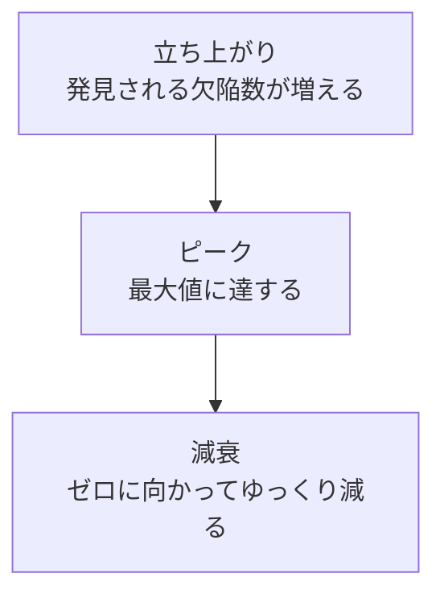

# lesson29: テスト結果の分析 — 欠陥クラスターと DDP で欠陥検出の改善点を見つける

## このレッスンで学ぶこと

- 類似欠陥の再発を軽減する 2 つのアプローチと、テスト結果が欠陥検出の改善に使える理由を説明できるようになる
- 予測した欠陥クラスターと実際の欠陥クラスターを比較し、より入念にテストすべき領域を選べるようになる
- テストレベルごとの欠陥検出率（DDP）を計算し、改善対象のテストレベルを選べるようになる
- 構造カバレッジ分析・テストギャップ分析・欠陥発生パターン分析で何がわかるかを説明できるようになる
- 不合格テストの数と欠陥の数が一致しない理由を説明できるようになる

## 類似欠陥の再発の軽減

欠陥予防の 3 つ目の実践は、類似した欠陥が再発するのを防ぐことです（[lesson26](/lessons/lesson26/)）。テストアナリスト（TA）は、ソフトウェアへの欠陥の再発を最小限に抑えるために、主体的に貢献できます。シラバスが説明するアプローチは 2 つです。

| アプローチ | 狙い | レッスン |
|------|------|------|
| テスト結果の分析 | テスト分析とテスト設計を改善し、欠陥検出の有効性を上げる | このレッスン |
| 欠陥分類による根本原因分析の支援 | 欠陥の種類ごとに根本原因を突き止め、是正措置で再発を防ぐ | [lesson30](/lessons/lesson30/) |

## テスト結果が与えるフィードバック

**テスト結果**はテストの実行のステータスです。TA はテスト結果から故障を識別しますが、それだけではありません。テスト結果は、欠陥検出の有効性を向上させるためのフィードバックも TA に与えます。

「どこに欠陥が集まっていたか」「どのテストレベルが欠陥を取りこぼしたか」を読み取れば、次のテスト分析とテスト設計を変えられます（テスト結果の評価は [lesson02](/lessons/lesson02/)）。

シラバスは、テスト結果を分析する技法を 5 つ説明しています。

| 技法 | 何を比べるか | わかること |
|------|------|------|
| 予測した欠陥クラスターと実際の欠陥クラスターの分析 | 予測した欠陥の多い領域と、実際に欠陥が多かった領域 | より入念にテストすべき領域 |
| 欠陥検出率（DDP）分析 | テストレベルで検出した欠陥と、流出した欠陥 | 欠陥検出が効果的でないテストレベル |
| 構造カバレッジ分析 | テストが実施した領域と、していない領域 | カバレッジの低い領域 |
| テストギャップ分析 | 最近のコード変更と、それを実施したテスト | まったくテストされていない新規の変更 |
| 欠陥発生パターン分析 | 時間の経過に伴う欠陥数の推移と、理論的な分布 | 既存のテストの有効性と改善の余地 |

学習目標（K4）は「欠陥検出に関する改善の可能性を識別するためにテスト結果を分析する」です。最初の 2 つは数値を使って自分で分析できるようになる必要があるので、例題を置きます。

## 予測した欠陥クラスターと実際の欠陥クラスターの分析

通常、少数のコンポーネントに大部分の欠陥が含まれています（FL シラバス 1.3 の欠陥の偏在）。TA はテスト後に、実際に欠陥が発生しやすかった領域を識別し、予測した**欠陥クラスター**と実際の欠陥クラスターを比較します。

- 不一致があれば、予想より多くの欠陥が見つかった領域に、より入念なテストを行う
- クラスターを決めるときは、明確性と一貫性を確保するために測定可能な基準（欠陥密度、欠陥の重要度など）を使う
- 基準の中では、欠陥の**重要度**が重要な役割を果たす

致命的な欠陥や重大な欠陥の小さなクラスターは、通常、軽微な欠陥や外観上の欠陥の大きなクラスターより重要です。件数が多い領域を機械的に選ぶのではなく、重要度を見てより厳密なテストが必要な領域を決めます。

## 例題 1 の題材

旅行予約サービスのリリース前に、システムテストの結果を分析します。このサービスは 4 つのモジュールで構成されています。

::: info 予測の根拠と実績
過去 3 回のリリースでは、変更したファイルの数と、システムテストで見つかった欠陥の数に強い相関がありました。平均すると、変更したファイル 10 本あたり欠陥 4 件です。この比率を予測モデルとして、今回の変更規模から欠陥数を予測しました。

| モジュール | 変更したファイル数 | 検出した欠陥数 | うち致命的・重大 | うち軽微・外観上 |
|---|---|---|---|---|
| 検索 | 50 | 22 | 2 | 20 |
| 予約 | 80 | 29 | 8 | 21 |
| 決済 | 30 | 25 | 15 | 10 |
| 会員管理 | 40 | 9 | 3 | 6 |
:::

## 例題 1 の手順

### 予測した欠陥数の計算

予測モデルは「ファイル 10 本あたり 4 件」なので、変更したファイル数に 0.4 を掛けます。

| モジュール | 計算 | 予測した欠陥数 |
|---|---|---|
| 検索 | 50 × 0.4 | 20 |
| 予約 | 80 × 0.4 | 32 |
| 決済 | 30 × 0.4 | 12 |
| 会員管理 | 40 × 0.4 | 16 |

### 予測と実績の比較

予測した欠陥数と実際の欠陥数を並べ、実績が予測の何倍かを求めます。

| モジュール | 予測 | 実績 | 実績 ÷ 予測 | 読み取り |
|---|---|---|---|---|
| 検索 | 20 | 22 | 1.1 | ほぼ予測どおり |
| 予約 | 32 | 29 | 0.9 | ほぼ予測どおり |
| 決済 | 12 | 25 | 約 2.1 | 予測の 2 倍以上 |
| 会員管理 | 16 | 9 | 約 0.6 | 予測より少ない |

検算として、予測の合計は 20 + 32 + 12 + 16 で 80 件、実績の合計は 22 + 29 + 25 + 9 で 85 件です。全体ではほぼ予測どおりなのに、決済だけが突出していることが確認できます。

### 重要度による確認

件数だけなら、検索（22 件）と決済（25 件）は近い値です。重要度の内訳を見ると違いがはっきりします。

| モジュール | 致命的・重大 | 軽微・外観上 | 致命的・重大の割合 |
|---|---|---|---|
| 検索 | 2 | 20 | 約 9% |
| 決済 | 15 | 10 | 60% |

検索の 22 件はほとんどが外観上の欠陥です。決済は、予測の 2 倍以上の欠陥が見つかったうえに、その 6 割が致命的または重大です。

### 改善対象の選択

欠陥の偏在の原則から、決済は実際の欠陥クラスターであり、まだ見つかっていない欠陥も多く残っていると考えられます。TA は決済モジュールを、より入念にテストする対象に選びます。たとえば、決済に適用するテスト技法のカバレッジ基準を強める、決済のリスクレベルを見直してテストの優先順位を上げる、といった提案につなげます（[lesson08](/lessons/lesson08/)、[lesson21](/lessons/lesson21/)）。

会員管理は予測より少ない結果でした。品質がよかった可能性もあれば、テストが弱くて欠陥を取りこぼした可能性もあります。この判断は、次の DDP 分析のように流出した欠陥を見なければつきません。

## 欠陥検出率の分析

**欠陥検出率**（DDP）は、あるテストレベルで見つけた欠陥の数を、そのテストレベルと以降で見つけた欠陥の総数で割った値です。テストレベルにとって最も重要なテスト有効性の尺度の 1 つです。

DDP は、次の式で計算します。

```
DDP（%） = そのテストレベルで検出した欠陥数
          ÷（そのテストレベルで検出した欠陥数 + そのテストレベルから流出した欠陥数）
          × 100
```

分母の「流出した欠陥」の数え方に、シラバスは 2 つの決まりを置いています。

| 決まり | 内容 | 例 |
|------|------|------|
| 検出可能だった欠陥に限定する | 流出した欠陥の数は、対象のテストレベルで検出可能だった欠陥に限る | 本番でしか起こらないネットワーク構成の欠陥は、コンポーネントテストの流出に数えない |
| 欠陥を数える境界を明確にする | 一貫性を確保するため、時間的制限や除外基準をあらかじめ決める | 「リリース後 6 か月以内に見つかった欠陥まで」「サードパーティコンポーネントや特定の顧客環境の欠陥は除く」 |

DDP の読み方は次のとおりです。

- あるテストレベルの DDP が低いなら、流出した欠陥の割合が高く、そのテストレベルの欠陥検出が効果的でない
- その場合、TA は理由を分析し、そのテストレベルをより的を絞った入念なものにする改善案を提案する
- 見逃された欠陥を減らす優先度は重要度によって変わるので、DDP は重要度別に分けて計算するのが最善である

## 例題 2 の題材

社内システムの前回リリースについて、テストレベルごとの DDP を計算し、改善対象を 1 つ選びます。

::: info 欠陥データの集計
テストレベルはコンポーネントテスト（CT）、統合テスト（IT）、システムテスト（ST）、受け入れテスト（AT）の 4 つです。欠陥を数える境界は、リリース後 6 か月以内に本番で見つかった欠陥までとし、サードパーティのライブラリに起因する 3 件はあらかじめ除外しました。

各欠陥には、欠陥の性質から「最初に検出可能だったテストレベル」を付けました。このプロジェクトでは、あるテストレベルで検出可能だった欠陥は、それ以降のテストレベルでも検出可能だったものとして扱います。

| 最初に検出可能だったレベル | CT で検出 | IT で検出 | ST で検出 | AT で検出 | 本番で検出 |
|---|---|---|---|---|---|
| CT | 60 | 10 | 5 | 3 | 2 |
| IT | | 20 | 10 | 4 | 6 |
| ST | | | 40 | 5 | 5 |
| AT | | | | 18 | 2 |
:::

表の読み方を 1 つ確かめておきます。IT の行の「ST で検出 10」は、統合テストで検出可能だったのに統合テストでは見つからず、システムテストで初めて見つかった欠陥が 10 件あった、という意味です。

## 例題 2 の手順

### 各テストレベルで検出した欠陥数

表を縦に足します。列の合計が、そのテストレベルで検出した欠陥数です。

| テストレベル | 計算 | 検出した欠陥数 |
|---|---|---|
| CT | 60 | 60 |
| IT | 10 + 20 | 30 |
| ST | 5 + 10 + 40 | 55 |
| AT | 3 + 4 + 5 + 18 | 30 |
| 本番 | 2 + 6 + 5 + 2 | 15 |

合計は 60 + 30 + 55 + 30 + 15 で 190 件です。表のすべてのセルを足しても 190 件になることを検算しておきます（CT の行 80、IT の行 40、ST の行 50、AT の行 20）。

### 各テストレベルから流出した欠陥数

あるテストレベルから流出した欠陥は、「そのレベルで検出可能だった（そのレベル以前の行にある）」かつ「そのレベルより後の列で検出された」欠陥です。

| テストレベル | 対象の行 | 対象の列 | 計算 | 流出した欠陥数 |
|---|---|---|---|---|
| CT | CT | IT・ST・AT・本番 | 10 + 5 + 3 + 2 | 20 |
| IT | CT・IT | ST・AT・本番 | (5 + 3 + 2) + (10 + 4 + 6) | 30 |
| ST | CT・IT・ST | AT・本番 | (3 + 2) + (4 + 6) + (5 + 5) | 25 |
| AT | CT・IT・ST・AT | 本番 | 2 + 6 + 5 + 2 | 15 |

### DDP の計算

| テストレベル | 検出 | 流出 | 計算 | DDP |
|---|---|---|---|---|
| CT | 60 | 20 | 60 ÷ 80 | 75.0% |
| IT | 30 | 30 | 30 ÷ 60 | 50.0% |
| ST | 55 | 25 | 55 ÷ 80 | 68.8% |
| AT | 30 | 15 | 30 ÷ 45 | 66.7% |

検算として、AT の分母 45 は「本番より前に見つからなかった欠陥を含む、AT 時点で残っていた欠陥」です。AT で検出した 30 件と本番で検出した 15 件の和と一致します。

### 改善対象の選択

DDP が最も低いのは統合テストの 50.0% です。統合テストで検出可能だった欠陥の半分が、システムテスト以降に流出しています。TA は統合テストの欠陥検出が効果的でない理由を分析し、統合テストをより的を絞った入念なものにする改善案（インターフェースに注目したテスト条件の追加、統合の順序に合わせたテストケースの見直しなど）を提案します。

### 重要度別の DDP

改善の優先度は重要度で変わるので、統合テストの DDP を重要度別に分けます。統合テストの検出 30 件と流出 30 件の内訳が次のとおりだったとします。

| 重要度 | 検出 | 流出 | DDP |
|---|---|---|---|
| 致命的・重大 | 12 | 18 | 12 ÷ 30 で 40.0% |
| 軽微・外観上 | 18 | 12 | 18 ÷ 30 で 60.0% |

全体では 50.0% でしたが、致命的・重大な欠陥に限ると 40.0% まで下がります。統合テストの改善では、重大な欠陥を流出させている部分（たとえば決済や認証のような重要なインターフェース）から手を付けるべきだと判断できます。

## その他の分析技法

### 構造カバレッジ分析

**構造カバレッジ分析**は、テスト対象の特定の領域を、テストがどの程度まで実施したかを評価します。

- カバレッジの低い領域を識別すると、TA はその領域に的を絞ってテストできる
- カバレッジを高めると、これまで見逃されていた新たな欠陥の発見に役立つ
- ステートメントカバレッジ、ブランチカバレッジ、ニューロンカバレッジのような構造カバレッジは、通常テストツールで測定する
- 追加でカバーする領域を選ぶときは、その領域のリスクレベルを考慮する

### テストギャップ分析

**テストギャップ分析**は、テストが最近のコード変更をどの程度実施したかを評価します。構造カバレッジ分析との違いは、注目する領域です。

| 分析 | 注目する領域 |
|------|------|
| 構造カバレッジ分析 | カバレッジの低いすべての領域 |
| テストギャップ分析 | まったくテストされていない新規の変更 |

長い間変更されておらず、以前のリリースのためにテストが実施されたコードは、カバレッジが低くてもエラーが起きにくい領域です。テストギャップ分析を使うと、TA は追加のテスト工数を、特にエラーが発生しやすい領域に集中させられます。

### 欠陥発生パターン分析

**欠陥発生パターン分析**では、プロジェクトの連続するフェーズ（イテレーションなど）で発見される欠陥の数や密度を、時間の経過に伴うこれらの値の理論的な分布を示すパターンと比較します。

古典的な例は**レイリーモデル**です。単一のピークを持ち、右側に偏った分布で、発見される欠陥の期待数は時間とともに最初は増え、最大値に達した後、ゼロに向かってゆっくり減ります。



このパターンと実績を比べると、既存のテストケースの有効性と改善の可能性を推測できます。たとえば、パターン上では欠陥検出数が増えるはずの時期に、実績が低いレベルで一定のままなら、既存のテストの有効性が低すぎて、それ以上の欠陥を検出できていない可能性があります。

## メトリクスを読むときの注意

ここまでの分析技法は、欠陥数や DDP のようなさまざまな欠陥関連のメトリクスを使います。これらのメトリクスは、テスト結果（合格・不合格のテスト数など）、欠陥レポート、構造メトリクス（コードカバレッジや欠陥密度など）に基づいて算出します。

ただし、メトリクスはテスト結果から見かけほど簡単に読み取れるとは限りません。

| 見かけ | 実際 |
|------|------|
| 不合格のテストの数は、検出した欠陥の数と同じ | 必ずしも同じではない。複数のテストが同じ欠陥を検出することもあれば、1 つのテストが複数の欠陥を検出することもある |
| 重要なテストケースが不合格なら、重大な欠陥がある | 重要なテストケースが外観上の欠陥で不合格になることもあり、欠陥の重要度はテストの重要度とは異なる |

テスト結果と欠陥の関係は多対多になりえます。実際に検出した欠陥の数を求めるには、デバッグプロセスの結果を注意深く分析しなければなりません。例題 1 と例題 2 の欠陥数も、不合格テストの数ではなく、デバッグで確定した欠陥の数です。

## 試験のポイント

- K4 の計算は DDP が中心で、分子はそのテストレベルで検出した欠陥数、分母はそれに流出した欠陥数（そのレベルで検出可能だったもので、時間的制限と除外基準の範囲内）を足したもの、最も低いレベルが改善対象になる
- 欠陥クラスターの比較では、実績が予測を大きく上回る領域をより入念にテストし、件数より欠陥の重要度を優先する（致命的・重大の小さなクラスターは軽微・外観上の大きなクラスターより重要）
- 構造カバレッジ分析はカバレッジの低いすべての領域、テストギャップ分析はテストされていない新規の変更に注目する、という違いで見分ける
- 不合格テスト数と欠陥数は多対多の関係で一致せず、欠陥の重要度とテストの重要度も異なる
